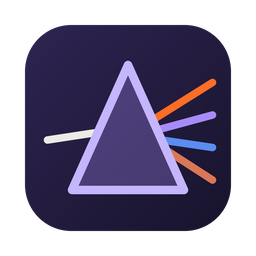
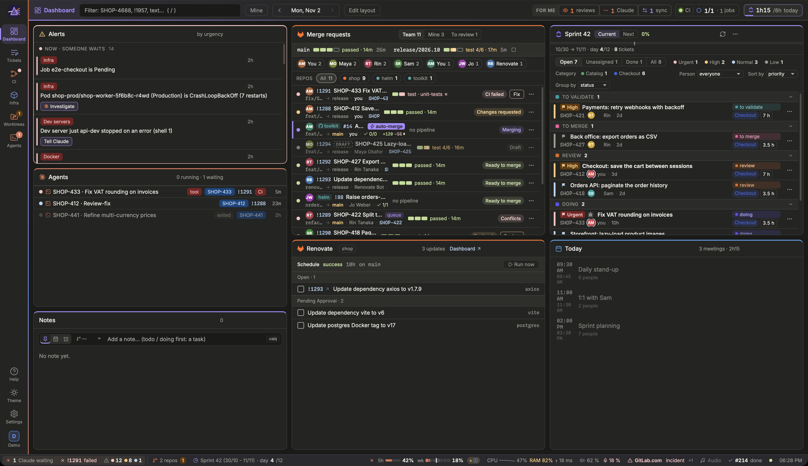
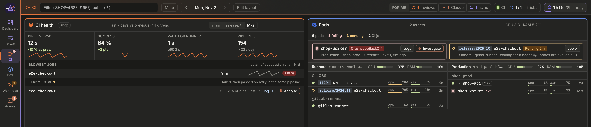
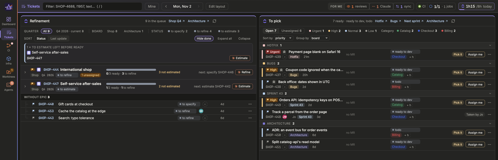
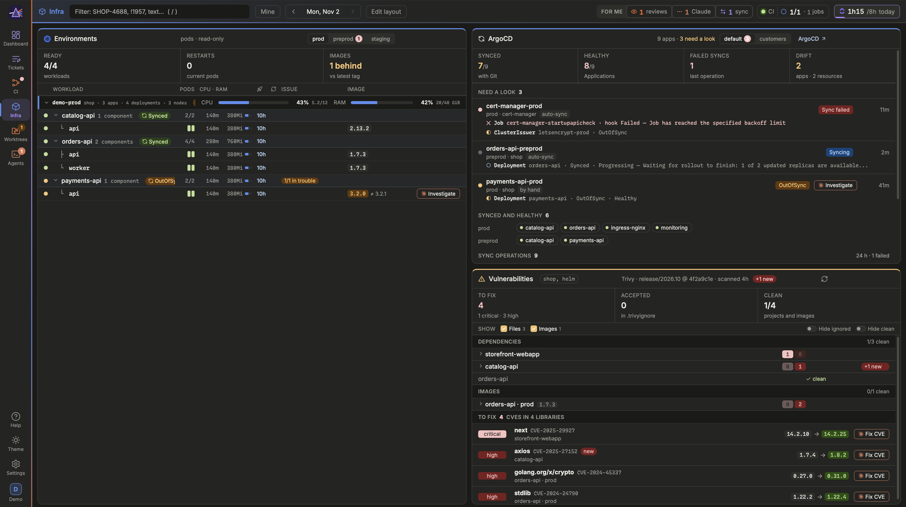
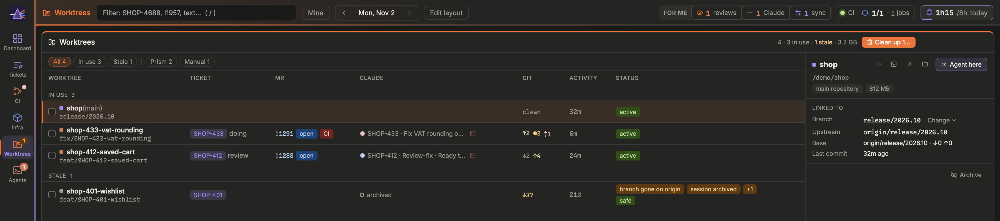
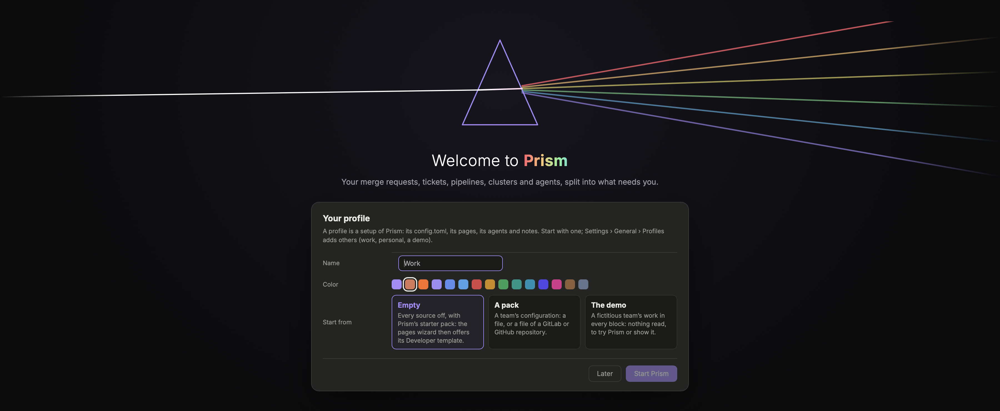

<div align="center">



# Prism

**Your merge requests, tickets, pipelines, clusters and AI agents in one local, real-time dashboard,<br>sorted by what needs you.**


</div>



A developer's day is spread over a dozen tabs: the forge, the tracker, CI, the cluster, the
calendar, the AI agents at work. Prism reads them all, live, and answers one question first:
**what needs me now?**

- **One window, every source.** GitLab or GitHub, ClickUp, Jira or Obsidian boards, Kubernetes
  and ArgoCD, Trivy, your macOS or Google calendar, Microsoft 365 or Gmail, Claude Code sessions.
- **Drift, caught for you.** An MR in review while its ticket still says “doing”, a red pipeline on
  your branch, a pod in CrashLoopBackOff, an agent stuck on a permission: they all land in
  **Alerts**, most severe first.
- **Local, by design.** No account, no cloud of ours, and nothing listening by default. Prism reuses
  the access you already have (`glab`, `gh`, `~/.kube/config`, the system keychain) and keeps only
  what it displays. Reaching it from your phone or from another computer is opt-in, on loopback
  behind a tunnel you choose, each device paired.

## What's inside

### Alerts and “For me”

The Alerts block ranks what is wrong right now: failed pipelines, queued jobs, unhealthy pods,
apps out of sync, tickets out of step with their MR, agents waiting for you. The header sums it up
in **For me**: reviews waiting, agents asking, tickets to sync, and a CI light. A counter in the
menu bar (the tray on Linux) and notifications keep you informed with the window closed.

### Merge requests and CI



Every MR of the team with its pipeline, approvals and reviewers, filtered to yours in one key.
Merge, rebase, approve or retry from Prism. **CI health** follows success rate, durations and
flaky jobs over time; **Pods** shows the runners and their jobs live, CPU and RAM included.

### Sprint, refinement and tickets



The sprint grouped by status, the refinement queue by epic, the tickets ready to pick. Prism links
each ticket to its branch, its MR and its worktree, so nothing falls between the tracker and the
code. Time tracking comes with it, and the Day trail rebuilds your day from its traces: the time
to log by ticket, and your daily ready to paste.

### Environments and vulnerabilities



Workloads per environment with their ArgoCD sync state and the image lag behind the latest tag.
Trivy scans the dependencies and images locally (only its CVE database is downloaded), with the
fixed version and a **Fix CVE** action for each finding.

### Agents and worktrees



Launch Claude Code, Command Code, OpenCode or Codex agents in real terminals inside Prism, one worktree
per ticket. Prism shows which agent is working, which one waits for you, what it changed, and
sends your review notes back as a prompt. Stale worktrees are spotted and cleaned up safely.

### Make it yours



- **Pages and blocks**: arrange the blocks on as many pages as you like, or start from a template.
- **Profiles**: work, personal, a demo; each with its own config, pages and agents.
- **Team packs**: share a team's setup (repositories, boards, environments) as one TOML file read
  from a repository; everyone keeps their own choices on top, and their clones where they like.
- **Themes, fonts, keyboard shortcuts and a console**, plus a few playful touches.

### From your phone, or another computer

- **Your phone**: Prism as an app on it (a page your computer serves, through Tailscale or your
  own tunnel), paired with a QR code and unlocked with a passkey; what it may do (read, act,
  merge, type to an agent) is yours to switch on, critical actions confirmed each time.
- **Another computer's Prism**: a server running `prism-server` (no window, no WebKit) or a second
  desktop opens in a window of this one, its agents, terminals and settings with it; paired with a
  code, its critical actions confirmed with Touch ID (polkit on Linux), its waiting agents in your
  status bar and notifications.

## Getting started

Prerequisites: [Rust](https://rustup.rs), Node.js with [pnpm](https://pnpm.io),
[just](https://just.systems), and the [Tauri prerequisites](https://v2.tauri.app/start/prerequisites/)
of your system.

```bash
just install   # frontend dependencies and the Tauri CLI
just dev       # the app, with hot reload
just build     # a release bundle: Prism.app, .deb + AppImage, or the Windows installer
just windows-check  # that it compiles for Windows, from macOS or Linux (cargo-xwin)
just windows-build  # the Windows x64 installer, unsigned, from macOS or Linux (cargo-xwin)
```

At first launch, Prism greets you and asks where to start: an empty profile, your team's pack, or
**the demo**, a fictitious team's work in every block, to try everything without connecting
anything. Then turn on the sources you use in Settings; each one checks its access as you type.

### What each source needs

Every source is optional and off until you turn it on; Settings checks each one's access as you
type. Prism finds these tools in the PATH of your login shell, even when opened from the Finder or the desktop's launcher.

| Source | Needs | Install (macOS) |
|---|---|---|
| GitLab | [`glab`](https://gitlab.com/gitlab-org/cli), logged in: `glab auth login` | `brew install glab` |
| GitHub | [`gh`](https://cli.github.com), logged in: `gh auth login` | `brew install gh` |
| Worktrees, agents | `git` | Xcode Command Line Tools |
| Agents | [`tmux`](https://github.com/tmux/tmux) (not on Windows: a process of Prism's own, `prism sessions`, holds them, and they outlive the window as in tmux), and the agent CLI: [Claude Code](https://docs.anthropic.com/en/docs/claude-code) (`claude`), Command Code (`cmd`), [OpenCode](https://opencode.ai) (`opencode`) or [Codex](https://github.com/openai/codex) (`codex`) | `brew install tmux` |
| Claude plan usage | Claude Code, logged in with a Claude.ai plan | |
| Vulnerabilities | [`trivy`](https://trivy.dev); for images, `docker login` to the registry (or `gcloud` for GCP's) | `brew install trivy` |
| Kubernetes: pods, environments, ArgoCD | a `~/.kube/config` with read access; `kubectl` for Settings' checks and context list; `gke-gcloud-auth-plugin` for GKE | `brew install kubectl` |
| Data (GCP) | [`gcloud`](https://cloud.google.com/sdk), logged in: `gcloud auth login` | `brew install --cask google-cloud-sdk` |
| Docker | the `docker` CLI and a running engine | Docker Desktop, OrbStack… |
| ClickUp, Jira | an API token, pasted in Settings (kept in the system keychain) | |
| Microsoft 365 mail | an app registered in Entra ID by your organization | |
| Gmail, Google Calendar | an OAuth client of your own Google Cloud project (Help › Signing in to Google) | |
| macOS Calendar | nothing: macOS asks for access once | |

On Linux, the same tools from your distribution's packages, and a Secret Service (GNOME Keyring,
KWallet) for the keychain. The Sound block reads the audio devices through `pactl`
(`pulseaudio-utils`), and the Audio block's now playing through `playerctl`; a few remote
features take the system's own when present — `spectacle`, `grim`, `scrot` or `import` for the
feedback's capture, `iw` for the Wi-Fi's link, systemd for keep-running — and say so without
them.

**Settings › General › Dependencies** shows which of these tools Prism found, where, and their
versions, the missing ones a source needs first, with how to install them.

## Privacy

Everything runs inside the app: the window talks to the Rust core through Tauri's IPC, with no
HTTP server and no open port, unless you turn on the remote: then Prism listens on 127.0.0.1 only,
behind the tunnel you choose (Tailscale checks your tailnet user), and answers only the phones and
computers you paired. Another computer's token never reaches the page: the app keeps it in the
keychain. Tokens stay in the system keychain or in the CLIs that own them
(`glab`, `gh`); Prism never stores them in its config. Data only goes between your machine and
the services you turn on, and only the fields needed for display are kept.

Send feedback opens an issue on Prism's repository (or a pack's) with what you write, and only
the lines you leave ticked: Prism's version, your packs, the versions of the tools it runs, where
it was opened from. Never a path, a value of your config, a ticket or a token.

## Documentation

- **[Building Prism](docs/guide.md)**: development, checks, packages, releases and a team's own blocks.
- **In the app**: Help (⌘? or F1) has the guides, a 3-minute tour and every shortcut.
- **[config.example.toml](config.example.toml)**: an annotated configuration.

## How it was made

Prism's code was written with the help of an AI agent ([Claude Code](https://docs.anthropic.com/en/docs/claude-code)),
directed, reviewed and used every day by its author.

## License

[MIT](LICENSE) © 2026 Denis BOURGE
