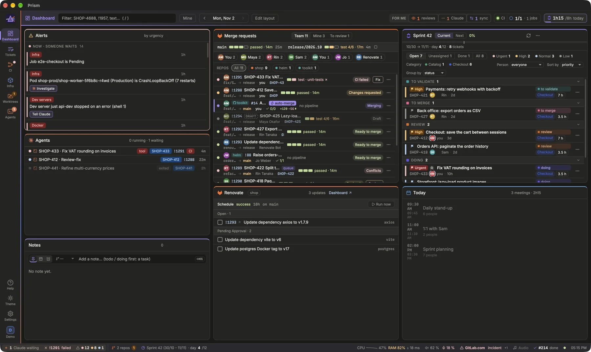

Prism gathers what a developer of the team watches all day (merge requests, CI, tickets, Claude agents, the agenda) and tells you what needs you, in one window.

## How Prism thinks

Prism reads your sources (GitLab or GitHub, ClickUp, Kubernetes, your Claude sessions, your Calendar on macOS) and shows them as **blocks** arranged on **pages**: the icons of the rail on the left. You never copy anything by hand: a click opens the MR, the ticket or the agent where it lives.

Above everything sits one question: *what needs me now?* The **Alerts** block answers it, most severe first. The header sums it up in **For me** (reviews waiting, Claude sessions asking, tickets out of sync) and a CI health light next to it.

> [!TIP]
> What you see is read-only until you click an action. Actions that could lose something, like removing a worktree, ask for a second click.

## Your first ten minutes
1. **Check your sources.** Open Settings (`⌘,`): each source section says whether its last read succeeded, and checks values such as a repository's project or the kube context as you type them. [Read: Setting up your sources](prism:help/setup)
2. **Pick your pages.** The pages wizard proposes a starting point: your team's pack templates, or Prism's starter pack (Developer), with your forge, tracker and agent CLI. It shows the pages and their blocks before creating them. [Open the pages wizard](prism:wizard)
3. **Read Alerts from top to bottom.** Red first, then orange, then blue. Press `x` on a line (or click its check mark) to mark it as seen.
4. **Learn three keys.** `/` filters everything, `m` keeps only what is yours, `i` opens what waits for you. All the others: `?`.

## Where things come from
Each source is read on its own rhythm, then every block updates at once:

- **GitLab** or **GitHub** (one per profile): merge requests (pull requests on GitHub) and their pipelines, through `glab` or `gh`, every 15 s by default, with CI health.
- **ClickUp**: the sprint, refinement, tickets to pick and time tracking, every 45 s by default. Or **Obsidian** Kanban boards instead, read from your vault.
- **Kubernetes**: pods of any cluster and namespace, GitLab runners included (watched live), environments and ArgoCD, read-only.
- **Claude**: the agents Prism launches and your Claude Desktop sessions. Prism reads their state, never the text of the conversation.
- **macOS Calendar** (macOS only): today's meetings, read locally on your Mac.
- **GCP** (optional, off by default): data pipelines and BigQuery cost, metadata only.

Data only goes between your computer and these services. Prism reuses the access you already have: `glab` and `gh` keep their token in the system keychain, and the ClickUp token sits there too.

> [!NOTE]
> Closing the window only hides it. Prism keeps running in the menu bar (the tray on Linux and Windows), with a counter of what waits for you, and sends a notification when something breaks. `⌘Q` quits.

## Finding your way
- The rail on the left switches pages (`⌘1` to `⌘9`). The **Agents** view follows the pages; **Theme** and **Settings** sit at its foot.
- Every block has a `?` in its title: what the block is for, what it shows, where its data comes from, and a link to the matching guide.
- The status bar at the bottom shows your running pipeline, the next meeting, Claude usage and more.
- `⌘?` or `F1` opens this Help at any time.

[Show the keyboard shortcuts](prism:keys)
