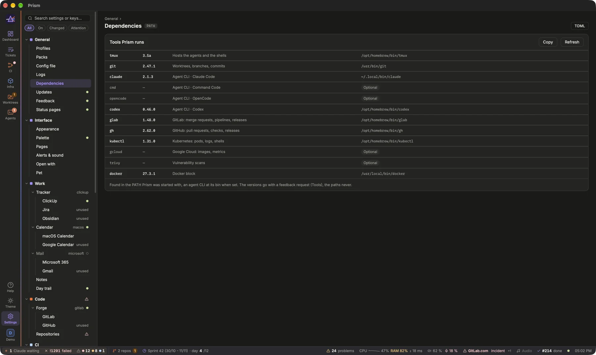

Prism reuses the access your computer already has: `glab` for GitLab or `gh` for GitHub, a ClickUp token in the system keychain, your kubeconfig, your Claude Code and gcloud logins. This guide shows how to connect each source, how Settings checks them, and what happens when one is off.

## The first launch
Without a config, Prism greets you and asks for your first profile: its name, its color, and what it starts from: **Empty** (every source off, with Prism's starter pack: the pages wizard then offers its Developer template), **A pack** (your team's, a file or a file of a repository), or **The demo**. **Start Prism** writes `config.toml` and relaunches on it. **Later** leaves Prism without config, until you set it up in Settings.

## Start from your team's pack
If your team shares a **pack** (its Prism configuration: repositories, ClickUp lists and statuses, environments, validation statuses…), import it first: **Settings › General › Packs**, then a file path or a file of a repository: `glab:group/project:path/pack.toml@ref` on GitLab, `gh:owner/repo:path/pack.toml@ref` on GitHub, the ref a branch, a tag or a commit. Its values fill Settings, marked *from pack*; anything you change is saved in your own `config.toml`, on top of the pack, and **Back to pack value** undoes it. **Update** rereads the pack, your changes stay; for a repository's pack, the field next to it changes the branch, tag or commit it is read at (to try a commit before it reaches main), and the commit read shows under its name. Like Prism itself, packs are checked at launch and every 6 hours (`[updates] packs`): a pack changed at its source shows in the status bar, and Settings › Packs says what changed and updates it. A pack may need a recent enough Prism (`[pack] requires`): an older one refuses it, and says to update Prism first. Where your clones live is yours, never the pack's: Prism then lists the pack's repositories without a clone here, and finds them in a folder you pick (only there), lets you choose each one (checked against its project), or clones it; **Settings › Code › Repositories** does the same any time. The **TOML** panel of Settings shows the pack's file, and the pack and your file merged. [Open Settings › General › Packs](prism:settings/packs)

Every source is optional: turn off the ones you don't use (**GitLab** or **GitHub**, **Runners**, **ClickUp**, **Calendar**, **Data**) and their blocks say so instead of failing.

## Profiles
Prism can hold several setups on the same machine, for instance your team's and a personal one: each **profile** has its own config.toml and packs, its own agents, notes and layout, and its own keychain entries. The badge at the foot of the rail shows the active one; click it to switch (`⌥⌘1`, `⌥⌘2`… in the Prism › Profile menu). Switching relaunches Prism on the other profile; the agents of the one you leave keep running and come back when you return. To keep both, **⧉** (or **Open alongside** in Settings › General › Profiles) opens a profile in its own Prism, next to this one: the window title, the menu bar icon and the Dock icon then carry each profile's name or letter. A profile opens in one Prism at most: opening it again brings that one to the front. Each one's status bar shows the others open: their letter and name, how many of their agents wait for you (tinted then), a click bringing that Prism forward.

**Settings › General › Profiles** lists them with their folder, packs and running agents; **Edit** renames one or changes its color. It also creates a new one: empty (every source off, with Prism's starter pack: the pages wizard then offers its Developer template), from a team's pack, or **the demo**: a fictitious team's work in every block, with nothing read from anywhere, to try Prism or show it. A profile's ClickUp token goes in the keychain as `prism-clickup-<profile>` (the default profile keeps `prism-clickup`), its Jira token as `prism-jira-<profile>`. Claude Desktop sessions show in the profile whose repositories they work in, and in every profile when they work in none.

## Before you start
A few things live outside Prism and are done once, in a terminal:

- **GitLab**: `glab auth login`; **GitHub**: `gh auth login`. Prism calls them and never sees the token, which stays in the system keychain.
- **ClickUp**: a personal API token (see **Create your ClickUp token** below), pasted in **Settings › Work › Tracker › ClickUp › API token**, which stores it in the system keychain. On macOS, the keychain service `prism-clickup` (`security add-generic-password -s prism-clickup -a "$USER" -w`); on Linux and Windows, `prism clickup-token` reads the token on its standard input and stores it in the system keyring (Secret Service, Credential Manager). A `CLICKUP_TOKEN` environment variable works too and takes precedence.
- **Jira**: an API token (id.atlassian.com › Security › API tokens), pasted in **Settings › Work › Tracker › Jira › API token**, which stores it in the system keychain under `prism-jira` (never in config.toml); `prism jira-token` reads it on its standard input too. With `security add-generic-password` on macOS, pass it as `-w "$(pbpaste)"`: the `-w` prompt keeps only 128 characters, and Atlassian tokens are longer; a `JIRA_TOKEN` environment variable takes precedence. **Settings › Work › Tracker › Jira** names the site and the account's email.
- **Microsoft 365 mail** (Mail block): an application your organization registered in Entra ID, with the delegated Mail.ReadBasic permission; you sign in once in **Settings › Work › Mail › Microsoft 365**, and the refresh token goes into the system keychain.
- **Gmail and Google Calendar** (Mail and Today blocks, on any system): an OAuth client of your own Google Cloud project, then one sign-in, in **Settings › Work › Mail › Gmail** or **Calendar › Google Calendar** (the same Google account). See [Signing in to Google](prism:help/google).
- **Obsidian**: nothing to sign in to; Prism reads and writes the vault's files.
- **Kubernetes**: a working `~/.kube/config` with read access to the clusters you want to watch.
- **Claude agents**: `tmux` and `claude` in the PATH of your login shell (see [Working with Claude agents](prism:help/agents)).
- **GCP data**: `gcloud auth login`, with read access to the data projects.

Tokens never go into `config.toml`.

**Checking an access.** The pages wizard's **Forge** and **Tickets** steps set the accesses the pages need: the forge's login command (copied in a click), the tracker's token pasted there, with a link to the page that creates it. Each access is then asked of the service itself: *signed in as …*, or what to do (*no token yet*, *refused this token*, *not signed in: run `glab auth login`*). The same check sits under the token in **Settings › Work › Tracker › ClickUp** or **Jira**, and under **Login** in **Settings › Code › Forge**; **Test** asks again, after a `glab auth login` for instance. A token is checked as soon as it is saved, even before the restart that puts it to use. Later, a token missing or refused shows in Alerts as such, with a button to its Settings section.

Prism picks up the PATH of your login shell at startup, so it finds `glab`, `gh`, `git`, `kubectl` and `claude` even when launched from the Finder. **Settings › General › Dependencies** shows which ones it found, and their versions. [Open Settings › General › Dependencies](prism:settings/dependencies)

## Create your ClickUp token
Prism reads ClickUp with a personal API token: it acts as you, with your access, and nothing more.

1. In ClickUp, click your avatar (bottom left), then **Settings**.
2. Under your own settings, open **Apps**.
3. In **API Token**, **Generate** (or **Copy** if you already have one). The token starts with `pk_`.
4. In Prism, paste it in [Settings › Work › Tracker › ClickUp](prism:settings/clickup) › **API token** (its link opens ClickUp's Apps page), then **Save to keychain**: the line under it says *signed in as …* once ClickUp accepts it. **Restart Prism** to put it to use.

The token goes into the system keychain (`prism-clickup`, `prism-clickup-<profile>` for another profile), never into `config.toml`. **Regenerate** in ClickUp revokes the old token: anything else using it stops working, Prism included until you paste the new one. Prism then shows *ClickUp refused the token* in Alerts, with a button to the ClickUp settings.

## ClickUp, Obsidian or Jira
A profile reads one tracker, ClickUp by default. With **Obsidian Kanban** (**Settings › Work › Tracker**, `[tracker] provider = "obsidian"`), **Settings › Work › Tracker › Obsidian** names the vault and its boards, one per repository: a ticket's id then resolves in its board's repository, so two projects can both have a `T-12`, and a board's **Id prefix** is a pattern (`[ABCLM]` for `A-07` to `M-23`). A card's status is its lane; a card linking a note (`[[T-12]]`) takes the note's id, title and priority, a card titled `**C-68 — …**` that id, and its indented lines are its description. Prism moves cards between lanes (the note's `status` following), sets priorities and comments, and creates cards. Obsidian has no assignees, time entries, refinement queue nor next sprint: those blocks and actions step aside. With **Jira Cloud** (`[tracker] provider = "jira"`), **Settings › Work › Tracker › Jira** names the site, the account and the board: Prism reads its active sprint (a Kanban board's open issues), statuses ordered by its columns and lowercased, and previews issues. Prism moves an issue through its workflow (the transition leading to the chosen status must exist from where it is), sets its priority (Jira's first priority reading as urgent, high, normal or low; an issue always has one) and adds or edits comments as plain text, assigns it to you (Jira has one assignee: it replaces the previous one) and adds it to the active sprint; the Sprint block's **+** creates an issue of **New issue type** in the board's project, in the active sprint. With **Time tracking** on, the Time block reads and writes your worklogs. To pick shows the board's next sprint and the **Queues** of Settings › Work › Tracker › Jira, each a JQL query used for pick, refinement (by epic) or sync; the board's issues in progress outside the active sprint show in Sprint. The ticket prefix and the flow statuses live in **Settings › Work › Tracker**, whichever the tracker.

## GitLab or GitHub
A profile reads one forge, GitLab by default. On GitHub (**Settings › Code › Forge**, `[forge] provider = "github"`), Prism reads the pull requests of your repositories and their checks (GitHub Actions and commit statuses), merges, rebases, approves and comments on them, and shows the Actions jobs and their logs. A pull request is then written `#12`. CI health reads the GitHub Actions workflow runs, Vulnerabilities adds Dependabot's alerts, Renovate follows its workflow or app; what reads GitLab's own CI (the merge queue, a block reading GitLab jobs) stays off. The access switch, the branches, the merged window, the polling and CI health live in **Settings › Code › Forge** (`[forge]`), whichever the forge; **Settings › Code › Forge › GitLab** holds what GitLab alone has.

## Connect each source

Open Settings (`⌘,`). The sources are grouped under **Sources** and **Infra** in the navigation.

1. **Forge**: GitLab by default; for GitHub, set the **Provider** to `github`. [Open Settings › Code › Forge](prism:settings/forge) Then give each repository its **Project**: `group/project` on GitLab, `owner/repo` on GitHub. The check next to it says `found: …`, or that `glab` or `gh` cannot see it. [Open Settings › Code › Repositories](prism:settings/repos) On GitLab, also set the **Host** (gitlab.com or your instance). [Open Settings › Code › Forge › GitLab](prism:settings/gitlab)
2. **Repositories**: each repository is a card, grouped by working folder (where its clone is). Open one to give it its clone (**Choose a folder…** or **Clone**), switch on what Prism reads of it (on this machine: worktrees, base images; on the forge: MRs, pipelines, merge queue, tickets) and, if need be, its own branches. Below the list, **Blocks that read a repository**: CI health, Renovate, Vulnerabilities and your team's blocks each read the repository chosen there, and **Bare MR references** names the one `!1294` means (none: every MR is written `shop!1294`). With a single repository, or a pack that names it, there is nothing to choose. [Open Settings › Code › Repositories](prism:settings/repos)
3. **ClickUp**: lists and folders are found by name: the **Sprint folder** and the **Boards** beyond the sprint — bugs to pick, a refinement queue, tasks to log time on… (each a list, or a folder's lists, and what it is for); a name found nowhere shows in Alerts (*ClickUp config: not found in the workspace*). The **Ticket prefix** (ABC for ABC-123) links tickets to branches and MRs; empty, Prism has no ticket ids. Off, no token is needed. [Open Settings › Work › Tracker › ClickUp](prism:settings/clickup)
4. **Clusters** and **Pods**: pick the **Default context** from your kubeconfig (the check says `reachable`), then add the **Targets** of the Pods block: a context (the default one if empty) and its namespaces, `*` matching any characters. GitLab runners and their CI jobs are recognized among them.
5. **Environments** and **ArgoCD**: one row per environment and cluster, read-only.
6. **Claude sessions**: the folders where Claude Desktop keeps its session metadata and transcripts. Prism only looks at whether a session is working or waiting, never at what is said.
7. **Agents**: the **Agents view** switch checks that `tmux` and `claude` are found. [Open Settings › Agents › Agent](prism:settings/agents)
8. **Calendar**: with the macOS Calendar (the default), macOS asks for access to your calendars on first launch; if you refused, allow it again in System Settings › Privacy & Security › Calendars. An Exchange or Microsoft 365 account: [Exchange in the macOS Calendar](prism:help/exchange). On Linux or Windows, or to read Google Calendar directly, set **Provider** to `google` and sign in to Google ([Signing in to Google](prism:help/google)).
9. **Data (GCP)**: off by default. Turn on **GCP access**, list the **Projects** to read, and the check says `gcloud logged in`.

> [!TIP]
> Not sure where something is? Type in **Search settings…** at the top of the Settings navigation.

## Reading the checks
Settings tells you whether each source works, in three places:

- At the top of a source section, its last read: **Read correctly with the current config.**, **Last read failed: …** with the reason, or **Not read yet.**
- Next to a value that can be checked (project, kube context, namespace, folder, gcloud, agent tools): a check mark and what was found, or a warning and the problem. **Check again** runs them once more.
- In the navigation, a warning icon marks a section whose check failed or whose source could not be read.

On the dashboard, a source that cannot be reached shows up in **Alerts** as a red **Source** line, `… unreachable: …`. An invalid `config.toml` shows up there too, instead of preventing Prism from opening.

## The access switches
Not everyone has access to everything. Four switches say what Prism may read at all:

| Switch | Off means |
|---|---|
| `[forge] enabled` (**GitLab access**, **GitHub access** on GitHub) | Neither the forge nor the local repository are read: no MRs, pipelines, worktrees, vulnerabilities, repositories or agents. |
| `[clusters] enabled` (**Cluster access**) | No pods, environments or ArgoCD. |
| `[agents] enabled` (**Agents view**) | No Agents view; the Claude actions open Claude Desktop instead. |
| `[calendar] enabled` (**Agenda**) | No calendar is read (macOS Calendar or Google Calendar), nor its access asked for: no Today block, meeting countdown or reminders. |

`[data] enabled` (**GCP access**) works the same way for the Data and BigQuery cost blocks.

When a source is off, nothing tries to reach it, so you get no access error in Alerts. The pages wizard sets these switches for you from the template you choose: a Product template, for example, turns the forge (GitLab or GitHub), the clusters and agents off.

> [!NOTE]
> Forge, cluster, Calendar and GCP access are read when Prism starts. Settings marks such values with a **restart** badge and, after saving, offers **Restart Prism**.

## Saving
Changes are kept aside until you save: **Save to config.toml**, or `⌘S`. Saving rewrites only the keys you changed and keeps the comments and layout of the file. The **TOML** button shows the file next to the settings, so you see exactly what will be written.

[Read: Settings and config.toml](prism:help/settings)
