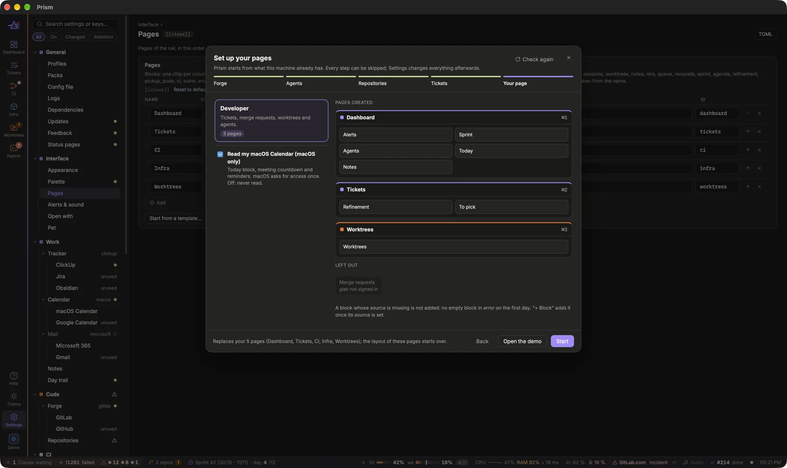
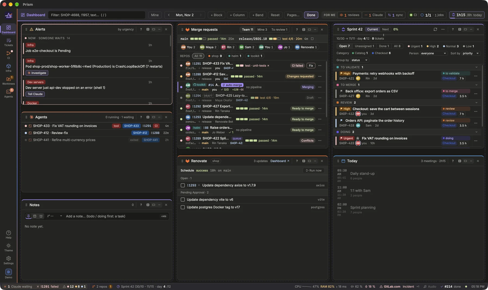

Prism shows everything as blocks arranged on pages. This guide explains how to choose your pages, rearrange their blocks, and use the controls shared by every page: the filter, Mine, the date picker and the status bar.

## Pages of the rail
Each icon of the rail on the left is a page; `⌘1` to `⌘9` (or `1` to `9`, and `gt` / `gT`) switch between them. The pages are stacked in the rail's order: going to another one slides the screen up or down to it (at once when animations are off or macOS reduces motion), and Agents, Settings and Help come in from the right. On a trackpad, two fingers up or down over the rail go to the next or previous page; over the page itself, they only scroll. Settings › Interface › Appearance › **Swipe between pages** (`[appearance] page_swipe`, on by default) turns the gesture off. Without any setting, Prism shows one empty **Dashboard**: fill it with **+ Block** in Edit layout, or pick a template in the pages wizard.

A page icon can carry a badge: a red dot when a runner is down, the number of stale worktrees, or the number of broken data pipelines, whichever page hosts the matching block. The **Agents** icon shows how many agents wait for you.

## Choosing your pages

The pages wizard opens on its own the first time, when no pages are configured. Its templates come from your packs: your team's pack brings those of its roles (Developer, Product, Data…). Without any, the wizard offers to import **Prism's starter pack**, which brings the **Developer** template: tickets, merge requests, worktrees and agents. It is a pack like any other afterwards, in **Settings › General › Packs** (or `prism pack import prism:starter` from a terminal).

The wizard goes in five steps, each started from what this machine already has: **Forge** (glab or gh installed, and whom they are signed in as: *signed in as …*, or the login command to run; or no forge), **Agents** (the agent CLIs found in the PATH, with their path and version, the first ticked being the default; a link to install one that is missing), **Repositories** (the git repositories of your working folders and of `~/Development`, `~/src`, `~/code`…, those of the chosen forge ticked: written as `[[repos]]` with their MRs and worktrees, and their folder as a working folder when you have none), **Tickets** (ClickUp, Jira, Obsidian, or no tracker: the tickets then come from your merge request titles and branches) and **Your page** (the template, and **Read my macOS Calendar**, macOS only). Nothing is searched until the wizard opens, no token is read, and only *signed in as …* reaches the window. **Check again** looks once more, after a `gh auth login` say. **Skip** passes over a step: the config keeps what it says for it. Under each step, **Your first page** shows the blocks as they come; the last one shows the pages, without the blocks whose source is missing (no forge signed in, no repository, no agent CLI or tmux, no tracker, no kubectl context), listed apart as **Left out**: no block empty and in error on the first day, **+ Block** adds one once its source is set. **Start** writes the pages to `config.toml` together with the steps' choices; **Open the demo** opens the demo profile in its own Prism, next to this one, to see Prism filled before connecting anything.

[Open the pages wizard](prism:wizard)

You can also edit pages one by one in **Settings › Interface › Pages** (the `[[views]]` table): a name, an icon, a color, and the blocks of each column, written as one string per column, such as `todo sessions notes`. **Start from a template…** opens the pages wizard. Pages apply as soon as you save.

## Rearranging a page

1. Click **Edit layout** in the header.
2. Drag a block by its handle to another place or another column.
3. Click **+ Block** to add a block. The menu groups them by what they are about (Overview, Tickets, Code & agents, CI & delivery, Security, Infra, Data, Fun); hovering one shows its help and a live preview; a block can appear on several pages.
4. Click **+ Column** to add a column (four at most), or **×** on a block to remove it from this page.
5. Click **Done**, or press `Esc`. Empty columns are removed.

The blocks are written to `config.toml` as you go, in the page's **Blocks by column** (Settings › Interface › Pages), with the page's Id, so renaming or moving a page keeps its layout. **Reset** brings the page back to equal sizes and normal blocks; its blocks stay. **Pages…** jumps to Settings › Interface › Pages. Columns and blocks resize with the mouse; double-click a handle to go back to the default proportions.

> [!TIP]
> Renaming a page in Settings › Interface › Pages keeps its layout as long as its **Id** stays the same.

## Block controls
Hover a block's title to reveal its controls:

- **?** explains the block: what it is for, what you see, where its data comes from, and **Read the guide →** for the full story.
- Three size buttons: **Normal**, **Short** (a few lines: just your MRs and reviews, the current meeting and the next one…) and **Collapsed** (title only). Normal blocks share the remaining height. On the keyboard: `za` collapses, `zs` switches to short.
- **Zoom** enlarges the block to the whole page (`zz`); `Esc` restores it.

## Table columns
In a table (Environments, Worktrees, the week of Time logged), drag the right edge of a column's header to make it wider or narrower; the other columns keep their width. Double-click the edge to give the table back its automatic widths. Each table remembers its widths, on this computer.

## Filter and Mine
The filter in the header (`/` to go there, `Esc` to clear) accepts a ticket id, an MR number such as `!1957`, or any text. It follows the links between tickets, MRs, branches and sessions, and applies to every block, Alerts included. It stays as long as the window is open.

**Mine** (`m`) keeps only your MRs (as author) and your tickets (as assignee), with their pipelines and jobs. Claude sessions, the `main` and `release/*` pipelines, and the infra, CI, Claude and review alerts stay visible. Mine combines with the filter.

## The date picker
The ‹ day › picker in the header chooses the day you look at: it drives time entries, the merged MRs section and the agenda. ‹ and › step a day; a click on the day opens a calendar of the month (`←` `→` `↑` `↓` move in it, `Enter` picks, `Esc` closes). **Today** comes back to the current day. The rest of the dashboard always shows the current state.

## The status bar
The line at the bottom of the window is shared by every page. It shows, when there is something to say: the connection state, the **Repos** menu, your running or failed pipeline, deployments in progress, the next meeting, reminders due, Claude sessions waiting, Claude usage, the sprint day, the audio player and the clock (the time, handy in full screen; the date on hover). Most items open what they describe in one click.

Its items are grouped by what they ask of you, between thin lines: on the left what waits for you (agents waiting, your pipeline, the next meeting, reminders, the digest), lightly tinted, then your work (repositories, sprint, other profiles, shells); on the right the computer and Prism, **Problems** among them ([Settings and config.toml](prism:help/settings) says what it lists). When the window is too narrow, the least needed items move into a **⋯** at the end of the bar; what waits for you never does.

> [!NOTE]
> Right-click the status bar to choose which items it shows, or **Customize…** to arrange them: drag them along the bar, the orange line parting left from right, or into the tray above to hide them. The order is saved as `[appearance] statusbar` (Settings › Interface › Appearance); **Default order** goes back to the zones.

## On the phone

The phone remote shows one block at a time, whatever your pages hold: every block of Prism, and a pack's, is a view. Four are bottom tabs (`[remote] tabs`, by default home, mrs, tickets, agents); the others are under **More**, by group as in **+ Block**. It opens on **Home**: the agents waiting for an answer, the MRs that need you, your tickets in progress, the next meeting, and the most serious alerts, each opening its own view. A few views gather blocks: **Tickets** (sprint and to pick), **CI · Delivery** (CI health and the delivery blocks), **Infra** (pods, environments, vulnerabilities). A block off on the computer is left out. The blocks' filters, sorts and groupings (an MR filter, a ticket list's status, person, grouping and sort, the agents' filter…) are the same on the computer and on the phone: changed on one, the other shows them the next time the block opens. Tabs, folds and widths stay each screen's. From a phone, this needs its actions on (Settings › Remote).

[Read: Settings and config.toml](prism:help/settings)
