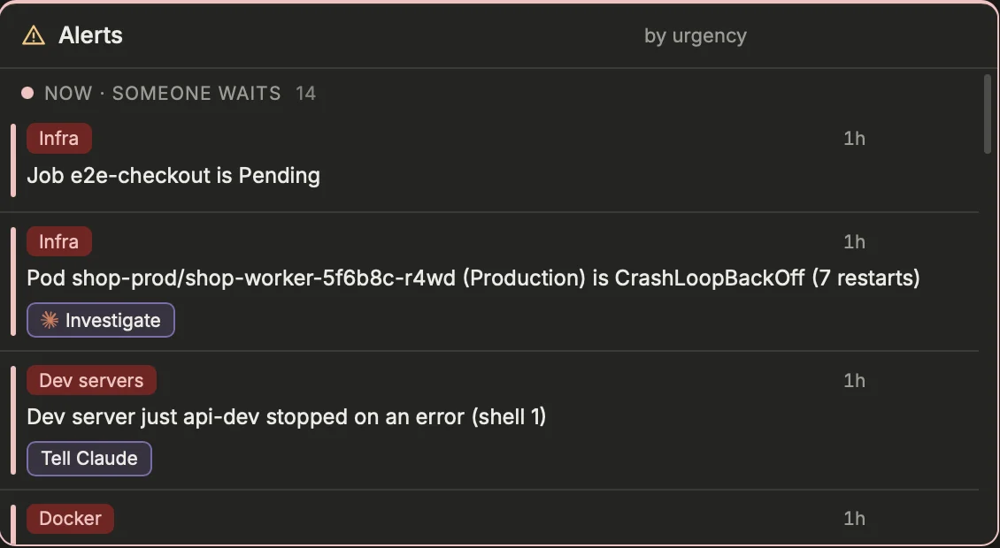
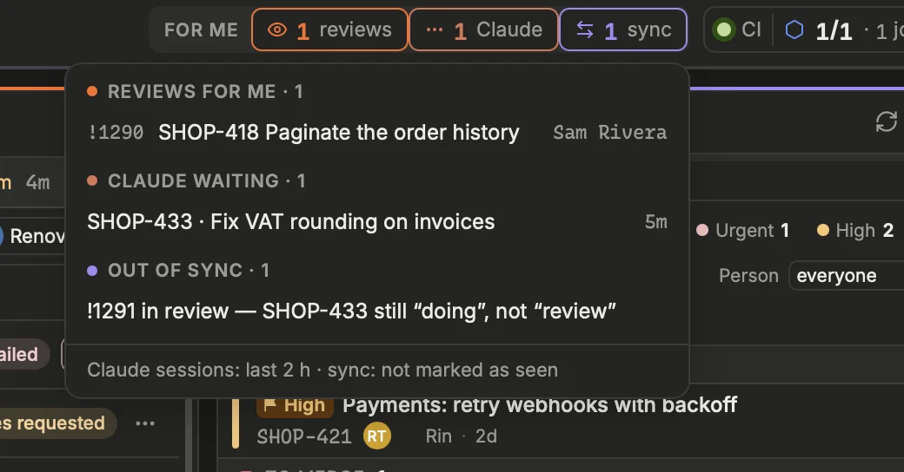

The Alerts block turns everything Prism reads into one list of problems worth acting on, most severe first. The header, the menu bar (or tray) and notifications carry the same list when you are looking elsewhere.

## What lands in Alerts
{width=565}

Each line has a colored tag naming its kind, then a sentence saying what is wrong. Prism checks, among others:

- **Infra**: a runner down, jobs queued for a runner too long (with the runner that explains it, when there is one), no runner manager at all.
- **CI**: a failed pipeline on `main` or a `release/*` branch.
- **ArgoCD**: a failed sync, a degraded or missing application, or one out of sync for too long.
- **Data**: a GCP data pipeline broken or drifting, when Data is on.
- **Sync**: an MR and its ticket that disagree: MR merged but ticket not moved on, MR open but ticket still before development, MRs out of draft but ticket still in progress (it should be in review), MRs all approved but ticket still in review (an MR with changes requested does not count as approved: its ticket stays in review), ticket to merge but its MR not in the merge queue (`[tracker] merge_queue_statuses`), ticket closed with an MR open, ticket in review with no MR, ticket in progress with neither branch nor MR for days.
- **Review**: an MR waiting for your review for a while.
- **MR**: your own MRs failing CI, in conflict, ready but needing a rebase, or with no ticket id.
- **Claude**: a session stuck on a permission prompt, or sessions waiting for your answer.
- **Worktrees**: stale worktrees that can be removed safely, or whose folder is gone.
- **Source**: a source that could not be read.

A ticket in a blocked status (`[clickup] blocked_statuses`) is left out of every Sync rule.

## By urgency
Lines come in three bands, by what they hold up:

- **Now**: someone waits on you, a person or an agent (a question, a permission, a review asked), or something is broken.
- **Today**: your own work is blocked: a failed MR pipeline, conflicts, unresolved threads, a ticket out of sync.
- **When you can**: nothing presses: a rebase to do, a stale worktree, an agent's turn just over.

Each rule has its band, set in **Settings › Alerts** (`band_now`, `band_later`, `band_hidden`): a rule named nowhere goes by its severity. A Today line held longer than `escalate_hours` (24 by default) goes up to Now. Its age shows on the right. The tag keeps its color: **red** broken, **orange** to act on, **blue** worth knowing.

The alerts of one MR or one ticket share a single line (`group`): its id and title, each alert a small pill, and the fixes of the one to act on first — conflicts before anything, threads before the CI (fixing them pushes, the CI runs again). The chevron unfolds them, each in full.

In **Short** mode, the block keeps the Now and Today lines, three at most, or says **Nothing urgent.** Collapsed, its title still shows how many items are left.

The status bar's item **What waits for you** shows a dot and a count per band; a click opens the same list from any page.

## Acting on a line
Many lines carry quick fixes, as small buttons before **Open**:

- **→ status** moves the ticket to the status it should have.
- **Rebase** asks the forge (GitLab or GitHub) to rebase the MR; **Merge queue** puts it in the merge queue; **Retry** reruns the failed jobs; **Logs** opens the pipeline logs.
- The MR number opens its pane; **Pod logs** opens the logs of a failing workload.
- An agent button starts the matching agent action, in the launcher (`⇧`-click: at once): **Review**, **Fix pipeline**, **Rebase & fix conflicts** on an MR, in its worktree; **Fix pipeline** on a protected branch's failed pipeline, in a new worktree; **Investigate** on a failing pod or a degraded ArgoCD application, read-only on the cluster. To fix a pipeline, Prism reads the failed jobs' logs and puts their last lines in the prompt (`[agents] fix_log_lines`): the agent starts from the error.
- **Tell agent**, on a dev server stopped on an error, sends the error to the agent whose shell ran it; when that agent is busy, the message is only typed in its prompt, for you to send.
- Once an agent works on the line (on the MR's branch, or launched by its button), the button gives way to the agent and its state (**on it**, **asks permission**, **ready for review**): a click opens it.

On the keyboard, move to the line with `j` / `k` and press `a`: it runs its first quick fix.

A fix that worked shows a check mark. The line itself disappears when the data catches up, at the next read.

> [!TIP]
> The filter and **Mine** apply to Alerts too: type a ticket id to see only the problems around it.

## Marking as seen
Some lines need no action from you. To set one aside:

1. Hover the line and click its check mark, or move to it with `j` / `k` and press `x`.
2. The line moves to the **Seen** section at the bottom, folded. It no longer counts in the header or the menu bar.
3. To bring it back, unfold **Seen** and click the undo button, or press `x` again.

A seen line comes back on its own when its text changes (a new count, a new state), and a mark expires after seven days, so a recurring problem never stays hidden for long.

## Putting off
A line you will deal with later: its moon button (⏾) puts it off **1 hour**, **this afternoon**, until the **next morning**, **after my meeting** (the one under way or the next today, from the calendar) or **when it changes**. It moves to the **Put off** section, folded, with when it comes back; the undo button brings it back at once. Put off on the Mac, off on the phone too, and the other way round. **Band of this kind of alert…** opens the settings where its rule's band is chosen.

## For me and the CI light
{width=520}

The header sums up what concerns you, in two clusters:

- **For me**: the reviews waiting for you, the Claude sessions waiting for you, and the Sync lines not marked as seen. Click it, or press `i`, to see each item and open it. With nothing waiting, it reads **Nothing waiting**.
- **CI health**: a light that stays green while all is well. It turns red and pulses when a pipeline failed on `main` or `release/*` (`main ✕` and a count) or when a runner is down. Next to it: healthy runners out of the total, and the active CI jobs. Click it for the details.

## Notifications and the menu bar
Prism keeps running in the menu bar when you close the window. Its counter adds up the Claude sessions waiting for you and the red and orange lines not marked as seen; hover it for the details.

A system notification is sent when something new appears: a failed pipeline on a protected branch, a runner down, a failed deployment, a broken data pipeline, a review waiting for you, or Claude asking for an answer or a permission. Pending jobs, ArgoCD out of sync and drifting data stay in Alerts without interrupting you, and a Prism agent finishing its turn does not notify. Beyond three new items at once, you get a single summary.

## Digest, quiet hours and focus
By default each new item notifies as it appears. Turn on **Digest** (Settings › Interface › Alerts & sound › Notifications, `[alerts] digest`) and Prism holds them instead, then sends one summary at each **Digest at** time (`digest_times`, 9:00, 12:30 and 17:30 by default): what still needs you, and what resolved meanwhile (a pipeline green again). The kinds in **Still at once** (`digest_urgent`: infra, deployments and an agent asking for a permission by default) keep notifying at once.

**Quiet hours** (`quiet_hours`, such as `19:00-08:00`) silence everything, urgent included, digest or not. So does **focus**: a calendar event whose title holds **Focus events** (`focus_events`, `Focus` by default), or Zen mode. A digest due meanwhile waits for their end; in live mode, what they held goes out as one summary once they end. Meeting reminders and your own reminders keep their time.

The status bar says what is held and when the next digest goes out, or that quiet hours or focus are on. Click it for the last digest and what waits for the next one; **Send now** sends the summary at once, **Mark read** clears the last one.

## Tuning the thresholds
Each time-based rule has its threshold in **Settings › Interface › Alerts & sound**, the `[alerts]` section, applied as soon as you save:

| Setting | Key | Default |
|---|---|---|
| Job waiting | `pending_job_minutes` | 5 minutes |
| Review waiting | `review_wait_hours` | 4 hours |
| Ticket idle | `doing_idle_days` | 3 days |
| Session waiting | `waiting_session_hours` | 2 hours |
| ArgoCD out of sync | `argo_out_of_sync_minutes` | 15 minutes |

The same section holds the badge and data thresholds, such as `large_mr_lines`. The ticket statuses the Sync rules rely on are in **Settings › Work › Tracker › ClickUp**.

[Open Settings › Interface › Alerts & sound](prism:settings/alerts)

## On the phone
The remote's **Alerts** tab shows them by band — **Now**, **Today**, **When you can** — each one in full, its kind and age above it. Its fixes (an agent action, a status, a rebase…) and **Open** are buttons under the text; **⏾** shows the times to put it off under it, **✓** marks it seen, as on the Mac: the seen and the put off ones fold at the bottom, a tap shows them again.

