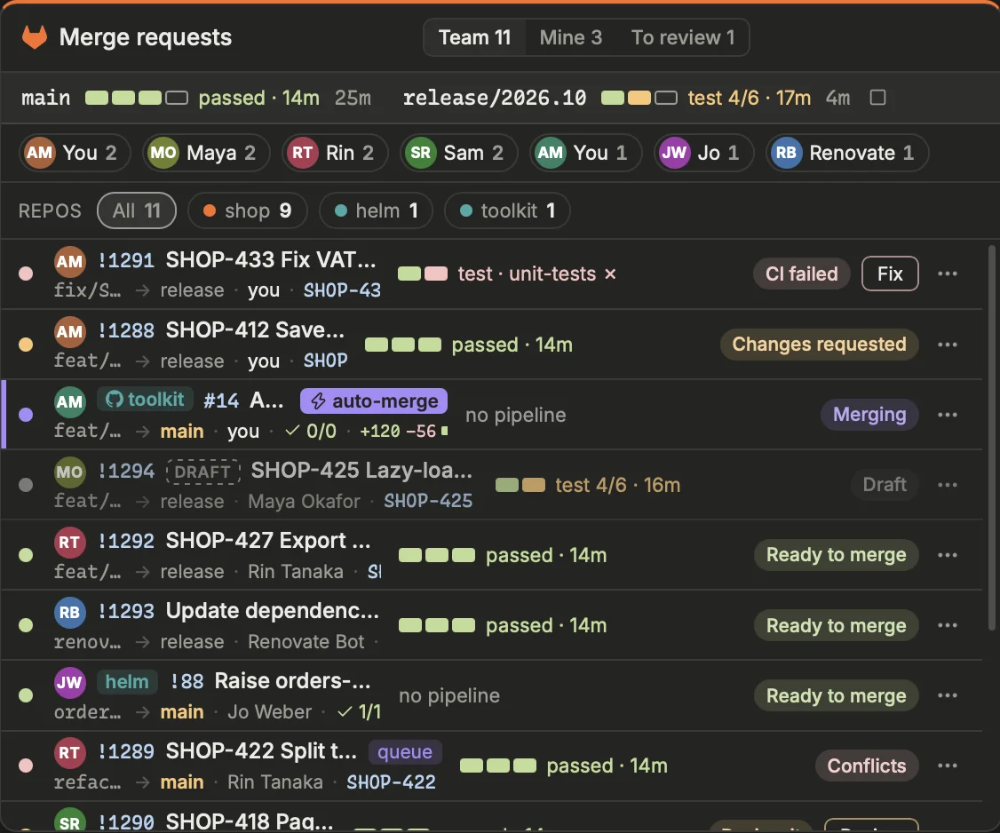
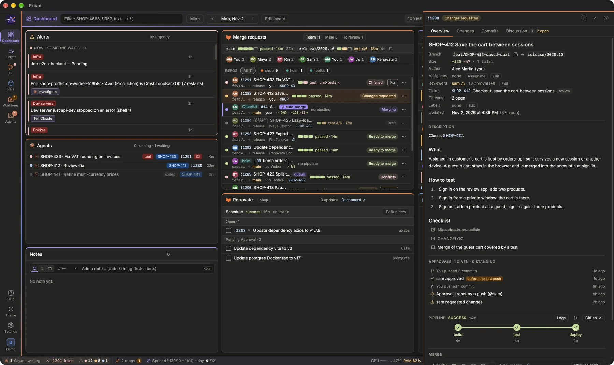
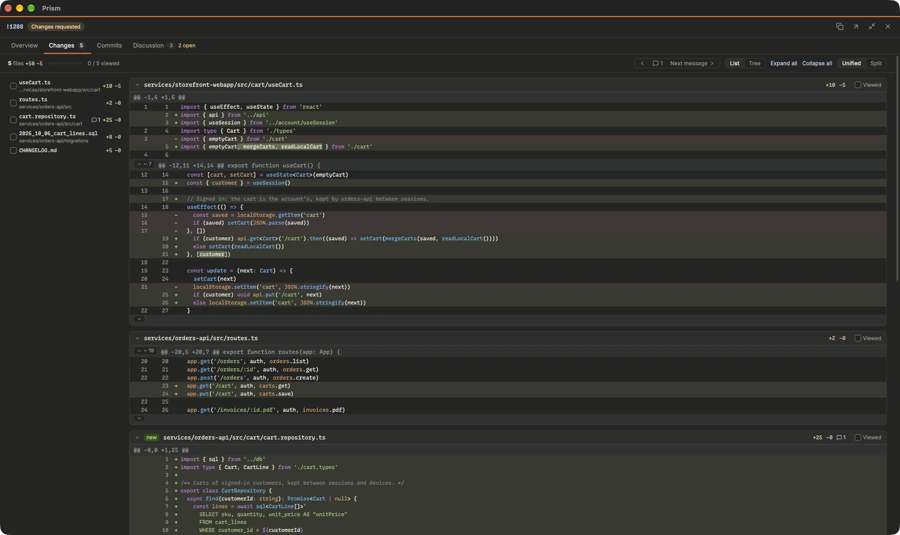

Follow the team's merge requests, see at a glance what each one needs next, and review them without leaving Prism.

> [!NOTE]
> On a GitHub profile, merge requests are pull requests: the block is **Pull requests**, and one is written `#12` rather than `!12`, in the filter too.

> [!TIP]
> One block for both forges: a repository on the other forge (Settings › Repositories, *Forge*: a personal project on GitHub in a GitLab profile, say) has its MRs in the same list, its chip marked with that forge's logo and its numbers written its way (`toolkit#14`). They are read with that forge's own tool and login (`gh` or `glab`), so *mine* and *to review* follow your account there; review, approve, merge, rebase and auto-merge work as on the others. Its branches' pipelines and the merge queue stay the profile forge's.

## Reading the list
{width=563}

The **Merge requests** block has three tabs: **Team**, **Mine** and **To review**. Rows are sorted by last update, most recent first. Each MR fits on two lines:

- first, the author's dot (their GitLab / GitHub profile picture, or their initials on a colour of their own; `[forge] avatars` off: always the initials), then the full title, with a red shield for a security MR and a **Draft** tag;
- below, the context: branch → target, author, ticket (a click opens its preview), approvals, open threads, age and size;
- in a fixed column, the pipeline at a glance: one segment per stage (green passed, orange running, red failed, outlined for a manual one) and a short label such as `Verify 3/7 · 4m`.

In the **Team** tab, a row of authors with their number of open MRs lets you show only one person's MRs. When other repositories are configured with their MRs, a **Repos** row filters by repository, and their MRs are named like `helm!214`.

The size of an open MR is its added and removed lines, `+48 −9`. Past a threshold, it stands out in orange: the MR is large and will be harder to review.

> [!TIP]
> The large-MR threshold is 400 changed lines by default. Change it in Settings › Interface › Alerts & sound › **Large MR** (`[alerts] large_mr_lines`).

[Open the Merge requests block](prism:block/mrs)

## The next step
Prism reads each MR and says in plain words what unblocks it, with the button that does it. Colour is used for that only:

| Colour | Meaning | Steps |
| --- | --- | --- |
| Red | blocked | *Conflicts*, *CI failed* |
| Orange | for you to do | *Review it*, *Rebase needed*, *Open threads* |
| Blue | waiting on someone else | *Waiting for review*, *In review*, *CI running* |
| Green | ready | *Ready to merge* |
| Purple | automatic | *In merge queue*, *Merges after CI*, *Merging* |

The button on the row is the unblocking action: Claude **Fix** for a failed pipeline on your MR, Claude **Review** when someone waits for your review, Claude **Resolve** for conflicts, **Rebase**, **Merge** (your MR ready to merge, when there is no merge queue: a second click confirms) or **Merge queue**, **Auto-merge** (your MR approved, without open threads, whose CI is still running: the forge merges it once green), or **Logs**. Everything else is in the ⋯ menu, spelled out: merge now (any MR the forge can merge), merge queue (GitLab), auto-merge, rebase, logs, pipeline retry, cancel and new run (GitLab), Claude actions, time tracking, branch copy, GitLab.

## The MR drawer

Click an MR (or press `Enter` on its row) to open its drawer on the right. It has three tabs:

- **Overview**: the summary (branch, author, assignees, reviewers and approvals, ticket, threads, labels, dates), the pipeline with its stages and failed jobs (*Retry job*, logs), the merge section, and the MR description rendered in Markdown with its images.
- **Changes**: the diff, for review.
- **Discussion**: the threads and comments, with *Reply* and *Resolve thread* / *Reopen thread* on each, and a new comment at the bottom (`⌘↵` sends).

**Approve** sits in the drawer's header when the forge lets you approve; once approved, it shows **✓ Approved** and, on GitLab, a click revokes your approval (GitHub cannot take one back: dismiss your review on GitHub). The row follows immediately. Next to it, **Request changes** opens a comment saying what should change: `⌘↵` posts it and sets your review to *changes requested*, which also removes your approval. The header then shows **⚠ Changes requested**, and among the *Reviewers*, those who requested changes are marked ⚠. Whoever requested them, an MR with changes requested says so everywhere: its next step is **Changes requested** (yours to do on your MR), its row shows *⚠ changes requested*, a toast tells you when someone requests changes on one of yours, and its ticket is never offered "to merge", even approved. On GitLab, a click on it takes your request back; GitHub cannot, dismiss your review there. From the drawer you can also edit *Assignees* and *Reviewers*, use *Assign me*, and *Mark as draft* / *Mark as ready*. *Labels* › **Edit** (or *Labels…* in the ⋯ menu) checks or unchecks the project's labels; a name it does not have yet is offered as *Add “…”*, and the forge creates the label. Only the labels you changed are sent: one set meanwhile elsewhere (the merge queue's job, the forge's page) stays.

When someone approves one of your MRs, a toast says who, with the MR's ticket, and whether the MR is now fully approved.

## Reviewing the changes

1. Open the MR and go to **Changes**. Press `f` for full screen if you want more room.
2. Choose **Unified** or **Split** rendering; your choice is remembered.
3. Read file by file. When the drawer is wide, the file list on the left jumps to a file; **Expand all** / **Collapse all** act on every file. On the keyboard (`Tab` to focus the drawer), `]` / `[` move to the next or previous file.
4. Tick **Viewed** on a file (or press `v`): it collapses and the progress shows. The box unchecks itself if the file changes later.
5. Hover a line and click the **+** in the margin to comment on it. On several lines: drag from one **+** along the others, or shift-click a second line's **+**; the lines picked are lit, and the comment hangs under the last one (on GitLab as on GitHub, a thread on those lines). They stay in one hunk: a forge takes no range across two. Existing threads show under their line, with reply and resolve; one on several lines says which.

Large files (over 400 lines) start collapsed. In a modified line, the part that changed is highlighted.

## Markdown files
A `.md` file can also be read rendered: **Diff**, **Both** or **Preview** in its header (**Both** by default, remembered). The preview shows the whole file on the MR's source branch, next to its diff. The blocks the MR changes have a bar in the margin, green for added and orange for changed; removed lines get a red marker. Hover a block to light the matching lines of the diff (and the reverse); click to scroll there.

## Merging, rebasing and Claude
- **Merge now** merges the MR right away when the forge says it can (pipeline, approvals, threads, no draft nor conflict): with its own squash and source-branch settings on GitLab, your default merge method for the repository on GitHub. It cannot be undone: a second click confirms.
- **Merge queue** (GitLab) adds the label your merge bot or CI job watches (`[gitlab] merge_queue_label`): it rebases the MR, then puts it in auto-merge.
- **Auto-merge** lets the forge merge as soon as pipeline, approvals and threads allow it, right away if that is already the case. One click turns it on or off. On GitHub, the repository must allow auto-merge.
- **Rebase** asks the forge to rebase the branch onto its target.

The **Claude** section of the ⋯ menu launches an agent on the MR: **Fix pipeline** (when CI failed), **Review**, **Review-fix** to apply the review comments, **Rebase onto** its target branch to rebase and resolve conflicts (also offered as **Rebase locally** when GitLab's own rebase failed: its reason shows on the MR), **Validate locally** to check the MR on its branch (when its ticket waits in the first validation status, it moves to the last and is assigned to you, as from the ticket), and a backport for an MR that does not target `main`.

> [!NOTE]
> `⇧`-click on a Claude action launches it at once, without the launcher. The Claude actions are those of the repositories with **Worktrees** on (Settings › Code › Repositories): none on the MR of another repository.

[Read: Working with Claude agents](prism:help/agents)

## The Merge queue block
**Merge queue** (+ Block › Code & agents) shows what waits to be merged in one repository, chosen above the list (the choice is the same on the phone):
- **In the queue**, for a repository with a merge queue (Settings › Repositories, *Queue*): the MRs with its label, oldest first, the order its CI job takes them. With priority labels (`[gitlab] merge_priority_prefix = "merge-priority::"`, then `merge-priority::0`, `merge-priority::1`… on the MRs), the lowest number comes first, then the MRs without one, the oldest first within each; the row shows **P0**, **P1**…, and an MR's ⋯ menu sets it (*Merge priority*: P0 to P3, — for none; the MR's other priority label goes). **▶** marks the next one. One held up (conflicts, a failed rebase, a failed pipeline) is counted as *stuck* in the header: the job will not merge it as it is.
- **Auto-merge**: the MRs the forge merges by itself once green, out of the queue.
- **Approved, not in the queue** (or *auto-merge off*, without a queue): approved MRs nothing will merge. Their row offers **Merge queue**, **Auto-merge** or **Merge**.

When the MRs go to several target branches, the list is split by branch (the main branch first, then the release ones): each has its own order and its own **▶**.

In short mode, the auto-merge icon on a row says the forge will merge that MR by itself once green (already set by the queue's job, or turned on by hand).

Drafts and MRs still in review are left to the Merge requests block. It reads nothing of its own: the same MRs, the same rows and drawer.

## On the phone
The remote's **MRs** tab is made for a thumb. **Team** / **Mine** switch the list; one scrolled row filters by repository and by author; the protected branches' pipelines sit in a strip. What **needs you** comes first — an MR awaiting your review, yours blocked or ready for its next step — then the others, most recently updated first. Each row shows who and its state, the title on two lines, its pipeline, ticket, approvals and threads, and its next step as a button (**Fix**, **Review**, **Merge**…; a merge asks for a second tap).

A tap opens the MR on the whole screen, **‹ MRs** goes back. The facts are tiles, then the description, approvals and pipeline. At the bottom, always at hand: the **main action of the moment** (the row's next step; failing that, **Approve**) and **Actions**, a sheet with everything else — approve, request changes, merge, rebase, auto-merge, draft, the agent actions, log time, links. An agent action starts the agent at once on the phone, and opens it. **Changes** shows one file at a time, its lines wrapped: **‹ ›** or the file list go from one to the next, **Viewed** moves on to the next file not yet viewed. In **Discussion**, the comment box stays at the bottom.

