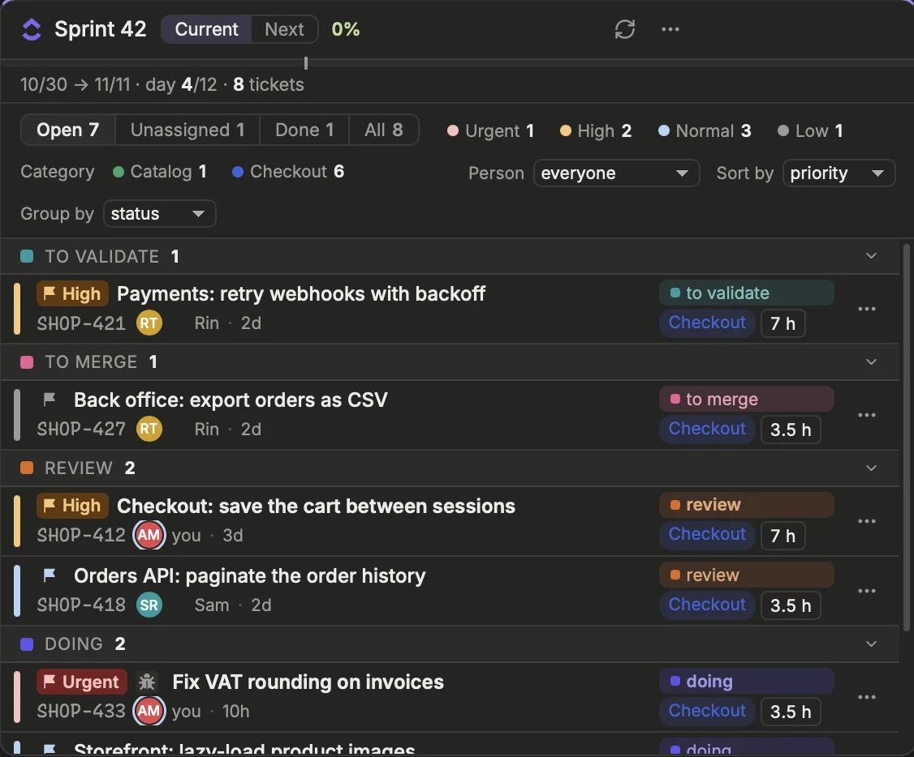
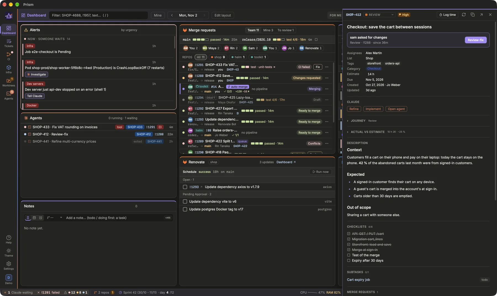
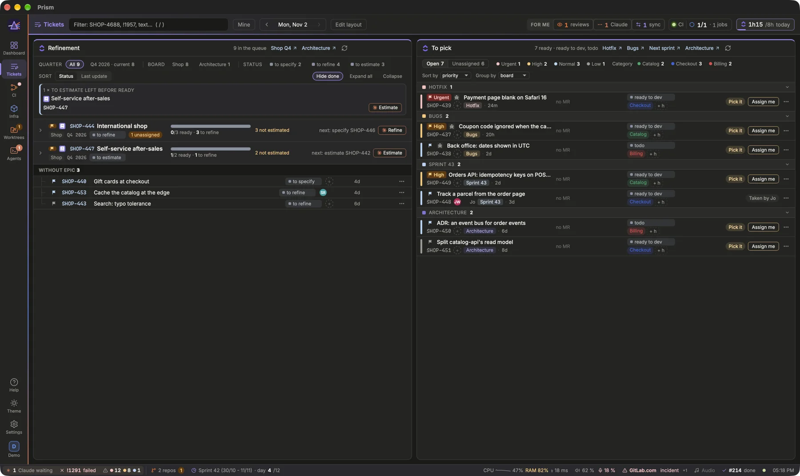

Follow the sprint's tickets with their merge requests (pull requests on GitHub), prepare the next ones, and pick up work, with your tracker's edits made in place and Claude one click away. The tracker is ClickUp by default, Jira or Obsidian Kanban boards otherwise (**Settings › Work › Tracker › Provider**); what follows describes ClickUp, then what changes with the two others.

## The Sprint block
{width=563}

The **Sprint** block lists the tickets of the current sprint. Under the title, a bar shows the sprint's progress and its day. The **Current** and **Next** tabs switch to the following sprint: its dates, in how many days it starts, and all its tickets.

Each ticket fits on two lines: the full title, then the ID, the assignees, the parent and the age (orange beyond 14 days without update). On the right: the ticket's MR (number and pipeline at a glance, a click opens its drawer), the status, the next step and its action.

- The **priority flag** leads the title: *Urgent* in red, *High* in orange, a plain flag for Normal and Low, empty without priority. Click it to change the priority in ClickUp.
- The **status** is a dropdown with the statuses of the ticket's list.
- A click on the **assignees** assigns the ticket to you, or removes you if it is already yours; the other assignees do not change.
- **Estimates**: a click on a ticket's estimate (on its row, or in its preview) turns it into a field: type the hours (`3.5`), Enter saves, Esc cancels, an empty field clears it. By default, the tracker's own estimate (ClickUp's time estimate, Jira's original estimate; **Enter the estimate**, `[tracker] estimate_builtin`). A team estimating in number custom fields lists them in **Estimate fields** (`[clickup] estimate_fields`) and turns the built-in one off: those fields show on every ticket, even empty, to be filled in. A formula field is shown, never written to.
- **Custom fields**: those named in **Ticket fields** (`[clickup] fields`, Settings › Work › Tracker › ClickUp, e.g. `["Type"]`) show under the status, a pill per value in its option's ClickUp color; the preview lists them too. The toolbar filters on their values (like the priorities: a chip per value with its count, **None** for the tickets without), and **Group by** offers each of them: a group per value, in ClickUp's option order, the tickets without one after. **Filter fields** (`[clickup] filter_fields`) keeps those filters and groupings to the fields listed (a dropdown such as Type); the others are only shown. Every field can sort the list: **Sort by** a field, numbers as numbers and a dropdown in ClickUp's order, ↑ or ↓, the tickets without a value last; then by priority, as by default. Only the fields with a value, in the order given; a dropdown, labels, text, number, date, checkbox, people or rating field all read.

Tickets are grouped by status (finished ones in a collapsed *done* group), by assignee, or not at all. The toolbar filters **Open** / **Unassigned** / **Done** / **All** and by priority (**Done**, once a ticket is finished: those only, their group open); `m` keeps only your tickets. **Person** shows one person's tickets: you, any assignee of the sprint, or the unassigned ones, with their open tickets counted (not with Obsidian, which has no assignees); remembered, each tab its own. Subtasks are indented under their parent. The **Outside sprint** switch adds the tickets in progress that are not in the sprint, in a group of their own, with their board and *Add to Sprint* in their menu.

[Open the Sprint block](prism:block/sprint)

## My sprint
The **My sprint** block is the current sprint from your side, to prepare the retro. At the top: the tickets assigned to you that are done, the share of your time on the sprint's tickets, your longest stretch of focus (median of the days), the reviews you gave, and the agents you launched with what they cost.

Below: where your time went (sprint tickets, meetings, other tickets, no ticket) and, day by day, your longest stretch without a meeting and how many times you switched between tickets and MRs. These come from the **Day trail**'s traces: an estimate, not a timesheet; with the Day trail off, they stay empty. Then your tickets: delivered, or carried and why (blocked, never started, red CI), the tracker's estimate against the time logged or traced, and the cycle from in progress to done as Prism saw the moves. **Seen by Prism** lists what stands out, compared with your own previous sprint only; the team is a single line, without ranking.

**For the retro** holds your points for the sprint retro, apart from your notes: pick to keep (▲), to change (▼) or an idea (✦), type the point and press `Enter`. They are kept by sprint, in Prism's data folder (`retro.json`): once the next sprint has begun, the sprint picker in the cell's header brings back the points of the one being reviewed. A click on a point's mark changes its kind, a double-click on its text edits it, × removes it. Notes tagged `#retro` during the sprint come back below, under *From my notes*. **Copy as Markdown** and **Draft my points** include the current sprint's points, by kind.

**Copy as Markdown** copies it all for the team's retro; **Draft my points** asks an agent for two or three points to keep and to change, from those figures (it changes no file). Each sprint's figures are kept on this machine, to compare the next one with.

## The next step of a ticket
Like an MR, each ticket says in plain words what moves it forward, with the button that does it:

- *Pick it*: nobody has it yet, the button is **Assign me**.
- *Start* or *No MR yet*: it is yours and has no MR, the button is **Implement** (Claude).
- When the ticket has an open MR, the MR's own step and action: *CI failed* → Fix, *Review it* → Review…
- *!… merged, move on*: the MR is merged, the button moves the ticket to the next status.

Everything else is in the ⋯ menu (or `.` on the row): status, priority, assign me, log time, the Claude actions, filter the dashboard, open in ClickUp.

## A ticket's journey
A ticket goes through seven steps: **Refined**, **Dev**, **MR**, **Review**, **Merged**, **Validation**, **Done**. Prism places it from what it already reads: the tracker's status, the agents linked to the ticket, the MRs that name it (draft, CI, approvals, threads, merge). A step that failed — a red CI, conflicts, a failed rebase — turns red.

At the top of the ticket preview, a card says where the ticket stands and why (*2 unresolved threads*, *CI failed: test*, *Sam waits for your review*), with the one button that moves it on: **Review-fix** on your MR with feedback, **Fix** on a red CI, **Review** when your review is asked, **Validate locally** once merged, **Implement** before any MR, and the MR's own actions (Rebase, Merge, Auto-merge…).

Below its fields, the **Journey** section draws the seven steps, then a journal by stage, dated where Prism knows the date: *Refinement* (created, estimated, in which sprint), *Development* (each agent with its CLI, how long it ran and its worktree; the MRs opened and their CI), *Review* (reviewers, threads, changes asked, approvals) and *Delivery* (the merge, the merge queue, the environments rolled out since the merge, validation, done). The steps still ahead are dashed; a stage with nothing to show is left out. An environment counts as rolled out when its workloads changed after the merge, as in the thread: a time, not a proof of the commit. Nothing is stored for it: the journal is rebuilt from what Prism reads. The section is folded, its current step beside its title; open it with its chevron, and it stays open for every ticket, as does **Actual vs estimate**. The next action card at the top can be turned off: `[tracker] next_action`, in Settings › Work › Tracker.

## The In progress block
**In progress** (+ Block › Tickets) is your work in progress, one row per ticket: the sprint's tickets assigned to you and not done, those with an open MR or a running agent of yours, and the MRs asking for your review. Each row has the seven steps as small bars, why it stands there, your part (*author*, *reviewer*, *assignee*) and the same one button as the ticket preview. A click on its id or title opens the ticket (or the MR, without a ticket Prism reads).

The order empties the day from the top: someone waiting on you first (a review asked, feedback on your MR, an agent's question), then what failed, then the normal flow, then what has not started; within each, what waits the longest first. **My move** shows only what you can act on, **Waiting on others** what waits on someone else (a review, the CI, the merge queue, an agent at work) with how long, **All** both; the choice is kept, and shared with the phone, where each row's button takes the whole width. In short mode, only your moves, one line each.

## Blocked tickets
The preview lists the ticket's **Commits**, read from your local clones as of their last fetch, the newest first: those whose message names it (`ABC-123`, not `ABC-1234`), on any branch, and those of the branches named after it (`feat/abc-123-…`) not yet merged. A filled dot: in the main or a release branch; a hollow one: not merged, with its branch. The short hash opens the commit on the forge; with several repositories, each commit names its own. Nothing is read from the forge, and a repository without a clone has none.

A ticket that waits on others in ClickUp (its dependencies, **Waiting on**) shows them on a third line: each blocker's id, status and name, the finished ones struck. While one is unfinished the line says **waiting on**, in red, and the row is tinted; once they are all done it says **unblocked**, in green: time to start. A ticket others wait on says **blocks …** on its second line: worth finishing first. Click a blocker to preview it, even from another list. Too much? Click **waiting on** to fold the line of every ticket into a chip on its second line (`waiting on 2`, the blockers in its tooltip); click the chip to unfold them. The Sprint and To pick headers count the blocked tickets, and the preview lists both directions under **Waiting on** and **Blocking**. Dependencies are set in ClickUp; Jira and Obsidian have none here.

## The thread of a piece of work
A ticket, its branch, its MR, its pipeline, its agents and its deployments are one piece of work. Press `t` on a row (a ticket, an MR, an agent, a worktree, a dev server's agent), or choose **Thread** in its ⋯ menu, and a drawer shows that thread from the ticket to production: **Ticket**, **Worktree**, **Agent**, **MR**, **Pipeline**, then each environment. Click a link to open it (the ticket preview, the MR pane, the pipeline logs, the agent, the worktree in your editor).

Prism builds it from what it already joins: the ticket id in a branch name, an MR's branch, an agent's ticket, branch or linked MR, a worktree's branch. A link that should exist by now is dashed orange: a ticket in progress with no worktree, branch nor agent; a branch with commits and no MR; an MR merged days ago and in the first environment, but not in the next. An environment counts as **updated** when its workloads changed after the merge: Prism compares the times, not the commits. Below come the alerts about it (the ticket's status out of step with its MR, a red pipeline), then its figures: time logged, the agents' cost, the meetings naming the ticket, what it waits on and what it blocks.

On each ticket row, the same thread is folded into small squares next to its id (worktree, agent, MR, pipeline, environments): green when there, dashed orange when missing, red when broken. A ticket no work has touched yet has none. Click them to open the drawer. They are off by default: Settings › Interface › Appearance › **Ticket threads** (`[appearance] ticket_threads`) shows them.

## The ticket preview

Click a ticket row, a Refinement card or the ticket of an MR: its preview opens in a side pane, with the description, checklists, subtasks and comments, read from ClickUp when it opens. Images show inline and attachments in an **Attachments** section. Under its fields, the agent actions of its ⋯ menu as buttons (**Refine**, **Implement**, **Validate locally** when it applies, **Open agent**): a click opens the launcher over the pane, `⇧`-click launches at once.

1. Change the status with the dropdown; the dashboard follows at once.
2. Click a cited ticket or a subtask to open it in the same pane; ← goes back.
3. Add a comment with *Comment* (`⌘↵` sends), or **Edit** one of yours.
4. `Esc` closes the pane. `⌘`-click on a ticket opens it in ClickUp instead.

> [!NOTE]
> Editing a comment replaces its text in ClickUp: the original rich formatting (mentions, bold) is lost. Prism refuses to edit someone else's comment.

## Refinement and To pick

The **Refinement** block is the preparation queue: tickets in the refinement statuses, from the boards used for refinement (Settings › Work › Tracker › ClickUp › Boards): a folder's quarterly lists, or a board's list. It is grouped by EPIC: one row per EPIC with the progress of its tasks, its estimated load, its signals (not split, unassigned, dormant) and the next action, unfolding into its tasks. On top, up to three things to do: an EPIC to split, the ticket asleep the longest, an EPIC only estimates away from ready. Sort by status (the flow's order) or by last update, and filter by quarter, folder and status: with statuses chosen, an EPIC unfolds into its tasks in those statuses only, its progress still counting them all.

The **To pick** block lists the tickets ready to be picked up (`ready to dev`, `todo`): the boards used to pick from (Settings › Work › Tracker › ClickUp › Boards) and the next sprint, grouped by board in their colour. Rows are the same as in the sprint, with **Assign me**. *Add to Sprint* in the ⋯ menu adds the ticket to the current sprint after a second click, in addition to its own list.

> [!WARNING]
> *Add to Sprint* does not check that the ticket is specified and estimated. Make sure it is ready before you add it.

[Open the To pick block](prism:block/pickup)

## With Jira
With Jira Cloud as the tracker, the **Sprint** block shows the active sprint of the board named in **Settings › Work › Tracker › Jira** (a Scrum board), or its open issues (a Kanban board), the board's columns ordering the statuses; the **Next** tab shows the following sprint. The board's issues in progress outside the active sprint join it too (**Ongoing statuses**, Jira's “In Progress” category by default). **Refinement** and **To pick** read the board's **Queues**, each a JQL query used to pick from, for refinement or for sync, like ClickUp's boards; To pick adds the next sprint.

A status change goes through a transition of the issue's workflow, so one leading to that status must exist. The priority goes to the first Jira priority that reads as urgent, high, normal or low. Comments are added or edited as plain text; an issue is assigned to you, added to the active sprint, or created in the board's project. Time is logged as Jira worklogs (see [Time tracking](prism:help/time)).

## With Obsidian
On Obsidian Kanban boards, the **Sprint** block shows the open cards of every board, grouped by board, and **To pick** those in a lane of the Ready statuses (**Settings › Work › Tracker**): moving a card to such a lane sends it there. The status picker offers its board's lanes; a change moves the card in the file, and its note's `status` takes the value the notes of that lane have. The priority goes to the note's `priority` (`p0` to `p3`) or the card's `#p0`-`#p3` tag; a comment under the note's `## Comments`. The **+** of the Sprint block creates a card, and its note when the board's cards have notes. Prism reads the files again as soon as they change.

## Claude actions on tickets
The **Claude** section of a ticket's ⋯ menu hands the work to an agent:

- **Refine** asks Claude to refine the ticket in the repository (your team's refinement skill if it has one), read-only: feasibility, technical solution, estimate. In Refinement, the action reads **Estimate** for a ticket to estimate, and **Split** for an EPIC not split yet.
- **Implement** asks Claude to implement the ticket (your team's skill if it has one) in the ticket's worktree, or in a new worktree named after the ticket.
- **Validate locally** appears on a ticket in *validation* or *to validate*: an agent validates the ticket against what it asks for, not its MRs, which are in principle merged (the prompt cites them with their target branch). An MR still open is named for the agent to validate on its branch; when it is the only one, the agent works on that branch, otherwise in a new worktree named after the ticket. From *to validate*, once the agent is launched, the ticket moves to *validation* and is assigned to you.
- **Open agent** opens the launcher named after the ticket, with no prompt, in its worktree if it has one.

Each action opens the agent launcher, prefilled; `⇧`-click launches at once.

[Read: Working with Claude agents](prism:help/agents)
