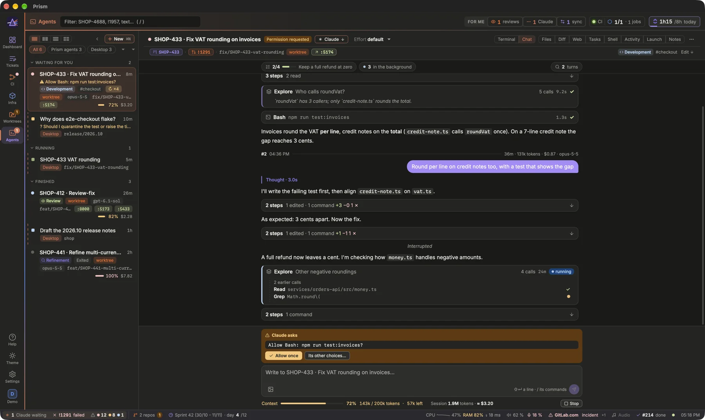
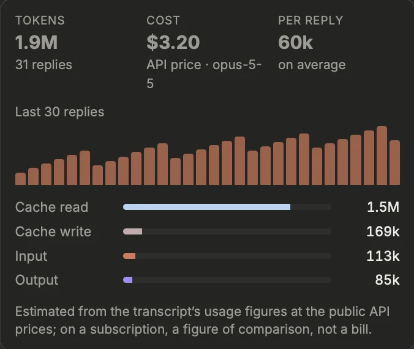
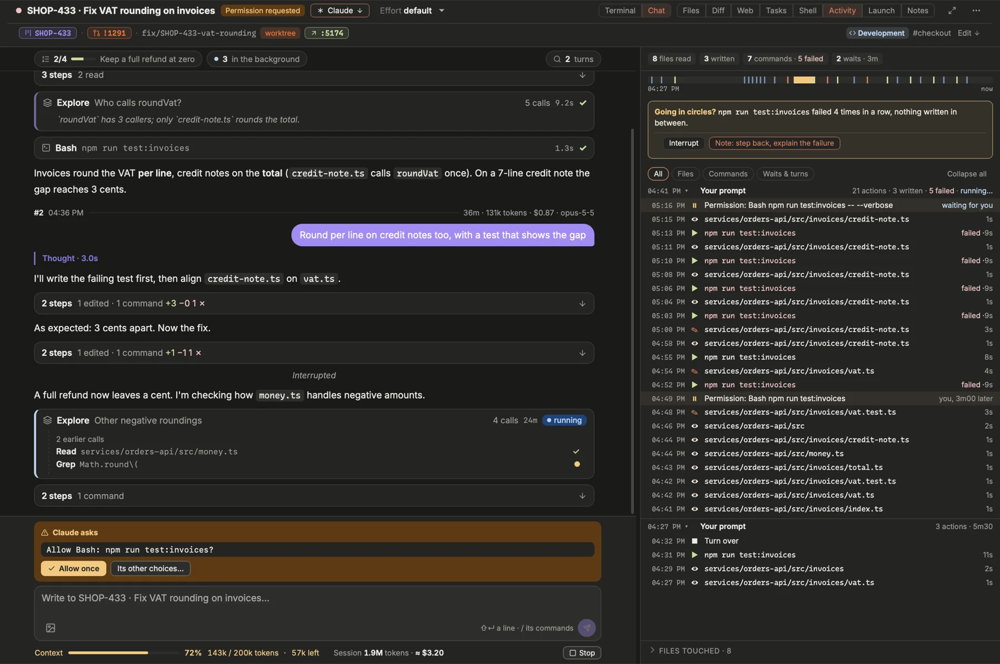
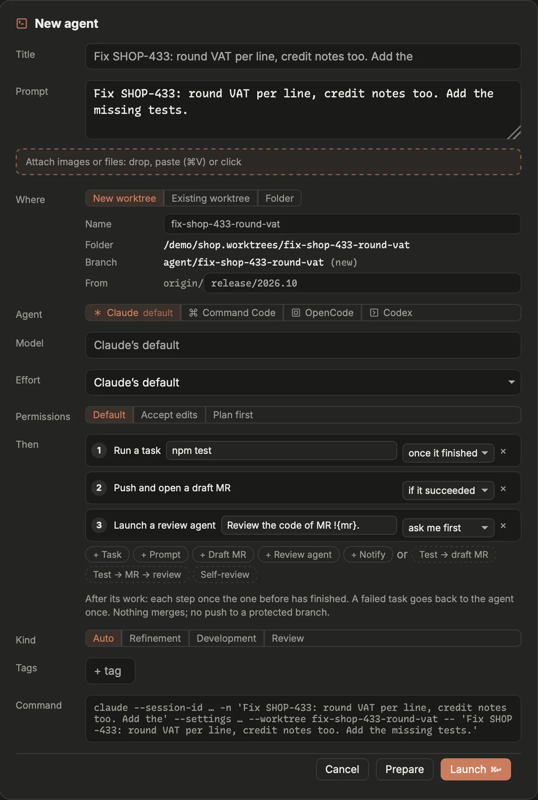
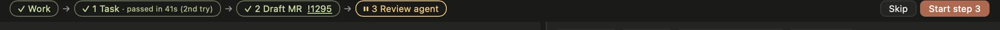
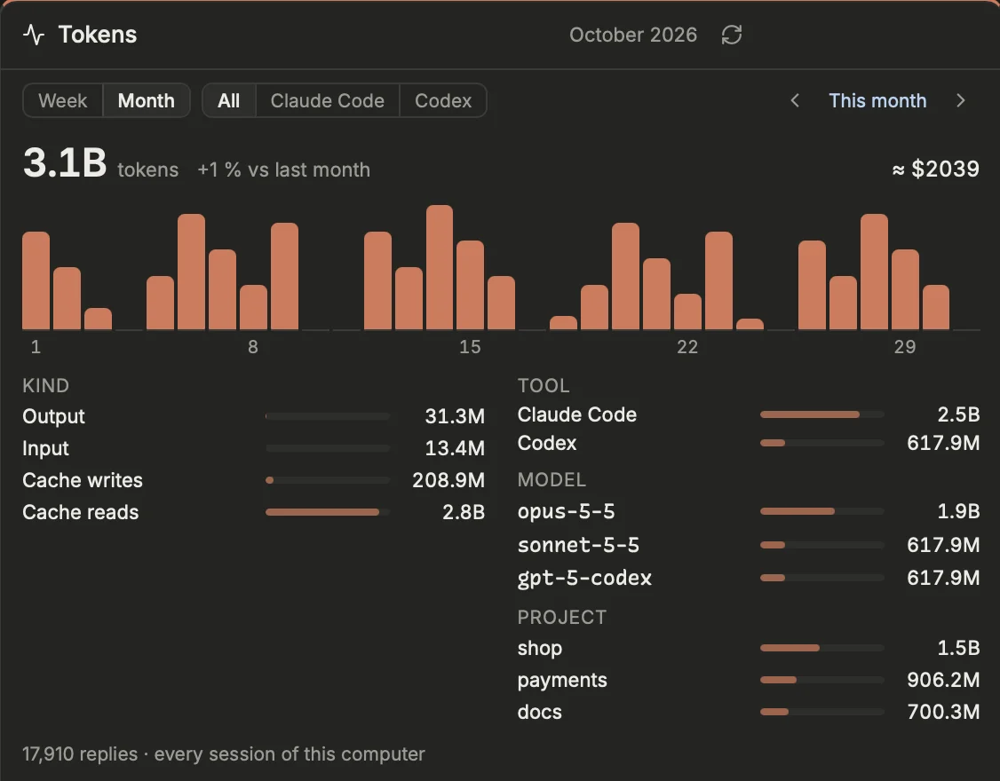

Hand work to Claude Code without leaving Prism: each agent runs in a real terminal of the app, in its own worktree if you want, and Prism tells you the moment one of them needs you.

## The Agents view

Open it with the **Agents** button of the rail, or the digit after your last page (`⌘6` with five pages). Each agent is a `claude` session in a terminal kept alive by tmux: quitting Prism does not stop it, and Prism reattaches to it on return.

> [!NOTE]
> Agents need `tmux` on the PATH: on macOS `brew install tmux`, on Linux your distribution's package, on Windows a tmux-compatible build on the PATH. Without it the Agents view stays unavailable.

The list on the left shows your agents and your Claude Desktop sessions together, grouped by status:

- **Waiting for you**: Claude asks you a question (*Needs your answer*) or wants a permission (*Tool or permission*). The row says what it is waiting for.
- **Running**: Claude is working.
- **Finished**: ready to review, completed or idle.

The page header is the same as on the other pages: its filter (a ticket, an MR, a word) keeps only the agents and sessions linked to it, through their ticket, branch and MRs. The filters **All** / **Prism agents** / **Desktop** narrow the list, and the **group** menu next to them changes the grouping: by status (what Claude is doing), by kind (`[[agents.kinds]]`), by tag (one group per tag, an agent with several in each of them), by repository (the one it works in: its worktree's, or the clone its folder is in; a Desktop session's too). By repository, every repository of the config shows as a project, an agent in it or not: a **+** opens the short launcher on it (the prompt first, the worktree named after it, the mode last used there; **More options** for the rest), **Left 6d ago** says where its last agent closed stood (its branch, its last words) with **Reopen** to bring it back on its conversation, and **Next** is its first ticket to pick on a board that names it (Obsidian), ▶ to implement it; the projects nothing happened in for two weeks rest, folded. On the phone, **By project** in the Agents tab shows the same cards. The **kind** says what an agent does — Refinement, Development, Review by default — as a coloured badge: guessed at launch from the command its prompt starts with (`/acme-flow:refine` → Refinement, through each kind's commands), changed in its header. Where the work stands is its status and its MR's. **Tags** are free: several per agent, typed in its header, `#api` in the list; the **All tags** menu keeps only the agents with one. The ⚙ button swaps the list for **Manage**: rename the kinds (and set the commands that make each) and the suggested tags (the agents carrying one follow), reorder, add or remove them, saved to `[agents]` in config.toml at once; a tag in use but not suggested can be kept, or taken off every agent. Click a group's title to fold it (and again to unfold it): Prism remembers it for each grouping, the count stays, and an orange dot says when an agent in it waits for you; `⌘[` / `⌘]` skip folded groups. The **sort** menu orders each group by **Last activity** (the default: within a kind, what waits for you comes first), **Created**, **Name** or **Branch**; Prism remembers your choice. `⌘B` collapses the list into a rail of icons; `⌘[` / `⌘]` move to the previous or next agent.

On the Dashboard, the **Agents** block shows only Prism's agents, those waiting for you first, with badges for their ticket, MR, CI and how far the branch is behind its base. A click opens the agent in the Agents view.

> [!TIP]
> When an agent asks for a permission, **Allow once** in its header answers yes without going to the terminal.

## Launching an agent
1. Press `⌘N`, click **New**, or choose a Claude action in a ticket's or an MR's ⋯ menu: the launcher opens, prefilled.
2. Give it a **Title** and a **Prompt**. The prompt is sent as is: a plain prompt, or a skill command such as `/my-plugin:refine` with a ticket ID.
3. Choose **Where**: **New worktree** (its own checkout, on a new `agent/…` branch from the base, or on the MR's existing branch; **From** picks another branch on origin to start from, offered as you type — empty, the repository's base —, and the worktree's counts and its **Draft MR** follow that branch; with several repositories marked **Worktrees** in Settings › Code › Repositories, pick its **Repository**), **Existing worktree**, or **Folder**. The launcher shows the folder and branch it will create: a name already taken (its folder, or its `agent/…` branch, left by an earlier worktree) gives way to the next free one (`-2`, `-3`…), as the launcher says; an MR's branch already checked out in another worktree cannot be checked out twice, so Launch waits for you to pick that worktree under **Existing worktree**. A repository's main checkout is shared: best for read-only work such as refine, review or investigate. Going from **Folder** to a worktree keeps the folder's repository: it becomes the new worktree's **Repository**, and **Existing worktree** picks one of its worktrees.
4. Choose the **Agent**: Claude Code, Command Code, OpenCode or Codex, for this agent only. The one marked *default* is its repository's (`[[repos]] agent`), failing that the one of Settings › Agents (`[agents] provider`); it follows the repository you pick under **Where** until you choose another. Its **Model**, for this agent only and kept when it resumes: the names that CLI offers are suggested (Claude Code's aliases and models, Codex's catalog, `cmd --list-models`, OpenCode's catalog), any other may be typed; empty, the model of its page in Settings, failing that the CLI's default.
5. Choose the **Permissions**: **Default** (the mode of your Claude settings), **Accept edits** or **Plan first**, and optionally a **Kind** (**Auto** by default: the one its command names, shown beside it) and **Tags** (click a suggested one, or type any other; Enter adds it).
6. Check the **Command** line, which shows exactly what will run, then **Launch** (`⌘↩`).

**Several repositories.** In a new worktree, **Also in** ticks other repositories with worktrees (`[[repos]] worktrees`): each gets a worktree of the same name, on a new branch of the same name from its own base, and the agent works in all of them, its CLI given the others (`--add-dir`; Claude Code and Codex only, the others work in one folder). Its header shows them (**+ helm**), a resume gives them again, and closing it removes them as its own worktree, unless there is something to lose. Its **Draft MR** step opens an MR in each repository with commits, each description listing the others.

**Prepare** instead of Launch declares the agent without starting it: it waits in the list as *Prepared*, nothing runs and no worktree exists yet. **Start**, in its header, launches it as prepared (its worktree made then, its **Then** steps after it), under the title, kind and tags you gave it meanwhile; **Edit…** reopens it in the launcher, and Launch or Prepare there replaces it. Its **Launch** tab shows what it will run. The effect of the action that opened the launcher (a ticket moved to *validation* and assigned to you…) applies as soon as you prepare it, as it does on Launch. If your tracker refuses that change, a message says why, with **Retry**.

A Claude action taken outside the Agents view (in a ticket's or an MR's panel, Worktrees…) opens the launcher as a drawer over that panel, compact (**More options** shows Then, kind, tags and the command): ← or `Esc` goes back to the panel, and once launched you stay where you were, a toast offering **Open it**. `⇧`-click on a Claude action skips the launcher and starts the agent at once, with the action's defaults, and the same toast. **Open in Claude Desktop instead** keeps the former path: a Claude Desktop session, prompt not sent. It is offered only when Desktop sessions are shown (**Show Desktop sessions**, never with Command Code).

## Working with an agent
Every key goes to Claude, except `⌘` shortcuts. On Linux and Windows, Ctrl goes to Claude there (Ctrl+C, Ctrl+B…): Prism's shortcuts take Ctrl+Shift inside an agent's terminal. `⌘.` interrupts Claude, and `⌘+` / `⌘-` / `⌘0` change the terminal text size — an agent shown as its Chat, the Chat's (**Chat text size**, `[agents] chat_font_size`, Settings › Agents › Agent; the phone keeps its own). The mouse wheel scrolls the history; a drag selects and copies on release, a double-click a word, a triple-click a line; the selection stays in sight until a click or a key (the key then goes to the agent, as it does after scrolling the history). Links open with `⌘`-click (Ctrl-click on Linux and Windows), plain URLs as those Claude Code writes. A ticket or an MR the agent names (`ABC-123`, `!1957`) or links to (an MR of a repository Prism reads, a ticket of your tracker) opens in its panel over the terminal; `⌘⇧`-click opens a link in the browser instead. Any other link — a local server such as `http://portfolio.localhost:3000`, docs — opens in the browser. A right-click (or `⌃`-click) opens Prism's menu, **Copy** (a selection made with `⌥`-drag) and **Paste**, never tmux's. Accents go through copy and paste: the agents' panes run in a UTF-8 locale; an agent opened before this setting gets it after a **Restart**.

The header has two rows. The first says what to do now: the agent's name (double-click to rename it, in Prism only), its state in words, and the one action of the moment — **Allow once** when Claude asks for a permission (it answers yes without going to the terminal), **Resume** when the agent is stopped (it picks the conversation up again, even after the computer restarts). On the right, **Files | Diff | Web | Tasks | Shell | Activity | Launch | Notes** open the side panel, **Stop** makes Claude exit and keeps its last screen, and **⋯** holds the rest. The second row, smaller, says where it works and how it is filed, to read: its ticket (click to preview) and its MR (click to open its panel), found in its title and branch, its branch (its folder on hover), worktree, then its **kind** (a coloured badge) and tags. **Edit** shows their fields: **+ link** links another ticket or MR by hand (a ticket id, or an MR such as `!123`), × unlinks it, back to the one found; **Kind** changes in place; × removes a tag, **+ tag** adds one (the suggested and used ones are offered); **Done** goes back to the line to read. **Header details** (`[agents] header_meta`, Settings › Agents › Agent) set to `edit` keeps the fields always there. Its open ports show there too, `:5173` in green: the servers the **Dev servers** block finds for this agent (in its shells, started by the agent itself, or a Compose container of its folder); a click opens it at http://localhost. The list shows them on its row. Nothing while the Dev servers block is off (Settings › Agents › Dev servers). In its Chat, **Allow once** and **Stop** are in the dock under the conversation rather than in the header.

The **⋯** menu:

- **Open its folder**: in the Finder, a shell or your editor; **Attach in …** opens the agent in your own terminal app too.
- **Rename**; **Restart** restarts Claude on the same conversation, so it rereads settings, hooks, MCP servers and `CLAUDE.md` (a second click while Claude works); **Interrupt** stops the current turn, like `⌘.`.
- **Remove worktree**, once the agent is stopped, removes its worktree only if nothing would be lost; otherwise a bar says why it is kept.
- **Close** stops the agent if it still runs (two Ctrl-C, a few seconds to exit cleanly; a second click to confirm), ends its terminal session and removes its worktree, its local branch with it, when nothing would be lost (a merged MR's commits count as delivered) and no other agent or Claude Desktop session works in it; otherwise the worktree stays and a message says why. The conversation stays in Claude's history.

**Context window**: a bar under a Claude Code agent's terminal shows how full its context is at its last reply, the tokens used and how many are left (`36% 360k / 1M tokens · 640k left`); its row in the list, the percentage. Amber past 70 %, red past 85 %: Claude Code compacts the conversation on its own when it is nearly full, and the gauge comes back with the next reply. The window is 1M tokens for a model asked for with `[1m]`, otherwise 200k. A Command Code agent shows it too, its window read from `cmd status --json`: that of its default model, so after a `/model` to another one, the tokens alone. An OpenCode agent shows it too, its window read from OpenCode's model catalog; a model it does not list (a provider set up by hand), the tokens alone. A Codex agent shows it too, tokens and window read from its transcript.

{width=338}

**What the context holds**: with Claude Code and Codex, a click on the context gauge opens its detail. The **Base** is what the CLI sends before your first word (system prompt, tools, MCP, skills, CLAUDE.md or AGENTS.md), measured from the first request; then the conversation since the last compaction: your prompts, the replies and thinking, the tool calls, the tool results (unfolded by tool: Read · 23, Bash · 17…), images, reminders and hooks, estimated by the size of each message and scaled to the tokens of the last reply. **Heaviest in the context** names the biggest items: the file read, the command run, the page fetched, with the turn they came at — their names, never their content. **Compact** (click twice) types `/compact` in the agent once its turn is over: the conversation gives way to its summary.

**What it consumed**: next to the context bar, **Session** gives the tokens of the whole conversation (Claude Code and Codex) and their cost at the models' public API prices (`≈ $3.10`); its row in the list, the cost. On a subscription it is a figure of comparison, not a bill. A click opens the detail: replies, tokens per reply, and the split between cache reads, cache writes, input and output. Prism sums the usage figures of each reply of the transcript (Codex's rollout), never its text; Codex's at OpenAI's standard prices (GPT-6.1 Sol: $2 in, $0.10 cached, $10 out per million), not its fast or long-prompt rates. **Cost alert** (`[agents.claude] cost_alert`, Settings › Agents › Agent › Claude Code) flags in Alerts a Claude Code agent past that many dollars; the Day trail's **By ticket** adds what a ticket's agents cost.

> [!NOTE]
> Prism follows an agent's status through Claude Code's hooks and keeps only metadata (event, tool, file name, the context's token count). It never stores the prompt, the answer or a tool's output.

## Terminal or Chat
For Claude Code, Command Code and Codex agents, **Terminal | Chat** in the header picks how you read it. **Chat** shows its conversation from its transcript, in place of its terminal (which keeps running under it): your prompts as bubbles, its answers as Markdown, each turn opened by a line with its number, its time and what it took (time, tokens, cost at the API prices, the model that answered it). The calls and thoughts between two of its answers fold into one line — **11 steps** with what they did: files read, edited (lines added and removed), commands, others, and the failed ones in red —; a click unfolds them, each call on one line (a click shows a command's last lines or an edit's diff), files read in a row folded into one. The turn under way shows its last three calls, **N earlier** the others. **Fold its steps** (`[agents] fold_steps`, Settings › Agents › Agent) off shows every call on its own line. Its subagents stay out of the fold, each a card of its own: its type (Explore, Plan…), what it was asked, its calls so far and for how long it has worked, **running** while it works — in the background too, as Claude Code launches them — its last calls shown; once over, its last words, a click shows its calls. Those in the background also count in the **background tasks** chip. A subagent woken again by a message (Claude Code's `SendMessage`, the terminal's **N agents**) gets a card of its own where the message went: what it was told, **running** until it is over again. Over the conversation, one rail of chips: its **plan** (steps done, the current one), its **background tasks**, its chain (**Then**, its steps after its work) and its **turns**; each opens a popover over the conversation (a click aside or Esc closes it), the turns' with a search (over every turn of its session), a click going to that turn. Scrolling up to its top brings its earlier turns, 30 at a time, up to its session's first, however long: Prism reads its transcript further back as needed, then only what it writes since. While it works, the line under the conversation says what it does and names the model answering: after a `/model`, the next reply's; **Interrupt** (Esc) stops its turn, the agent stays. A question it asks (its multiple-choice questions) is a card: pick its choices, or write your own words, then **Send the answer**. Under it, one dock: its permission prompt as a card (**Allow once**, or **Its other choices…** in the terminal), the box, then its context, its usage and **Stop**. The box writes to it: Enter sends, ⇧Enter adds a line (a prompt of several lines reaches it whole). It is sent at once, even while it works or after an interruption: its CLI keeps it and reads it once its turn is over. Only a menu on its screen (a permission, its question) holds it, until you answer it; at its prompt, its quick answers are in the box, and the prompt Claude Code suggests is the box's ghost text, **Tab** takes it. Its background tasks (Claude Code: a command, a subagent or a monitor it runs in the background) have their chip while one runs, and for a few minutes after the last ends: how many run, or how the last ended; opened, each with what it is, for how long it has run or ran, its state (running, done, failed, stopped) and what Claude Code said of its end, or a monitor's last event and how many it sent. Typing `/` offers its CLI's slash commands as they match, each with its arguments, what it does and where it comes from (a plugin, the project, the user): ↑↓ pick, Tab or Enter puts it in the box, Esc puts the list away. Prism keeps no list of its own: Claude Code tells its commands for the agent's folder (its own, the project's and the user's, skills, plugins), asked once in a while without a prompt, so without cost; Codex, only your prompts (`~/.codex/prompts`), as `/prompts:name`; Command Code, none. A Command Code agent's Chat reads its session (`~/.commandcode/projects`), found by the id its mod reports: its prompts, answers, calls, plan and each turn's cost (its own); its questions stay lines, answered in its terminal. The same list helps in the phone's answer box. Its permissions' other choices, and its menus (`/model`…), are the terminal's: **Terminal** goes back to it. An agent opens as its Chat by default: **Agents shown as** (`[agents] view`, Settings › Agents › Agent) set to `terminal` opens them as their terminal instead; each agent keeps the choice you make in its header. Side by side, a pane's menu offers **Chat** too. In its Chat, a link to an MR or a ticket Prism shows opens its panel, any other in the browser; ⇧ or ⌘ held, the browser whatever it is. A ticket (`SHOP-437`) or an MR (`!1957`) it names opens its panel too, as in its Terminal.

**Its plan, commented on.** In plan mode (Claude Code), the agent ends with a plan and waits: its Chat shows it as a card, **Plan proposed · v1**, rather than a line. Hover a passage — a heading, a paragraph, a step — and click the **+** in its margin (on a phone, the faint **+** is always there): your comment goes under it, the passage lit and numbered; Enter adds it, ⇧Enter adds a line, Esc cancels, ✎ and × change or remove it. On several passages in a row: shift-click the **+** of the last one while the box is open, or drag from one **+** to another; the comment goes under the last, and the agent reads where it starts and ends. Under the plan, the number of comments, **Preview** (the message the agent will read), **Clear** (two clicks) and a box for a general comment. Then: **Send comments · keep planning** refuses the plan with your comments as one message, each passage quoted (it plans again); **Approve** lets it go on, its edits allowed — with comments drafted it becomes **Approve with comments**, and they go with the approval; **Approve, ask each edit** has each of its edits ask you. The answer goes through its menu ("Tell Claude what to change"), which takes one line: your comments reach it on one line. Each new plan is a version (v2, v3…): **Changes** shows its lines added and removed since the one before; a comment whose passage reads the same in the new version is a draft again, one whose passage changed is counted as addressed (**Put away** hides them). Approved, its comments are forgotten. ⤢ opens the plan in its **Plan** tab (the side panel, and More on the phone): the last version wide, the earlier ones folded under it. A long answer of the agent's (several passages, or long) gets the same **+**: **Send comments** sends them as a prompt; **Comment its answers** (`[agents] comment_answers`, Settings › Agents › Agent) off keeps its answers read only. Comments are kept until sent, shared with the phone: written on one, sent from the other. From a phone, approving is an action (`[remote] actions`), comments are typing (`[remote] typing`, the passkey).

## The side panel
**Files | Diff | Web | Tasks | Shell | Activity | Launch | Notes**, in the header, open a panel on the right, about the agent's folder (its worktree, otherwise its folder). Each agent keeps its own, and its width: opening the Web view for one leaves the others as they were, and coming back to an agent finds the panel it had open (or none), as wide as it left it; an agent never resized takes the last width set. Drag the edge to resize it, double-click it to reset. The expand button next to them gives the panel the whole width for a while (the terminal keeps running, hidden); it or Esc restores it.

- **Files**: its folder as a tree, folders folded except those holding changes (with how many), each file with its git status; a filter, and **Changed** to keep only the changed ones. Click a file (or ↑ ↓, → ← to unfold and fold, Enter) to open it in a tab, in an editor: the next file clicked replaces that tab (its name in italics), a double click or an edit keeps it; a dot marks a tab not saved, × closes it (a second click when it is not saved). The editor colours the code in Prism's theme, folds it, finds and replaces in the file (⌘F), moves to a line (⌘⌥G); **⌘S** saves, as the file was read: never while the agent works (it waits for its turn to end, **Waits**), and never over what the agent wrote meanwhile. A thin mark in the gutter shows each change against the last commit (green added, blue changed, a red notch where lines were removed); a click shows the lines as committed, ↑ ↓ the other changes, **Revert** puts them back. The header line names the function, class or heading the cursor is in; Markdown shows rendered (**Source** for the text), images as images; an HTML page opens in **Web**. The file's header opens it in your editor, downloads it, copies its path, or goes to **Diff**.
  - **⌘P** (or the ⌘P button) opens a file by letters of its path (`chkout` finds `checkout.ts`), the open and recent ones first, then the changed ones: ↵ opens it, ⌘↵ opens it beside the file shown, ⇧↵ adds `@path` to the agent's Chat prompt. `:42` goes to a line, `@name` to a function or heading of the file, `#words` searches every file. The ⌘K palette also lists the files of the last Files tab shown.
  - **Search** (⌘⇧F, which is not Zen mode there) searches every file of the folder as you type — tracked and untracked ones, `.gitignore` honoured — with **Aa** (case), **W** (whole words), **.\*** (a regular expression), the files to include (`src/**`, `!*.test.ts`: a name alone matches in any folder) and **Changed**. A line found opens its file there, the matches marked. ▸ shows **Replace**: **All** writes every file found (a second click confirms), never while the agent works nor over a file you edited and did not save.
  - Lines selected: a small bar under them **asks the agent** about them (a question typed there, sent with the lines and where they are), **adds them to its prompt** (its Chat, to send with more), makes a **note** of them (TODO, in the repository's notes), or copies where they are (`src/a.ts:12-15`).
  - When the agent changes a file open in the editor, it is read again in place (where you were kept, its new lines lit a moment). If you had edited it and not saved, a banner says so: **Compare** shows its version against yours, a change at a time (Accept keeps yours, Reject takes its), **Take its version**, or **Keep mine** (saved over its version).
  - From 640 pixels of panel, the tree is a column and ◫ shows two files side by side (⌥-click a tab, or ⌘↵ in ⌘P, to open one beside). Settings › Agents › Files: **Vim keys** (`:w` saves), **Wrap long lines**, **Font size**, **Live reload**, **Search results**.
- **Diff**: **Uncommitted** (against `HEAD`) or **Branch** (the whole branch against its base, what the MR will carry), rendered like an MR review. Markdown files read rendered there too. It is also a review you hold with the agent:
  - **Notes**: the gutter **+** on a line writes a note to the agent; drag along the **+**, or shift-click a second line, for a range. The note starters (*Why this?*, *Simpler:*…) begin the sentence for you.
  - **On a hunk**: hover its header for **Explain**, **Add a test** or **Revert**: each writes a note on the whole hunk, to complete or send as is. Prism never edits the worktree itself: the agent does.
  - **Drafts**: the notes wait at the bottom of the panel, kept per agent even if Prism quits. **Preview** shows the prompt the agent will read (each note with its file, lines and the code quoted), **Insert** types it in its prompt without Enter, **Send** (`⌘↵`) submits it.
  - **While the agent works**, Send sends at once: it reads the notes once its turn is over (**Interrupt and send** stops its turn first, so it reads them now). Only a menu on its screen (a permission, its question) holds them, until you answer it.
  - **After sending**, the notes stay on their lines: *changed since* once the agent has touched them. **Since my notes** keeps only the files that moved since. **Resolve** folds a note; resolved notes are forgotten at the next commit.
- **Web view**: **Open…** picks what to show: **Folder**, the pages, documents and images of the agent's folder (HTML, SVG, PDF, Markdown, text, images) as a tree, or **Artifacts**, the pages the agent wrote in its session's scratchpad, newest first (shown first when one is less than an hour old). Type to search either, ↑ ↓ and Enter to open, Tab to switch. **.gitignored files** adds what `.gitignore` leaves out (a mockup, a build report), dimmed; dependencies and caches (`node_modules`, `target`…) are never listed. You can also type a path in the address (completed as you type), click an HTML file in Files, or give a local server (`http://localhost:…`). Markdown shows rendered and text as is, in Prism's theme.
- **Tasks**: what the folder declares, found in it and in its subfolders down to **Tasks depth** (`tasks_depth`, 3 levels by default: a monorepo's `web/`, `apps/api/src/`; 0 for the folder alone; never in hidden folders, `node_modules`, builds): `just` recipes, `task` tasks and `package.json` scripts (run with pnpm, yarn, bun or npm, after `packageManager` or the lockfile). Click one to run it in the shell shown in **Shell** (otherwise the first one at its prompt, otherwise a new one), which then shows; a recipe that needs arguments is only typed there, for you to finish. If that shell is busy (a dev server), Prism offers to run it in a new shell, or to send Ctrl-C first. Without `just` or `task` installed, Prism reads the file itself, and says so. A click on a file's header folds its tasks (⌥-click: every file); Prism remembers it for the agents of the same repository, and a filter shows them all again. The **☆** at the end of a task stars it as part of the repository's stack (every worktree of it shares the stars): the **Dev servers** block starts the starred tasks.
- **Notes**: the open notes of the repository the agent works in (its worktree's, or the clone its folder is in), reminders first: **Send** gives one to the agent (as the ➤ of the Notes block does: at once, held only while a menu of its waits for an answer; a TODO goes DOING); on hover, **TODO | DOING | DONE** sets its status (the one it has, clicked again, takes it off; DONE takes it out of the list), a reminder has **Done**, a double-click on its text (or the pencil, on the phone too) edits it — Enter saves, ⇧Enter adds a line, Esc cancels — and ✕ then **Delete?** deletes it; the input files a new note under that repository, **All notes** opens the Notes block filtered on it. See [Notes of a repository](prism:help/notes).
- **Activity**: what the agent did, from its hook log alone (the tool, the file, the command's first line, how long it took, whether it failed; never its output): a summary (files read and written, commands and failures, permissions waited for), a strip of the time spent reading, writing, running commands and waiting for you, the timeline, by turn (your prompt, then what it did until its turn was over: a click on a turn's header folds or shows its detail, **Collapse all** folds them all), filtered by **Files**, **Commands** or **Waits & turns**, and the files it touched. When the same command fails three times in a row with nothing written in between, a box says it may be going in circles, with **Interrupt** and a note typed in its prompt (not sent); its row in the list shows `↻ ×3`, and five times, Alerts.

- **Launch**: what the agent was launched with, as it was then: the action that opened the launcher, its title, CLI, where (the new worktree asked for, or the folder), permissions, kind, tags, its whole prompt (**Copy**) and its **Then** steps. A title, kind or tags changed since are flagged, not rewritten. **Launch again…** opens the launcher filled the same (a banner says so; **Start blank** empties it): a new agent and a new conversation, in a new worktree of the same repository and base under the next free name, or in the same folder while it exists; its steps come back, not how they went. `⇧`-click launches at once. To pick the same conversation back up, it is still **Restart** or **Resume**. An agent launched before Prism kept its launch shows only its prompt.

- **Shell**: login shells in the folder, for your own commands while the agent works, one tab each with what it runs (a green dot: a program holds it). **+** opens another, so a dev server keeps running in one while you test in the next. tmux keeps them like the agent: switching tab or agent stops nothing. `exit` or **×** closes one (a second click while it runs a program); closing the agent, or removing its worktree, closes them all.

The ⋯ menu opens the folder in the Finder, a shell or your editor.

## Several agents side by side
The buttons above the list split the view: one agent, two side by side, two one above the other, or four in a grid (`⌃1`, `⌃2`, `⌃4`; Ctrl+Alt+1… on Linux and Windows). Each pane is a live agent: its title, its state and the action of the moment (**Allow**, **Resume**), what it shows (its terminal, or one of its panels: Diff, Activity, Web…), its context. The focused pane, edged in orange, is the selected agent's: the keyboard, the list, `⌘[` / `⌘]` and `⌘.` act on it, and `⌥←` `⌥→` `⌥↑` `⌥↓` move to the agent on that side.

A click in the list opens an agent in the focused pane; `⌘`-click, or a drag onto a pane, puts it in another one (an empty one first). An agent shows in one pane at most, and the list numbers those shown. **×** empties a pane, the agent goes on. A double-click on a pane's title, or `⌘↵`, gives it the whole view, with its full header (links, kind, tags); `⌘↵` again goes back. **Follow who waits** (the alarm clock, next to the layouts) brings an agent waiting for you into an empty pane, or the last one, and empties it once answered; one you took out by hand stays out while it waits. The layout and which agent is in which pane are remembered.

## Dev servers
The **Dev servers** block shows, by agent, the servers its folder runs: a program in one of its shells listening on a TCP port, a server the agent started itself (from its Bash tool), or a Compose container started from its folder. Nothing to declare: Prism finds them in the process tree and the listening ports, and names each by the task that started it. Each line gives its ports (click one to open `http://localhost:<port>`), its shell and since when; **Show** opens that shell in the agent's panel, **Stop** sends it Ctrl-C (`docker stop` for a container).

A server whose shell goes back to its prompt stays, with its last lines: red when they read as an error, such as a port already in use (the line says which). **Run again** types the same command in the same shell; **×** forgets the line. A server stopped on an error is also in **Alerts**.

An agent running nothing is listed under **Nothing running**, with its starred tasks: **▶ Start** runs each in a new shell. Without a star, the button opens its Tasks panel, to star the stack once. **Outside Prism** lists the ports held by programs Prism did not start (a forgotten `node`, a Homebrew Postgres, a container), system and application programs aside; **Kill** takes two clicks.

Turn it on in Settings › Agents › Dev servers (`[dev_servers] enabled`), then add the block to a page. It reads every `poll_seconds` (5); `scan_outside = false` leaves out the ports outside Prism.

## Chains: when it's done, then…
{width=620}

In the launcher, **Then** adds steps that follow the agent once it has done its work: **Task** (a command run in its folder, its exit code read), **Prompt** (sent to the agent when it waits for you), **Draft MR** (its branch pushed, a draft MR opened into the branch it was made from, titled from its ticket, described by its commits), **Review agent** (a second agent in Plan first, `{mr}`, `{ticket}` and `{branch}` filled in its prompt) and **Notify**. Each step has its condition: **once it finished**, **if it succeeded**, or **ask me first** (it waits for your **Start**, or **Skip**). The ready-made chains (**Test → draft MR**, **Test → MR → review**, **Self-review**) fill the steps in one click.

A task that fails goes back to the agent once, with the end of its output, and runs again when the agent is done; failing twice, the chain stops there. Under the agent's header, the chain shows each step (✓ done, ◌ running, ⏸ waiting for you, ✕ failed), with **Stop the chain**.

Nothing merges, and Prism pushes no MR from the main or a release branch. Chains survive a restart of Prism, and run while it runs.

## Images and files in the prompt
Drop images, PDFs or any file on the launcher's prompt, paste a screenshot there (`⌘V`), or click **Attach**: each one shows as a thumbnail and its path goes in the prompt as `@path`, which Claude Code reads. Drop files on a running agent's terminal: they are saved in its folder, `.prism/attach/` (added to its git's own exclude file, never to `.gitignore`), and their paths typed in its prompt, not sent, for you to finish. The files of an agent still to launch wait in Prism's working folder, a month at most.

In its **Chat**, the image button left of the box (on a phone too: your photos or the camera) attaches images, as does pasting one in the box (`⌘V`). Each is saved in `.prism/attach/` and shown as a thumbnail over the box (× takes it out); its `@path` goes in your words and is sent with them. A heavy image (over 1.5 MB) or one the agent does not read (a phone's HEIC) is sent as a JPEG of 2048 pixels at most. From a phone, it goes with your words, so only while typing is on (`[remote] typing`).

## Dictating a prompt

At the computer, an agent's prompt can be spoken rather than typed: the **microphone** beside the image button of its Chat box, and beside a plan's comments, a question's own words and the launcher's prompt.

- **Hold** it (or hold **Fn** on macOS, **Ctrl ⇧ Space** on Linux, while the box has the focus) and speak; release: the text goes in at the cursor. **Click** it for a long dictation: a click starts, the next one puts the text in.
- While it records, a bar under the box shows the time, the microphone's level and its name; **Esc** cancels, nothing goes in.
- The text is never sent on its own: read it over, then send as usual (the draft is kept like typed text).
- A microphone muted, turned off or too low (the Sound block's `[sound]` thresholds) is said before recording, with **Raise** in one click.

Nothing leaves the computer: macOS's own speech recognition, forced on this Mac, or **whisper** built into Prism (macOS and Linux), whose model is downloaded once from Settings (`base`, 142 MB, by default; `small` is better on technical words). The repository's, branch's and files' names are given as words to expect. The audio stays in memory and is dropped once transcribed.

[Open Settings › Agents › Dictation](prism:settings/dictation)

## Command Code
With **Agent CLI** on `command-code`, new agents run [Command Code](https://commandcode.ai) (`cmd`) instead of Claude Code, and the labels, logo and plan usage follow. An agent keeps the CLI it was launched with. A repository can name its own (**Settings › Code › Repositories › Agent**, `[[repos]] agent`): the agents launched in its clone or its worktrees run that one, and the launcher's command shows it — Command Code everywhere but Claude Code on one repository, say. The differences:

- Prism follows it through a mod it loads (`--mod`) rather than hooks; the same metadata only. Command Code has no permission event: a tool still pending after 1.5 s counts as waiting for one.
- Prism creates the agent's worktree before launching it there; **Restart** resumes the conversation by its Command Code id.
- No **Auto** permission mode. Its **Artifacts** are the pages it writes in its session's scratchpad (`/tmp/commandcode-<uid>/…`), like Claude Code's.
- The status bar shows its 5 h and week windows; its panel adds the billing month, day by day like the week.

## OpenCode
With **Agent CLI** on `opencode` (or `[[repos]] agent = "opencode"`), new agents run [OpenCode](https://opencode.ai) (`opencode`), on the providers and models of your own OpenCode config. The differences:

- Prism follows it through a plugin it adds to your config for that agent alone (`OPENCODE_CONFIG_CONTENT`, your own plugins stay); the same metadata only. A subagent's turns are not the agent's.
- Prism creates the agent's worktree before launching it there; **Restart** resumes the conversation by its OpenCode id (`opencode --session`). OpenCode has no session name: the title stays Prism's.
- **Permissions**: **Plan first** starts its `plan` agent, **Accept edits** allows edits whatever your config says (OpenCode allows them by default). **Allow once** presses Enter on its question (*Allow once*); **Interrupt** presses Esc twice, as OpenCode asks.
- No plan usage in the status bar, and no **Artifacts**: OpenCode has no session scratchpad.

## Codex
With **Agent CLI** on `codex` (or `[[repos]] agent = "codex"`), new agents run [Codex](https://github.com/openai/codex) (`codex`), with your own Codex config and login. The differences:

- Prism follows it through hooks, like Claude Code, given on its command line (`-c hooks.<event>=…`, your own hooks stay); the same metadata only. **The first time**, Codex asks you to review them (*Hooks need review*): choose *Trust all and continue* in the agent's terminal. It asks again only if Prism moves (another build) or its data folder does. Codex also asks once per repository whether you trust the folder.
- Prism creates the agent's worktree before launching it there; **Restart** resumes the conversation by its Codex id (`codex resume`). Codex has no session name: the title stays Prism's.
- **Permissions**: Codex has no plan mode to start in, so **Plan first** runs it in its read-only sandbox, where it reads and proposes without changing anything; **Accept edits** runs it in its workspace-write sandbox; **Auto** routes its approval requests through its automatic review (`--approve-for-me`). **Allow once** presses `y` on its question (*Yes, proceed*); **Interrupt** presses Esc.
- The status bar shows its 5 h and week windows, read from its last session's transcript: as of Codex's last request, no call made. No **Artifacts**: Codex has no session scratchpad.

## Continue with another CLI
An agent is not tied to its CLI: **Continue with…** hands it over to another one — Claude at its limit, Codex to take it on — keeping the agent itself: its folder, worktree, branch, ticket, MR, notes and kind. Its CLI is a chip in its header (**Claude ▾**): its menu lists the other CLIs found on the computer, each with how much of its plan is used; the agent's ⋯ menu, the palette (*Continue with Codex*) and, on a phone, its ⋯ sheet offer it too.

No CLI can resume another's conversation, so the next one starts from a **relay**, the words it reads first, shown and editable in a window before it goes:

- **Relay written by Prism** (`prism`): built from the transcript and git, no model called — the first prompt, its plan, its last turns (your words and the end of each answer), the files changed since its base, what is not committed, its commits, the ticket and MR. Free, at once, and it works even when the former CLI is at its limit. Each part can be left out.
- **Summary written by the agent** (`agent`): **Ask Claude** sends the former agent a request for a handoff note; once its turn is over, its answer becomes the relay. The best summary, but it costs a turn and needs the agent able to answer — not at its limit.
- **The task only** (`task`): its first prompt and ticket; the next agent reads the code itself.

The window also picks the next CLI's model, effort and permission mode (the agent's own by default). **Continue** stops the former CLI in place (a turn under way is cut short) and starts the next one in the same terminal. OpenCode keeps no conversation Prism reads: from it, only *The task only*.

**At the limit.** When the plan of an agent's CLI is used up and it waits, a banner in its view says when the plan resets and offers the least used of the other CLIs (**Continue with Codex…**); **Wait** hides it until the reset. Alerts show it too (*Agent at its plan's limit*), with the same fix.

**Afterwards.** Its Chat keeps the earlier CLI's turns above, folded (**With Claude: 47 replies**), then the relay as a divider (**see the message**). Its **Activity** tab lists the CLIs it ran, with each one's time, replies and cost and the split between them; the agent's cost (its row, Actuals, the Day trail) is their sum. **Back to Claude** there hands it back: Claude Code and Codex pick their own conversation up again, the relay telling only what happened since; the others start a new one.

Settings › Agents › Agent: **Offer another CLI at the limit** (`[agents] suggest_switch`), **Relay** (`handoff`: the one picked first), **Turns in the relay** (`handoff_turns`, 8), **Read the relay first** (`handoff_review`; off, the chip, palette and ⋯ menu send Prism's relay or the task in one click). From a phone the relay is typing (`[remote] typing`, the passkey).

## Claude Desktop sessions
Your Claude Desktop sessions appear in the same list, with a dotted edge and a **Desktop** badge, grouped as in the desktop sidebar. **Show Desktop sessions** (`[agents.claude] show_desktop`, Settings › Agents › Agent › Claude Code) hides them, and they show only with Claude Code agents; hidden, they are not counted either. Prism only reads their status from disk, never their conversation; **Open in Claude Desktop** opens one there.

## Quick answers
When an agent waits at its prompt, one click answers it: **OK**, **Do it**, **Continue**… under its terminal, in the header of a pane side by side, on its row of the Agents block (on hover), in its alert and on the phone. A click sends and submits the text (never twice: the same text just sent is not sent again); ⇧-click, or an answer that is not *submitted*, types it into the agent's input, to finish there. Nothing shows while the agent works or asks for a permission: a text would answer the permission prompt.

Settings › Agents › Quick answers (`[agents.quick_answers]`) turns them off, and sets the list: a label, the text sent, submitted or not. Empty, Prism's are used, in the **Prompt language**. A text may name the agent's `{ticket}`, `{branch}`, `{mr}`, `{title}` or `{folder}` (`Open the MR for {ticket}.`): an answer whose variable the agent lacks is not offered to it. A pack can give a team's list; config.toml's replaces it whole.

[Open Settings › Agents › Quick answers](prism:settings/quick-answers)

## Quick actions
A job you ask of an agent again and again on the same repository — bring its main branch up to date from upstream, run a Trivy scan, refresh its lock file — is a quick action: a button with a ⚡ on its project in the Agents view (grouped by repository) and on the phone, and a line in the palette (⌘K, its name or its repository's). A click launches the agent at once, titled after it, a toast to open it; ⇧-click, or ⌘↵ on its line in the palette, opens the launcher prefilled, to change it before it goes.

Settings › Agents › Quick actions (`[[agents.quick_actions]]`) lists them: a name, the prompt (`{repo}` and `{base}`, the repository's default branch, are replaced), the repositories it is offered on (empty: every one), **Worktree** (a new worktree where the repository makes them; off, its clone as it is — what bringing `main` up to date needs), the **Mode** (`acceptEdits` to let it work alone; empty, the CLI's), its **Kind**, and its **Model** and **Effort** (empty, the CLI's). A pack can give a team's.

[Open Settings › Agents › Quick actions](prism:settings/quick-actions)

A routine (Settings › Agents › Routines) runs a quick action at fixed times, or a **prompt** written for it alone: a job that only makes sense on a schedule (« sum up the merge requests merged since {since} ») then needs no quick action cluttering the menus. Such a routine says itself what a quick action would (worktree, mode, kind, model, effort); without repositories it runs once, in the working folder. **Turn into a quick action** moves its prompt into one, to try it in a click.

On the phone, the **Agents** tab lists Prism's agents (not Claude Desktop's sessions): those **waiting for you** first — the question they ask, the command they want to run, or their plan — with their quick answers, **Allow** and the keys at hand; then those working, then the idle ones; the stopped ones fold at the bottom. A tap opens the agent's terminal. At the top, the plan's usage as in the status bar (the 5 h session and the week, in %); a tap shows each window with its reset and the week day by day. Under it, **New agent** starts one on a prompt, in a new worktree.

On the phone, the box under an agent's terminal sends a text of your own: **Send** asks your passkey (Face ID, fingerprint), then the agent gets the text at once, as typed on the computer — even while it works. The passkey is asked once per agent for the step-up window (**Typing to agents**, Settings › Remote), which also covers **Take**; Return adds a line, only **Send** sends. The quick answers, 1 2 3, **Interrupt** (Esc) and Allow need no passkey. In one of its shells, every key is typing (the same passkey), and **Again** runs the shell's last command once more (↑ then Enter, from its history, whoever typed it); the shell taken (**Take**), ↻ on the keys bar does the same.

On the phone, a question Claude Code asks (its multiple-choice questions) shows in the agent's **Chat** as a card: each question with its choices (one, or several when it says so), picked there, then **Send the answer**; Prism presses its menu's keys for you, without the terminal. A question may also take your own words, which ask your passkey as **Send** does. Once answered, the card shows the answers it got. On the computer and the phone, an agent asking is **waiting for you** (Answer its question), not a permission to grant: **Allow** would have picked its first choice.

On the phone, an agent's terminal is always at the phone's size, in a readable font, and follows it when the phone turns. Watching it never types: the agent's window takes the phone's size while you look at it from there, and the computer's when you type on the computer again or close it on the phone.

On the phone, an agent's tabs are those of the computer: **Chat**, **Terminal**, **Diff** (uncommitted or the whole branch, read only: review notes are written on the computer), then under **More** (a sheet) **Files**, **Shell**, **Tasks**, **Web**, **Activity**, **Launch** (Launch again opens the launcher there) and **Notes** (its repository's notes, each sent to it, its status set or deleted). Under its name, its state, branch and stage. Its **Chat** is the computer's, its chips' popovers as sheets from the bottom: a tap on the line of what it does shows the terminal's last lines (another, the terminal); its context is a thin line on the dock's edge (a tap, the detail); its permission a card with **Allow once**; the keys of its menus (1 2 3) and **Interrupt** (Esc) behind ⌨︎ next to the box. Its **⋯**, at the top right, stops it (**Stop**: Ctrl-C twice, its last screen stays, Resume picks it up) or closes it (**Close**: stopped, its worktree removed when nothing would be lost): a second tap confirms, then your passkey, with **critical actions** on (Settings › Remote › Exposure). Its **Files** read any file of its folder; a hidden one that git does not track (`.env`, a key) or one of `.git/` asks your passkey too, with critical actions on, since it is where secrets live: a tracked one (`.github/…`, `.gitlab-ci.yml`) opens as any other. Its **Web** shows its **Artifacts** (the pages it wrote in its session's scratchpad, newest first, a dot on those new since you last looked, their count on the tab) or the pages of its **Folder**, grouped by directory; a page opens full screen, its scripts and the files next to it loaded as on the computer, in a sandbox that cannot reach Prism; ↻ reloads it, ↗ opens it in the browser, **Ask a change…** puts its name in the agent's prompt.

## Tokens
{width=563}

The **Tokens** block adds up what your coding tools consumed over a **Week** (Monday to Sunday) or a **Month**: every session of this computer, Prism's agents or not, from Claude Code, Codex, Command Code and OpenCode. The total comes against the period before (the same days, for the one under way), with its cost: Claude Code's and Codex's at the public API prices (on a subscription, a figure to compare, not a bill), Command Code's and OpenCode's as they count it. A bar a day, **‹ ›** to go back in time; below, where they went: output, input, cache writes and reads, the tools, the models, the projects.

With several tools, **All** or one of them alone (a click on its row under **Tool** too): the total, the bars, the cost and the split are that tool's only, on the computer and on the phone alike. Prism reads the tools' usage figures, never what was said, and keeps the daily totals for **History** (`[tokens] keep_days`), after the tools have deleted their sessions; Settings › Agents › Tokens chooses the tools (`[tokens] sources`).

## Prism MCP: an agent that knows Prism

`prism mcp` is an MCP server an agent CLI starts: it gives the agent Prism's help, the commented reference (`config.example.toml`), the schema of every table (types, defaults, what reads it, its Settings page), your config merged with its packs (secrets hidden; tokens live in the keychain anyway) and Problems. With the "prism" skill that comes with it, the agent knows Prism's words (block, page, band, pack…) and which tool to call.

The agent never writes `config.toml`: it checks a change (`prism_validate`), then **proposes** it. Prism shows the proposal in a drawer — the agent's reason, the diff, what it touches, a key a pack sets overridden — and you **Apply** it (two clicks), **Refuse** it (your reason goes back to the agent) or **Edit before applying** (the agent gets what you changed). It applies live. Where you look, you find it: in the agent's Chat, its waiting call is a card (its reason, `+5 · [[repos]]`, the warnings) with **See the diff**, **Refuse…** and **Apply**, then a line saying it was applied, refused (with your reason) or edited; in Alerts, a line per proposal waiting, **See the proposal** opening it; in the Agents list, a **1 proposal** chip on its agent; in the status bar, `MCP · n` in the accent's color. On the phone the card shows, its answer given on the computer. The file changed meanwhile: the proposal is computed again on it, to apply again.

A custom block is tested before it is proposed: `prism_run_custom_block` runs it once, untrusted, in a sandbox (macOS `sandbox-exec`, Linux `bwrap`): no home folder, no token, a temporary folder, outbound network, 20 s and 256 MB. Without a sandbox on the computer, the test is refused. The block itself is trusted as you add it, as any block that does not come from Settings.

- **Configure Prism** (Settings › Agents › Prism MCP, or ✦ **Ask an agent** at the top of any Settings page): an agent in the config's folder, with the MCP server and the skill, the page in its prompt.
- **Prism MCP for every agent** (`[agents] prism_mcp`): every agent Prism launches gets them (Claude Code through a plugin, Codex and OpenCode through their MCP config).
- **Agents outside Prism**: `prism mcp install claude|codex|opencode` (or the page's **Add**) writes the server into that CLI's user config and the skill into its skills' folder; `uninstall` takes them out.
- `[mcp] enabled` turns the server off; `[mcp] proposals = false` makes it strictly read-only (the agent gives the TOML to paste).

It reaches the running Prism of the profile through a local socket, the owner's only; Prism stopped, only the docs, the reference and the schema answer. It reads nothing of your work (tickets, MRs, mail) and no secret.

[Open Settings › Agents › Prism MCP](prism:settings/prism-mcp)

## In passing: what an agent sees out of its task

While it works, an agent often sees something worth doing that is not what you asked: dead code, a stale doc, a missing test, a TODO it confirmed, the same bug elsewhere. Rather than a sentence of its summary you may never read, it flags it with `suggest_task`, a tool Prism gives the agents it launches (Claude Code, Codex, OpenCode), and carries on with its task. The Claude Desktop sessions' `spawn_task` calls come in too.

- **In its Chat**: a card where it saw it — the title, what and why, the files — in place of the tool call. It never blocks: it is not a question.
- **On the agent**: a chip **↗ n**, its open ones; a click opens the list on it.
- **The « In passing » list**: the **↗** button above the Agents list (and the **In passing** block of a page, More › In passing on the phone), by repository; Open, Launched, Tickets, Dismissed. Two agents seeing the same thing (same repository, files that meet, close titles) make one line, seen by both.

Each line: **Launch…** opens the launcher prefilled — its prompt headed by where it comes from, a new worktree from the base or from the agent's branch (chosen on the card; the agent's branch first when the task depends on its changes), its agent's CLI and effort, its kind — and Enter launches it. **After this agent** adds it to that agent's chain: launched once it is done. **Ticket** creates it in the tracker, its tldr and prompt in a comment. **Later** keeps it without a badge; **✕** dismisses it, the reason going back to the agent.

The agent learns what became of it at its next step (launched elsewhere: it leaves those files alone; dismissed: it does not propose it again), and can withdraw one itself (`dismiss_task`): struck out in its Chat. A line whose files a commit of another branch changed since says so. Open lines older than `stale_days` fold under Older; nothing is removed on its own.

[Open Settings › Agents › In passing](prism:settings/aside)

## Settings and console
In Settings › Agents › Agent (`[agents]`):

- **Agent CLI** (`provider`): `claude` (Claude Code), `command-code` (Command Code), `opencode` (OpenCode) or `codex` (Codex), for new agents (unless their repository names its own) and the plan usage.
- **Agent actions open** (`target`): `agent` for the Prism launcher, `desktop` for a Claude Desktop session.
- **Prompt language** (`prompt_language`): the language of the prompts the Claude actions write, `fr` or `en`, and so of Claude's answers.
- **Logs for a fix** (`fix_log_lines`): an agent launched from Alerts to fix a failed pipeline gets the end of each failed job's log in its prompt (up to 3 jobs), this many lines, 60 by default; 0, none: the agent reads the logs itself.
- **Tasks depth** (`tasks_depth`): how many subfolder levels the Tasks panel searches for task files, 3 by default; 0, the agent's folder alone.

The Claude actions ask for the job in a few plain words ("Refine ticket ABC-123.", "Review the code of MR !1620."), never by a skill's name: if your team's plugin has a skill for that job, Claude picks it from its description; otherwise it does the job its own way.
- **Worktrees folder**, **Branch prefix**, **Permissions** (the launcher's default, in each CLI's words), **Terminal text size**, **Scrollback**, **Kinds**.

Each CLI has its own page under Agent (`[agents.claude]`, `[agents.command-code]`, `[agents.opencode]`, `[agents.codex]`): **Binary** (`bin`, a name in the PATH or a path; empty, its usual name), **Model** (`model`, passed as `--model` to new agents and on resume, its names suggested; empty, the CLI's default) and **Extra arguments** (`args`, such as `--effort high`), added to every launch and resume, wherever it runs (by default or for a repository). Claude Code's page also has **Cost alert** (`cost_alert`: an agent estimated beyond this many dollars is flagged in Alerts; 0, the default, never), **Show Desktop sessions**, **Count Desktop sessions** for the header and Alerts counters, the folders of the Desktop sessions and transcripts, and **Refresh the token** of the plan usage.

In the console, `agent <prompt>` starts an agent on that prompt right away, in the first repository with worktrees, the one bare MR references name first (`agent refine ABC-4661`, or a `/plugin:skill` command typed as is); `agent` alone opens the launcher (a new worktree by default).

[Open the Agents view](prism:agents)
[Open Settings › Agents › Agent](prism:settings/agents)
