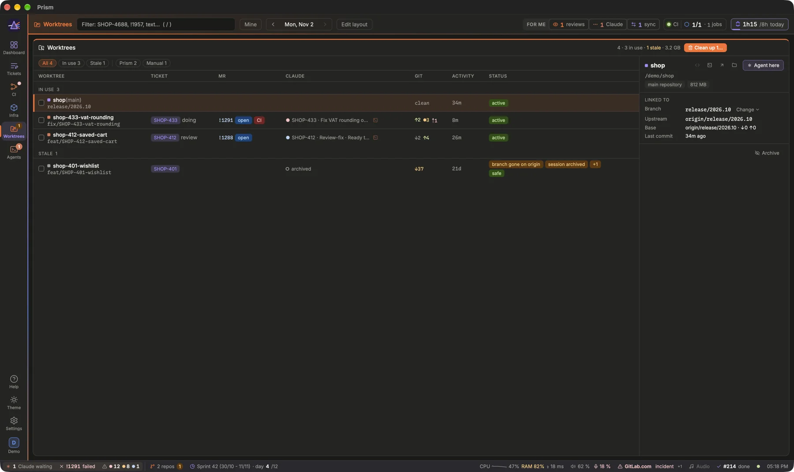

See every worktree of your repositories, what it is for and who works in it, and remove the ones you no longer need without ever losing work.

## What the block shows

The **Worktrees** block (and the Projects page's **Cleanup** tab, which took the Worktrees page's place: see [Projects and workstreams](prism:help/projects)) lists the worktrees of the repositories marked **Worktrees** in Settings › Code › Repositories (the former `[worktrees] repo` is one), each tagged with its repository when there are several: those of Prism's agents, those of Claude Desktop (in `.claude/worktrees/`), and the ones you made by hand. The header counts them, how many are in use and how many are stale, and the disk space they take.

For each worktree you see:

- its branch and upstream, and how far it is behind and ahead of its base;
- the ticket and the MR it is linked to;
- the Claude agents and Desktop sessions working in it, archived Desktop sessions included;
- its uncommitted changes, the commits pushed nowhere, its size and its last sign of life.

Click a worktree to see its detail: what it is linked to, the Claude work in it, and a **Verdict** that says whether it is safe to remove. The filters **All**, **In use** and **Stale** narrow the list.

[Open the Worktrees block](prism:block/worktrees)

## The four states
| State | Meaning |
| --- | --- |
| **In use** | An agent is running in it, a Desktop session is active, or there was activity recently (24 hours by default). |
| **Stale** | Its MR is merged, its branch is gone on origin, its ticket is done, its Desktop session is archived, or nothing happened in it for `[worktrees] stale_days` days (14 by default). |
| **Folder gone** | Git still knows the worktree, but its folder has disappeared. |
| **Idle** | None of the above: not in use, nothing says it is finished. |

A stale worktree shows **safe** when it can be removed without loss, **keep** when it still holds work. The Alerts block flags the stale worktrees that are safe to remove.

## Removing worktrees
- **Remove** deletes the worktree folder and its local branch. Like every destructive button in Prism, it takes two clicks: the first arms it (**Confirm**), the second removes.
- **Remove anyway…** appears when the worktree still holds work (uncommitted changes, untracked files, commits pushed nowhere). The Verdict says what would be lost; the second click, **Confirm: lose it**, deletes it for good.
- **Prune** forgets the worktrees whose folder is already gone (`git worktree prune`).

To clear several at once:

1. Click **Clean up…** in the block's header. It lists the stale worktrees.
2. Those with nothing to lose are ticked already. Those that would lose work are marked *unsaved work* and are never ticked by default: tick them one by one if you really want them gone.
3. Check the estimate of the space freed, then click **Remove**. If you ticked worktrees with unsaved work, click again to confirm.

Or pick them yourself, stale or not: tick the box in front of each worktree that can go (not the main checkout, nor one in use or locked); `⇧`-click ticks a range. A bar above the list counts them, with the space they take and those with unsaved work; its box ticks every one shown. **Remove N**, then **Confirm**, removes them one after the other: those Prism refuses are listed, the others go.

The icons at the top of the detail open a worktree in your editor, a shell in Prism, the terminal app or the Finder (Settings › Interface › Open with); **Agent here** launches a Claude agent in it.

Its git actions sit on the line they change:
- **Change ▾**, on the Branch line, switches it to another branch: a local one, or one of origin's (then made local, tracking it). Origin is fetched as the list opens; a branch another worktree is on is shown greyed. Refused with uncommitted changes, or while an agent runs in it.
- **Pull**, on the Upstream line, appears when origin has commits of its branch it lacks (↓N, as of the last fetch). Fast-forward only: when the two have diverged, nothing is pulled.

**Archive** and **Remove** sit under the Verdict, which says whether removing is safe.

## Safety rules
Prism removes a worktree only when nothing would be lost:

- no uncommitted change and no untracked file, apart from the `.claude/` folder Claude leaves behind;
- no commit missing from the remote, except commits from before the MR's merge, already delivered by a squash.

Some worktrees are never removed, not even with **Remove anyway…**:

- one where a Prism agent is running, or that a non-archived Claude Desktop session uses;
- the main repository;
- a locked worktree (unlock it first with `git worktree unlock`).

> [!WARNING]
> **Remove anyway…** deletes uncommitted changes and unpushed commits for good. Read the Verdict before the second click.

> [!TIP]
> An agent's own worktree can also be removed from the Agents view, with **Remove worktree** once the agent is stopped. The same rule applies: only if nothing would be lost.

## Settings
In Settings › Code › Repositories › Worktrees (`[worktrees]`):

- **Repository** (`repo`): the former way to name the clone of the repository bare MR references name, still read; the repositories with **Worktrees** on are the ones listed.
- **Base branch** (`base_branch`) of every repository that names none of its own (its card's **Branches**): `auto` takes the latest release branch, otherwise the main one; or a branch name. Behind and ahead are counted against it.
- **Stale after** (`stale_days`): days without commit nor Claude session before a worktree is stale, 14 by default.
- **Poll every** (`poll_seconds`).

Two related thresholds live in Settings › Interface › Alerts & sound: **Worktree in use** (`[alerts] worktree_in_use_hours`) and **Branch behind** (`[alerts] behind_commits`), past which a branch is flagged as behind its base.

[Open Settings › Code › Repositories › Worktrees](prism:settings/worktrees)
