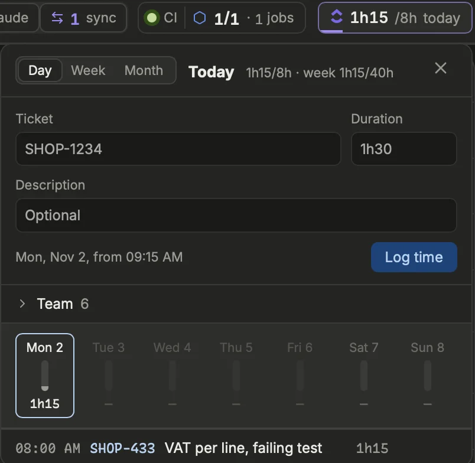
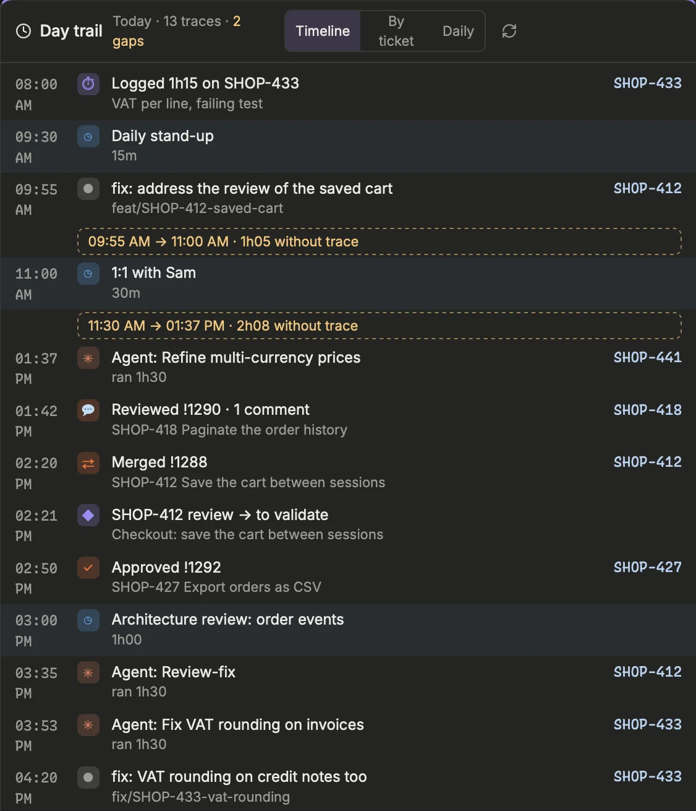
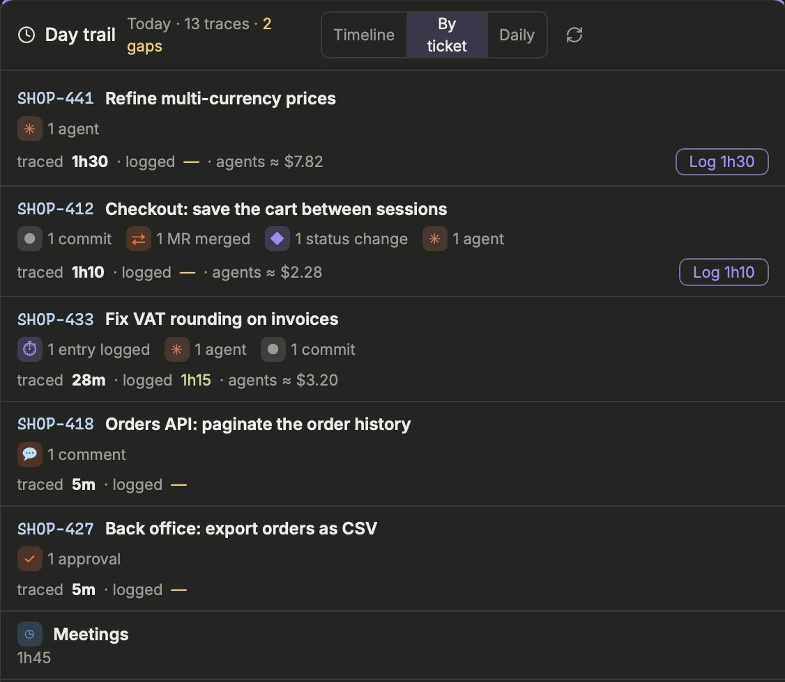
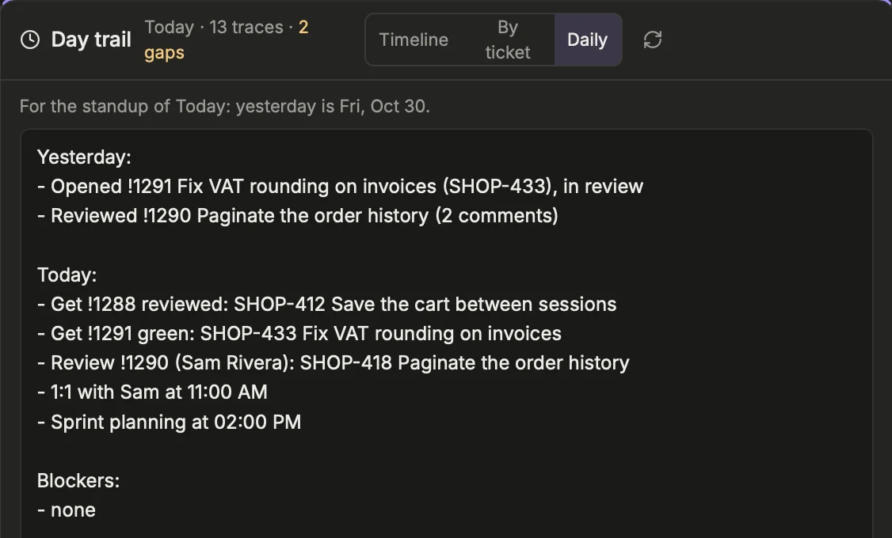

Log your time in ClickUp (or as Jira worklogs, Settings › Work › Tracker › Jira › Time tracking) without leaving Prism, see at a glance whether your day and your week are complete, and let the Day trail tell you what you did.

## The time chip in the header
The header shows a chip with the ClickUp logo and the time logged on the viewed day against the target, for example `6h00/7h today`. A thin bar under it fills up as you log; it turns green once the day reaches its target.

The target is 7 hours per working day and 35 hours per week. It is fixed in the app, not a setting.

A click on the chip opens the **Time tracking** drawer. Its head repeats the day's total and adds the week's (`week 21h00/35h`). A click outside the drawer closes it, and the ticket and description you were typing are kept for next time.

## Logging time
{width=402}

The drawer has three fields: **Ticket**, **Duration** and **Description** (optional).

1. Open the drawer from the header chip.
2. Type a ticket id, or pick one from the suggestions: your sprint tickets, the tickets of your open MRs, those of your Claude sessions and the tasks of the time boards.
3. Type a duration: `1h30`, `1h`, `45m`, `45` (minutes) or `1.5` (hours) all work.
4. Add a description if you want, then press `Enter` or click **Log time**. The form then empties, ticket included, ready for the next entry.

The entry goes to ClickUp on the day viewed in the header, starting right after the last entry of that day, or at 9:00 when the day is still empty. The line above the button tells you where it lands, for example `Tue 7 Oct, from 14:30`.

> [!TIP]
> You rarely need to type the ticket. **Log time** in the ⋯ menu of an MR or a ticket (Sprint, To pick, Refinement), or in the header of a ticket's panel, opens the drawer prefilled, and when the global filter holds a ticket id, the drawer starts with it.

## Recurring tasks
Meetings, support, rituals: the time that belongs to no sprint ticket goes to recurring tasks, read from the boards used for time (Settings › Work › Tracker › ClickUp › Boards, `uses = ["time"]`).

They sit in a collapsed section of the drawer, named after the board, with their count. Unfold it to find:

- the five you used most recently, as shortcuts at the top;
- a filter field, then the full list, each subtask under its parent;
- a click on a name picks the task and puts the cursor in **Duration**; the arrow opens it in ClickUp; hovering shows its description.

These tasks are not listed in the Sprint block, only here.

## The week, and editing entries
Under the form, the drawer shows the week of the viewed day, Monday to Sunday, each day with a small bar and its total. A day that reached 7 hours is green; a past working day that did not is orange, so a forgotten afternoon stands out. A click on a day selects it in the whole app. Future days cannot be selected.

Below the week come the entries of the selected day. To change one:

1. Click its pencil, or double-click the row.
2. Edit the start time, in 24 h (`09:30`, `9:30` or `930`; the day itself does not change), the ticket, the description or the duration.
3. Press `Enter` to save to ClickUp, or `Esc` to cancel.

Leaving the ticket empty keeps the entry's task. To delete an entry, click its ✕, then click again on **delete?** within a few seconds. Only the entries Prism displays can be edited or deleted.

> [!NOTE]
> Logging, editing and deleting only work in the Prism app window, not in a browser preview.

## Week and Month views
The switch at the top of the drawer, **Day · Week · Month**, changes what it shows; Prism remembers your choice. **Day** is the form and the day's entries described above. The drawer widens for the other two.

- **Week**: a timesheet of the viewed day's week, one row per ticket (or task) and one column per day, with each row's total and, at the bottom, each day's total coloured like the week strip.
- **Month**: a calendar of the month, each day with its total and a small bar, the week totals on the right, then the time per ticket over the month, most logged first.

Both have ‹ › to move to the previous or next week or month, as far back as the history read, and show the period's total against its target (working days × the daily target), with the target to date for the current period. The past working days that did not reach their target are listed in orange: a click on one, or on any day, opens the **Day** view on it, ready to fill the gap.

## The date picker
The ‹ day › picker in the header, with its **Today** button, sets the day you look at. It drives the time drawer, the Day trail, the merged MRs section, the agenda and the notes of the day. Everything else shows the current state.

Prism reads back `[clickup] time_history_days` days of logged time (30 by default), and at least back to the 1st of the previous month so that the Month view shows last month whole: you can go back that far to fill a gap.

## The Day trail

The **Day trail** block rebuilds the day picked in the header from its traces: your commits in the local clones, your MRs opened, merged, approved and commented, your tickets changing status, your agents, your meetings once over, and the time you logged. Nothing to write down: Prism keeps the journal itself, `[trail] keep_days` days of it (30 by default), on this machine. Add the block to a page with Edit layout, then + Block (Overview).

Its three tabs:

- **Timeline**: the traces in order, alike ones grouped (three commits on a branch, two comments on an MR). A click opens the MR or the ticket. A stretch of the working day (9:00 to 18:30) without any trace for `[trail] gap_minutes` (60 by default) is flagged: often time worked and not logged.
- **By ticket**: per ticket, the time Prism estimates from its traces against the time already logged. Each trace counts the time since the previous one, 45 minutes at most; an agent counts its run; meetings are apart. **Log** adds the difference to the ticket, starting at its first trace; **Log all** does every ticket. It is an estimate: nothing is logged without your click.
- **Daily**: your part of the standup. *Yesterday* is the working day before: MRs merged and opened, tickets worked on (commits, agents), MRs reviewed. *Today*: your MRs to get green, reviewed or merged, the reviews waiting for you, your tickets in progress, the day's meetings. *Blockers*: your tickets waiting on others. Edit the text freely (your version is kept for that day), **Regenerate** rebuilds it, **Copy** puts it on the clipboard.

The block opens on the daily in the morning and on the time to log afterwards, then on the tab you chose last. ↻ reads your traces again now.

Each source has its switch in Settings › Work › Day trail: commits (`git log` in the clones, by your `user.email`), forge events (GitLab's events, GitHub's `users/<you>/events`: your own only), ticket moves (seen while Prism runs) and meetings.

[Open Settings › Work › Day trail](prism:settings/trail)
