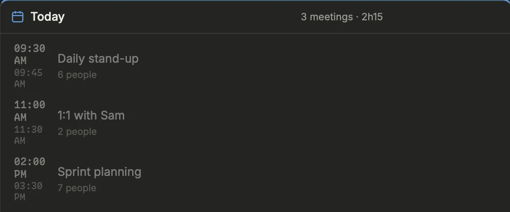
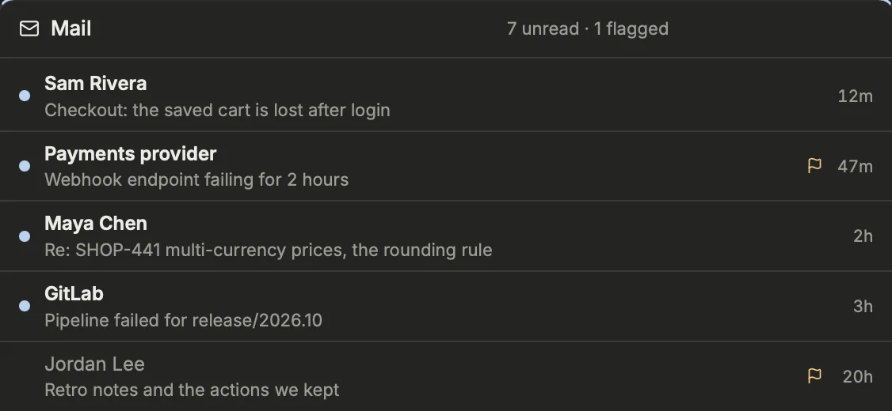

Keep what you must not forget next to your work: free notes, small tasks, reminders the system notifies, the meetings of the day read from your Calendar, and your unread mail.

## The Notes block
The **Notes** block holds short notes that stay on this machine. Type in the input and press `Enter` to add one; `Shift+Enter` starts a new line. Above the input, three buttons choose the kind of note:

| Kind | Shown |
| --- | --- |
| **Sticky** | Always, whatever the day. |
| **Today** (or the day picked in the header) | Only when that day is selected in the date picker. |
| **Reminder** | At the top, until done, with a system notification at its time. |

The last kind you used is remembered. Inside a note, ticket ids and MR references become links: a click filters the whole dashboard on them, the small arrow opens them.

To change a note, double-click its text (or focus it and press `Enter`), edit, then `Enter` to save or `Esc` to cancel. To delete it, click its ✕, then **Delete?** within a few seconds. Its ➤ (shown while an agent runs) lists the running agents, the one selected in the Agents view first, each with its ticket or branch and whether it waits for you or works: pick one, and the note goes to it as a prompt, without its tags. At once, even while it works or after an interruption: its CLI keeps it and reads it once its turn is over. Only a menu on its screen (a permission, its question) holds it, sent by itself once you answer it (notes sent meanwhile follow, in order; the queue survives a restart of Prism). A note already queued for that agent, or sent to it in the last 10 seconds (a double click), is not sent twice. A TODO note sent goes DOING. On the phone, the same ➤ types the note to the agent you pick, as its answer box does: with **typing** on (Settings › Remote › Exposure), its passkey once per agent for a while. Beyond five notes, a search field appears.

Notes and the layout are saved as JSON in the app's data folder, `~/Library/Application Support/app.prism.desktop/`.

## Notes as tasks
A sticky note or a note of the day can become a small task. Hover its left edge to see the status pill:

1. Click it once: the note becomes **TODO**.
2. Click again: **DOING**.
3. Once more: **DONE**. A fourth click removes the status.

You can also start the text with `TODO` or `DOING` (for example `TODO call the ops team`): the word sets the status and disappears from the note. Notes in progress come first, then those to do, then plain notes. The block's title counts the notes in progress. Done notes leave the list and join a collapsed **Done** section at the bottom, with the completed reminders.

## Tags
Write a tag in the note itself: `#infra`, `#perso`, `#client/acme` (a letter first; `#1957` stays a reference, `C#` is no tag). Edit the note to change its tags.
- **Filter**: click a tag, in a note or in the bar of tags under the input, to see only its notes; click it again (or the tag in the block's title) to see them all. A note written while a tag is filtered gets that tag.
- **Sort**: the A→Z button orders the notes by their first tag (untagged last), then by status.
- **Group**: the layers button replaces the Sticky and day sections with one section per tag (a note with two tags shows in both), and **No tag** last. Reminders keep their section.

## Notes of a repository
A note can be about one of your repositories (Settings › Repositories), whatever its kind. The **branch** picker in the input files the next note under a repository (— for none); the branch button of a note, on hover, moves it to another one or out of any.

- **Filter**: click a note's repository badge, or its chip in the bar under the input, to see only that repository's notes; click it again (or the name in the block's title) to see them all. A note written while a repository is filtered is filed under it.
- **Group**: the group menu next to the sort offers **Repository**: one section per repository, by name, and **No repository** last.
- **Repos menu**: in the status bar, each repository shows how many open notes it has; a click opens the notes over the view, filtered on it, ready for a new one.
- **Agents**: the ➤ of a note lists the agents working in its repository first. In the Agents view, an agent's **Notes** panel lists the open notes of the repository it works in (its worktree's, or the clone its folder is in): **Send** gives one to it, its status and ✕ change or delete it there, and a note written there is filed under that repository.

## Reminders
Choose **Reminder** above the input, type what to remember, then pick a time: **in 30 min**, **in 1 h**, **14:00**, **tomorrow 9:00**, **Monday 9:00** (only those still ahead are offered), or any date and time in the field. Without a choice, the reminder is set for one hour later.

Reminders sit at the top of the block, the soonest first, with the time left (`in 25 min`, `today 14:00`). When one is due, Prism sends a system notification, once; an overdue reminder turns red (`12 min late`) and the title shows how many are due. Then:

- tick its box to mark it done (it goes to **Done**, untick it there to reopen it);
- or click **Later** to push it back: **in 10 min**, or one of the same presets. It will be notified again.

> [!TIP]
> A reminder missed while Prism was not running is still notified the next time it checks, as "Reminder (missed)".

## Quick notes from anywhere
Press `⌘⇧N` to open the notes over any view, Agents and Settings included, with the cursor in the input. `Enter` saves and keeps the input open for the next note; `Esc` closes. Change the shortcut in Settings › Work › Notes (`[notes] key`). With `⌘` or `⌃` in it, the shortcut also works while you are typing in a field.

[Open Settings › Work › Notes](prism:settings/notes)

## The Today block: your agenda
{width=563}

The **Today** block shows the meetings of the day, read locally from the macOS Calendar: an Exchange, Microsoft 365 or Google account added in System Settings → Internet Accounts is part of it, and no token nor network call is involved (an Exchange account, step by step: [Exchange in the macOS Calendar](prism:help/exchange)). On Linux or Windows, or to read Google Calendar directly, set **Provider** to `google`: the block then reads the Google Calendar API, read-only, signed in with your Google account ([Signing in to Google](prism:help/google)).

- The title counts your meetings and their total time, then the time left today.
- The current meeting is highlighted with its progress; otherwise you see the countdown to the next one.
- **Join** opens the Teams, Zoom or Meet link; it lights up 15 minutes before the start.
- Declined, canceled or "free" meetings are struck through.
- A click on a meeting opens its details: attendees and their responses, and the invitation text. **Respond in Calendar** opens it in Calendar (**Respond in Google Calendar**, on the web, with Google), since Prism cannot answer an invitation itself. **Prepare** hands the meeting to an agent, read-only (in plan mode, since anyone can send you an invitation): what it is about, the attendees and how they relate to your tickets, MRs and notes, the points to raise.

The block follows the date picker in the header: pick another day to see its agenda.

Prism also sends a notification before each meeting you are expected at, even when its window is closed. The delay is 5 minutes by default: `[alerts] meeting_lead_minutes` (Settings › Interface › Alerts & sound).

> [!NOTE]
> With the macOS Calendar, on first launch, macOS asks whether Prism may read your calendars. If you refused, allow Prism in System Settings → Privacy & Security → Calendars, then reopen Prism.

## Calendar settings
In Settings › Work › Calendar:

- **Agenda** (`[calendar] enabled`): off, Prism never reads a calendar nor asks for access. There is then no Today block, no meeting countdown and no meeting notification. The change applies on the next launch.
- **Provider** (`[calendar] provider`): `macos` (the default, macOS only) or `google` (any system). Read at launch. Each has its page under Calendar: **macOS Calendar**, and **Google Calendar** with the Google account to sign in to; the provider not chosen is dimmed, and its page offers to become the calendar.
- **Calendars** (`[calendar] calendars`): the calendars read, checked among the provider's; none checked, all of the Mac's (birthdays and holidays included), or those checked in Google Calendar. A calendar checked then renamed or removed stays in the list, struck through, to uncheck.

[Open Settings › Work › Calendar](prism:settings/calendar)
[Open the Today block](prism:block/agenda)

## The Mail block

The **Mail** block lists the unread messages of your Microsoft 365 or Gmail inbox, newest first, and the flagged (starred) ones, read or not: the sender, the subject and how long ago. A click opens the message in Outlook or Gmail on the web; once read there, it leaves the list at the next read, within a minute.

With **Provider** set to `gmail` (`[mail] provider`), it reads Gmail through the Gmail API with `gmail.metadata`: the labels and headers only, never a body, a snippet nor an attachment. It signs in with your Google account, in Settings › Work › Mail › Gmail: see [Signing in to Google](prism:help/google). The rest of this section is about Microsoft 365.

It reads your mailbox through **Microsoft Graph**, with the narrowest permission there is, **Mail.ReadBasic**, delegated: your own mailbox only, and never the body of a message, its preview nor its attachments. It needs an application registered in Entra ID by your organization (its **Application (client) ID**), usually given by your team's pack.

To set it up: turn on **Settings › Work › Mail** with the `microsoft` provider, check the application in **Mail › Microsoft 365**, restart Prism, then **Sign in** there: Prism shows a code and opens Microsoft's page, where you type it, sign in with your work account and accept. The refresh token goes into the system keychain, this profile's entry, never `config.toml`; **Sign out** removes it. Then add the block to a page with **+ Block**.

- **Application** (`[mail] client_id`) and **Tenant** (`[mail] tenant`, empty: any work account).
- **Provider** (`[mail] provider`): `microsoft` (the default) or `gmail`. Each has its page under Mail, **Microsoft 365** (the application, the tenant and the sign-in) and **Gmail** (the Google account); the provider not chosen is dimmed.
- **Flagged** (`[mail] flagged`): the flagged messages too, the starred ones in Gmail (on by default).
- **Messages** (`[mail] max`): listed at most, 30 by default.

[Open Settings › Work › Mail](prism:settings/mail)
[Open the Mail block](prism:block/mail)
