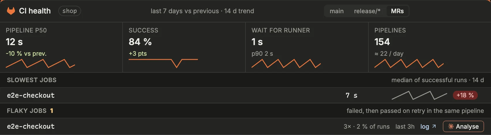
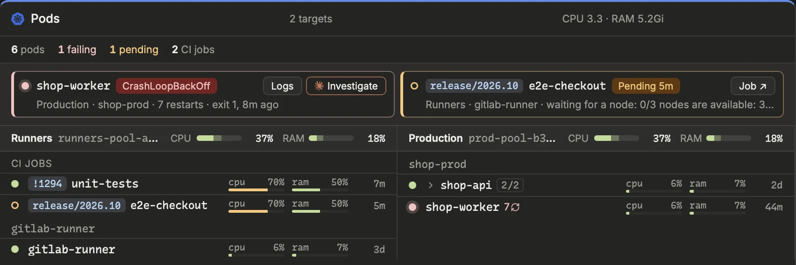

Whether the CI is getting slower or flakier, and whether your pods are healthy and the runners have room for your jobs. Plus pipeline logs, job actions and Renovate.

## Followed branches
The branch banner of the Merge requests block, the CI alerts and the header's count follow, for each repository with **Pipelines** on, its main branch and its release branches. To follow others, `develop`, `staging` or an integration branch, list them in Settings › Code › Repositories › Branches › **Branches followed**: names, patterns such as `env/*` (20 branches at most each), `@main` for the main branch whichever it is, `@release` for the release prefix's branches. The banner shows them in that order; below the field, what the forge has for them, a name with no such branch flagged. Settings › Code › Forge › Branches followed gives the list of every repository that names none.

## CI health

The **CI health** block (on by default; Settings › Code › Forge › CI health) has tabs that pick the pipelines: `main`, `release/*` or MRs. On GitHub, a pipeline is a GitHub Actions workflow run: those of pushes to the branch, and of pull requests. Four figures cover the last 7 days against the previous 7, each with a small trend curve over the whole window:

- **Pipeline p50**: the median pipeline duration.
- **Success**: the share of pipelines that passed.
- **Wait for runner**: how long jobs wait for a runner, with its p90.
- **Pipelines**: how many ran, and the daily average.

Under them, **Slowest jobs** shows each job's median duration and its change versus the previous week. **Flaky jobs** lists jobs that failed, then passed on retry in the same pipeline: how often, when last, a **log** link to the last failed attempt, and **Analyse**.

**Analyse** opens a Claude session in the repository that reads the job's last failures and proposes a fix. `⇧`-click launches it at once.

The window is `[forge] ci_health_days` (Settings › Code › Forge).

## Pods and nodes

The **Pods** block watches the pods of the targets of Settings › Infra › Kubernetes › Pods: each a cluster (a kube context) and its namespaces, named or matched by a pattern (`app-*`, `*-prod`; none: the whole cluster). The title shows the CPU and memory they use; the line below counts the pods, those failing, those pending and the CI jobs.

**What needs a look** comes first, whatever the target: each failing or pending pod gets a card with its status and why: its restarts and last exit (`exit 1`, `OOMKilled`, and when), or for a pending pod the scheduler's reason (`Insufficient cpu`). Its buttons open the pod's **Logs** (before its last restart when it crashed), its CI **Job**, or **Investigate**, which hands the pod to an agent.

Then each target, side by side when the block is wide. Its node shares its line, with two gauges, CPU and RAM; with several nodes, each gets its own line. The faint part of a gauge is what pods have reserved (requests), the solid part what they really use. Requests are what keep a job `Pending`: a node can look idle and still have no room. Hover a gauge for the figures; a node Prism could only partly read (RBAC on nodes or pods across namespaces) says so in its tooltip. With a target over a whole cluster, only the 20 nodes hosting the most of its pods are shown.

Below, the CI jobs, then each namespace: one line per workload, its pods folded (`shop-api 2/2`: ready out of total; click to unfold them), with its restarts, CPU and RAM in % of the limit (the highest of its pods; hover for the values) and its age. A hollow amber dot is a pending pod, red a failing one. Click a pod's name to open its logs. A finished pod (a CI job's, a Job's) is hidden. Short, the block keeps the counts and what needs a look.

If a pod breaks (a runner, a job, any pod: `CrashLoopBackOff`, image not found…), a red dot appears on the icon of the page holding the Pods block (CI by default), whatever page you are on, and Alerts says so. A `Pending` pod does not trigger it: it is only waiting for room. A job waiting longer than `[alerts] pending_job_minutes` shows up in Alerts, as do CI jobs left with no runner pod in their target.

The targets are set in Settings › Infra › Kubernetes › Pods (`[[pods]]`), the default context and **Cluster access** in Settings › Infra › Kubernetes › Clusters. The former `[runners]` section is still read: its namespace is the target “Runners”.

## Pipeline logs and job actions
You can open a pipeline's logs from an MR's ⋯ menu or pane, from the `main` / `release` banner of the Merge requests block, or from a block that follows deployments. The pane lists the jobs by stage on the left and shows the chosen job's log, colors included. The most telling job is picked for you: the failed one, otherwise the running one, which is followed live.

1. Pick a job on the left.
2. Use **First error** to jump to the first error line, **End** to follow the tail.
3. Press `f` (or ⤢) for full screen, `Esc` to close.

From the same pane:

- a failed or canceled job has **Retry job**: the forge retries it alone, in one click (on GitHub, in a new attempt of its workflow run);
- a successful job has **Run again** (a staging deployment, for example), in two clicks.
- a failed job (allowed failures aside) has **Diagnose**: an agent, in plan mode in the job's repository, finds the cause and proposes a fix without changing anything; the end of the log shown goes into its prompt (`[agents] fix_log_lines`). `⇧`-click launches it at once.

In an MR's pane, the pipeline section also has pipeline retry (the failed or canceled jobs) and cancel, and, on a stage with manual jobs, a play button with their count: pick a job and start it in two clicks. On GitHub, a manual job is one waiting for a deployment's approval (a protected environment): **Approve** approves it, if you are one of its reviewers.

On GitLab, **Run pipeline** (in the pipeline section, and in the ⋯ menu's *Pipeline*) starts a new merge request pipeline for an open MR, even one without any. Its rules read the MR as it is now: a pipeline that only runs once a label is set (`$CI_MERGE_REQUEST_LABELS`) runs after you add the label, which GitLab does not do by itself. GitLab refuses it, and says so, when no job would run.

> [!NOTE]
> On GitHub, a pipeline is a commit's checks, one stage per workflow; only GitHub Actions jobs have a log here.

> Logs are read through `glab` or `gh` on demand and never stored. For a log over 512 KB, only its tail is shown.

## Renovate
The **Renovate** block (off by default: Settings › CI › Renovate, which also names the dashboard issue and the schedule) shows the Dependency Dashboard: its items by section (awaiting approval, open MRs…), with the packages concerned, and a **Dashboard** link to the issue.

- Tick an item's box (two clicks) to check it in the dashboard: Renovate acts on it at its next run. You cannot tick during a run.
- An MR reference (`!12`, `#12` on GitHub) filters the dashboard on that MR; the arrow opens it.
- The **Schedule** line shows the state of the last pipeline of the Renovate schedule (the first one naming Renovate, unless Settings › CI › Renovate names it). **Run now** (two clicks) starts it.
- On GitHub, it is the Renovate **Workflow** (its last run; **Run now** dispatches it, which needs `workflow_dispatch` in the workflow), or, for the Renovate **App**, **Run now** ticks the dashboard's box asking it to run again.

[Open the CI health block](prism:block/ci)
[Open the Pods block](prism:block/pods)
