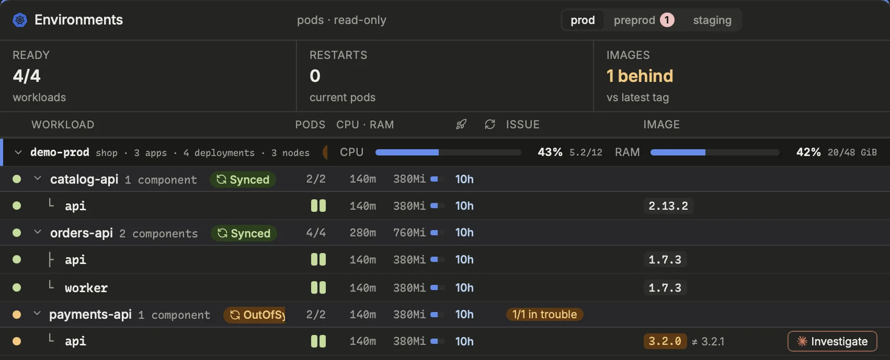
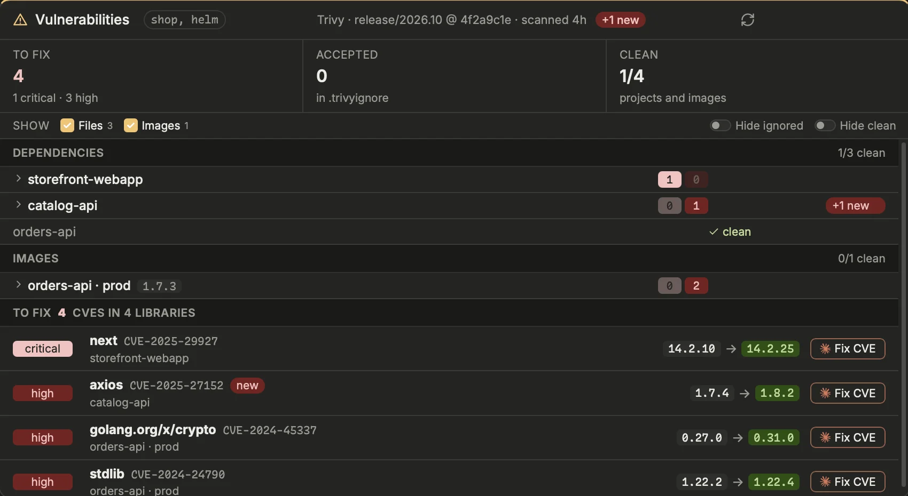
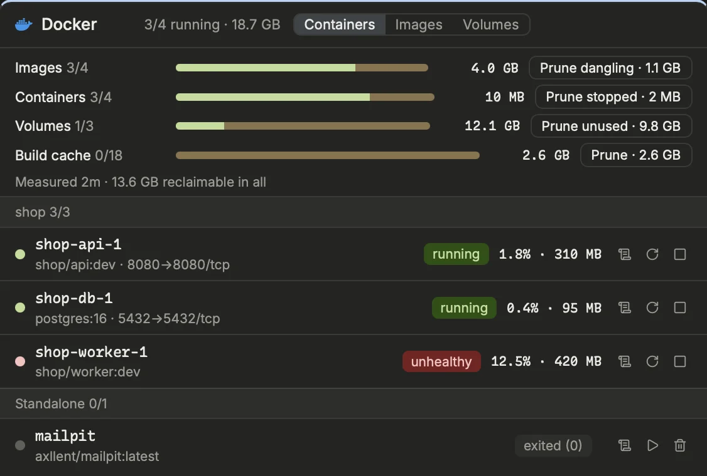

Are the deployed applications healthy and running the version you expect, and which known vulnerabilities ship with what you build? From both blocks, a Claude session can take over the diagnosis or the fix.

## The Environments block

The **Environments** block reads your Kubernetes clusters, read-only, every 30 seconds. Its tabs, one per environment (`[[environments]]`: **prod**, **staging**…), each carry a red count when workloads are in trouble.

At the top of a tab, three figures:

- **Ready**: workloads with all their pods ready, out of the total. It also flags namespaces Prism could not read.
- **Restarts**: restarts of the current pods.
- **Images**: where a block of your team gives the expected versions (`[clusters] stages`), how many workloads are behind the latest tag of their stage. The branch stage (staging) runs builds of a branch, so there is nothing to compare.

Below, a header names the columns (drag a header's right edge to resize its column), then workloads are grouped by cluster, with its CPU and RAM load, then by application. An application row sums its components (ready pods, resources, last rollout, restarts) and says how many are in trouble; click it to show or hide them. A click on a cluster's row folds its applications the same way: folded, it still says how many components are in trouble. Both are remembered.

Each component shows its ready pods, restarts, the waiting reason or last exit (`OOMKilled`, `CrashLoopBackOff`…), and its running image tag. A component behind the expected tag shows `≠` and the tag it should run.

## ArgoCD
When ArgoCD manages an application, a badge on its row gives the sync and health state: **Synced**, **Syncing**, **Sync failed**, or the health when not healthy. Hovering shows the revision and last sync; a click opens the application in ArgoCD when its web URL is configured. Each cluster line also sums up its applications (`3 synced`, or `1/3 not synced`).

An application out of sync longer than `[alerts] argo_out_of_sync_minutes` shows up in Alerts.

A click on an ArgoCD pill opens the **sync view**; a cluster's ArgoCD summary does too, or points out the ArgoCD block when the page shows it: the Applications of that cluster's instances, those failing or syncing first, and for the chosen one its last operation (phase, when it started and how long it took, auto-sync or started by hand, message), the resources of that sync with their result (a failed hook shows), the resources out of sync or unhealthy now, and its last deployments. While a sync runs, ArgoCD is read every 5 seconds instead of 30. ⌘-click on a pill still opens the Application in ArgoCD.

## The ArgoCD block
Where Environments shows ArgoCD beside each workload, the **ArgoCD** block (+ Block › Infra) looks at ArgoCD itself, for every Application its instances manage: the platform's and the add-ons' that no pipeline ships, and the customers' instances in a tab of their own (the groups of the Helm paths, `[argocd_layout]`).

- On top, **Synced**, **Healthy**, **Failed syncs** and **Drift** (Applications off Git, and how many resources).
- **Need a look**: a failed sync, a degraded or missing Application, one out of sync or syncing, the worst first. Under each, why: the resources of its last sync that failed (a hook, a resource refused), and those changed outside Git or unhealthy now. **Investigate** opens a Claude session when the Application lands in an environment of `[[environments]]` (ArgoCD does not say which cluster it deploys to).
- **Synced and healthy**: the others, as a wall of names by environment (production first).
- **Sync operations**: the last operation of each Application over 24 hours, whatever started it (an auto-sync, a change of config, a sync by hand), with its result and how long it took.

A click on any of them opens the sync view. The block only reads: it never syncs nor refreshes. It shows no versions nor what waits to ship: that is a delivery block's.

## Pod logs
Click a component's name, or its **Logs** button, to open its logs in a side pane: its pods on the left, the log of the chosen container on the right, following live.

1. Pick a pod, and a container if it has several.
2. After a crash, switch from **Current** to **Previous** to read the log before the last restart.
3. The pane shows the log's last 2,000 lines. Scroll to the top (or click **Older lines**) to read further back, 10,000 then 50,000 lines, then up to the container's start (200,000 lines or 48 MB at most).
4. Type in **Filter lines…** to keep only matching lines; **First error** jumps to the first error line, **End** follows the tail.
5. Press `f` for full screen, `Esc` to close.

### A shell in the pod
**Shell** in the pane's header opens a terminal inside the chosen container (`kubectl exec`, bash if the image has it, sh otherwise), with the rights of your kubeconfig. Like a worktree's shells, tmux keeps it: closing the drawer only detaches it, `exit` or × ends it, **+** opens another. If kubectl fails (no rights, no shell in the image), its message stays on screen until Enter. Back later: **N shells** in the status bar lists the shells still open, and `⌘⇧T` reopens the drawer closed last (see Keyboard). Turn it off with **Shell in a pod** in Settings › Infra › Clusters; it is never offered on a phone.

### CPU and memory over time
**Usage** in the pane's header shows, above the log, the chosen pod's CPU and memory over 1 h, 6 h, 24 h or 7 days: one chart each, its limit (the sum of its containers' limits, or of their requests) dashed across when near, written below anyway. Hover a chart to read a moment in both. On a GKE cluster (its context `gke_<project>_<location>_<cluster>`), the history comes from Google Cloud Monitoring (Google Managed Prometheus, cAdvisor's metrics), for any pod, an environment's too; it uses gcloud's login and needs the `monitoring.viewer` role on the project. Elsewhere, Prism keeps the readings of the Pods block's pods itself, every 15 s for 6 hours, from when it started. A phone shows it too, for a pod of the Pods or Environments block. Turn them off with **Pod usage over time** and **Google Managed Prometheus** in Settings › Infra › Clusters.

## Investigate with Claude
A component in trouble gets an **Investigate** button. It opens a Claude session in the repository, given the workload, its namespace, context and the problem seen. Claude diagnoses with `kubectl` (describe, previous logs, namespace events) without changing anything in the cluster, then explains the cause and proposes a fix in the code or the config. `⇧`-click launches it at once.

> [!NOTE]
> Prism never writes to a cluster. It only needs read access to pods and deployments in the listed namespaces.

## The Changes block
Since yesterday, what changed on staging? The Changes block puts on one timeline what touched an environment: Argo CD syncs (their revision, the MR that brought it, the images deployed), MRs merged into the branch that feeds it (`[changes] branches`), pods rolling out, restarting, in CrashLoop or OOMKilled, alerts appearing and going, vulnerabilities new or gone, and what the blocks of a pack add.

- The band at the top: a lane per source, a mark per change; the ranges Prism was closed are hatched. Drag on it to zoom on a range.
- The list below, by hour, newest first: repeats fold (a pod restarting 6 times in 4 min is one line). A time marked *seen* is when Prism saw it: alerts and vulnerabilities give no date of their own.
- A crash shows the sync or rollout of the same application just before it (`[changes] correlate_minutes`) as *probably linked*: a guess on time and name, never a certain cause. **Diagnose** sends an agent in plan mode with the application's timeline, to read its logs, its events and the diff of that change.
- **Compare** puts two environments on the same axis, staging above prod (`[changes] compare`, otherwise the one shown and the next in the roles' order dev → staging → preprod → prod; click an environment to compare with it, ⇄ swaps). The same revision or MR on both is joined with its delay; otherwise the same application with the same image (`api:2.15.0`), dashed. A line is red when the change had crashed on the first, and the second's line says so. *Waiting on prod* lists what went on the first and not yet on the second, each with whether it crashed there. The two lists side by side; narrow, one at a time.
- **What changed**, in a pod's logs, on an Argo CD crash alert and in the Argo CD panel of a Degraded application, opens it around the first crash. ⌘K: *Changes staging*. Copy gives the range as Markdown, for a post-mortem.

Prism keeps the transitions in a journal (`changes.jsonl` in the profile's data folder, `retention_days`). The Kubernetes events (`kube_events`) are off by default: the cluster keeps them an hour, and they need the right to list events.

## Setting up the clusters
Environments are listed in Settings › Infra › Kubernetes › Environments (`[[environments]]`): one row per environment and cluster, with **Env** (prod, demo, staging, or a name of your own such as `ops`: each name is a tab of the block, those of no stage last), **Kube context** and **Namespaces** (`*` matches any characters: `*` reads every namespace of the cluster, `app-*` those starting with `app-`; none: nothing is read). ArgoCD instances go in Settings › Infra › Kubernetes › ArgoCD (`[[argocd]]`): namespace, kube context, web URL, and the environments each is authoritative for. Without any, Prism looks in the `argocd*` namespaces of the default context's cluster (Settings › Infra › Kubernetes › Clusters).

> [!TIP]
> No rights on the clusters? Turn off **Cluster access** (`[clusters] enabled`) in Settings › Infra › Kubernetes › Clusters: pods, environments and ArgoCD are then not read at all, and Alerts shows no access error.

[Open Settings › Infra › Kubernetes › Environments](prism:settings/envs)

## The Vulnerabilities block

The **Vulnerabilities** block (off by default: Settings › Security › Vulnerabilities; it needs `trivy`) runs a local Trivy scan, as CI would see it today: HIGH and CRITICAL findings that have a fix, with each project's `.trivyignore` applied. Its title shows the branch and commit scanned and when. It scans once a day; the ↻ button scans again now. A **+N new** badge counts findings new since the previous scan.

Three figures sum it up: **To fix** (critical and high), **Accepted** (in a `.trivyignore`) and **Clean** (projects and images with nothing to report).

Three groups are scanned, each with its checkbox under **Show**:

- **Files**: the dependencies of the main branch (lockfiles, manifests), the repository as a whole, or each `project.json` project of `[vulnerabilities] components` apart (an Nx monorepo). `[vulnerabilities] branches = ["release", "main"]` scans the latest release branch too: each project then has a line per branch (`cart-api · release`, `cart-api · main`), and the title names both branches.
- **Images**: the images a block of your team names (`[vulnerabilities] images`), its own settings saying which and where they are.
- **Base**: the base images that block names too, built from another repository (a Dockerfile per image), scanned with their `.trivyignore`.

**Hide ignored** hides accepted findings everywhere; **Hide clean** hides projects and images with nothing to report. Click a project to see its own findings. Each finding gives the package, the CVE (linked), the installed version and the version that fixes it.

## Fixing a CVE
**Fix CVE**, on a finding, opens a Claude session that fixes it (your team's skill if it has one): it finds the dependency in every project, updates it and checks again, in a new worktree. When every affected target is a base image of another repository, the session starts in that repository instead, to fix its Dockerfile.

1. Find the package under **To fix**.
2. Click **Fix CVE** (or `⇧`-click to launch at once).
3. Review the change Claude proposes, then use ↻ to scan again.

On GitHub, the open **Dependabot** alerts of the repository, high and critical, are a target of their own, next to Trivy's: the version range concerned stands for the installed version, and each finding links to its alert.

[Open the Vulnerabilities block](prism:block/vulns)
[Open Settings › Security › Vulnerabilities](prism:settings/vulns)

## Docker

The **Docker** block shows the local Docker daemon (Docker Desktop, OrbStack, colima…), read through the `docker` CLI of the current context, or of `[docker] context`. Turn it on in Settings › Infra › Docker, then add the block to a page.

At the top, the disk per kind: images, containers, volumes and build cache, each with its active and total count and its size; the orange part of a bar is what Docker could free. Each kind with something to free has its prune button, in two clicks: **Prune dangling** removes the untagged images no container uses, **Prune stopped** the stopped containers, **Prune unused** every volume no container uses (named ones included: their data is lost), **Prune** the build cache. The disk is measured every 3 minutes and right after an action.

Below, three tabs:
- **Containers**, by Compose project: state and health, ports, CPU and memory. **Log** opens the log drawer with the project's containers on the left; a running container restarts or stops (two clicks), a stopped one starts or goes (two clicks).
- **Images**, largest first: the size that is the image's own (what removing it frees) and the containers using it. An unused one can be removed.
- **Volumes**, largest first, unused ones flagged.

Alerts flags a container unhealthy, restarting or exited with an error (a stop's 137 and 143 are not), Docker not answering, and reclaimable data beyond `[docker] reclaimable_gb` (10 GB by default; 0 turns it off).

[Open the Docker block](prism:block/docker)
[Open Settings › Infra › Docker](prism:settings/docker)

## System
The **System** block shows what the computer has under its feet while the agents, the dev servers and Docker run. It is on by default (Settings › Infra › System); add it to a page.

- **CPU**, **Memory** and **Network**, each with its last 10 minutes. The memory's colour is macOS's memory pressure: green, orange when it compresses, red when it swaps; the bar splits what apps, the system (wired) and the compressor hold.
- **Disk**: the free space of the disk your home folder is on — orange under 10 % or 25 GB, red under 5 % or 10 GB, limits set in Settings › Infra › System (`[system] disk_warn_gb`, `disk_warn_percent`, `disk_alert_gb`, `disk_alert_percent`; 0 turns one off) — and, under **Disks**, the external volumes plugged in. On macOS it is what a file can still take: the Finder adds the space the system could purge. To see where the space goes, the Disk usage block below scans a folder.
- **Who consumes**, grouped by what Prism knows: its agents (their processes under tmux), Docker (its virtual machine), the shells and dev servers, Prism itself, then the three heaviest other applications, their helpers counted with them. CPU is in % of one core, summed.
- **Network**: the latency of a TCP handshake to the services Prism calls (its forge, its tracker, its agents' API, and `[system] hosts`), every 15 s, with each host's last handshakes; the loss and jitter over 5 minutes, the default gateway, the traffic, and the Wi-Fi link's signal and rate (never the network's name).

In the status bar: CPU with its last minutes, RAM and latency; a click shows the block. Alerts flags the memory pressure red and the disk almost full (both with a notification), the disk getting full, the CPU at 90 % or more for 5 minutes, and more than 5 % of the handshakes lost (`[system] alerts`).

On the phone, **System** is one of the remote's views (under **More**, or a bottom tab with `[remote] tabs`): the gauges two by two, then who consumes, the disks and the network. The block takes that layout too in a narrow column on the computer.

[Open the System block](prism:block/system)
[Open Settings › Infra › System](prism:settings/system)

## Disk usage
The **Disk usage** block shows where the space of a folder or of the whole disk goes, scanned on demand: nothing is read until you scan, nothing is watched between two scans. It is on by default (Settings › Infra › Disk usage); add it to a page.

- **Scan**: pick a folder of `[disk_usage] roots` (the home folder `~`, the whole disk `/`…) or **Choose…** any other, then **Scan**; **Rescan** reads it again, **Stop** ends a scan at once. The block stays on the folder's disk (`[disk_usage] one_volume`): other disks and network shares mounted inside it are left out, and so are folders kept in the cloud only (iCloud Drive, OneDrive…), which take no space. On macOS the system may ask once whether Prism can read Documents, Desktop, Downloads or Photos: the scan waits for your answer (Full Disk Access avoids it).
- **The list**, on the left: the folders by size, opened one level at a time with ▸, their share and **Δ**, how much each grew or shrank since the scan before (`[disk_usage] delta`). Git repositories and worktrees are marked.
- **The treemap**, on the right: each folder a rectangle of its size, three levels deep, colored by type (build, cache, VMs, media, models, archives…) or by folder.
- A click selects (its path and size below, with its actions), a double click opens a folder, the path above goes back up; a right click gives the actions: show it in the file manager, a terminal there, copy its path, scan it alone, move it to the Trash (two clicks).
- **Reclaimable**: what can be rebuilt, found by its name — `node_modules`, Rust `target/`, `.venv`, `.next` and other JavaScript builds, `.terraform`, CocoaPods, Xcode's DerivedData, the caches, the iOS simulators no Xcode can run, Docker's disk image, the Trash. Each group shows how it is freed and goes in two clicks; **Show** finds its biggest one. Turn `[disk_usage] cleanup` off for a block that only reads.

Sizes are what the files take on the disk (a sparse disk image counts what it holds, a hard link once). The last scan of each folder is kept in Prism's data folder: Δ compares with it, and the block shows it again after a restart, coarser (small folders summed into their parent) until the next scan.

[Open the Disk usage block](prism:block/disk_usage)
[Open Settings › Infra › Disk usage](prism:settings/disk_usage)
