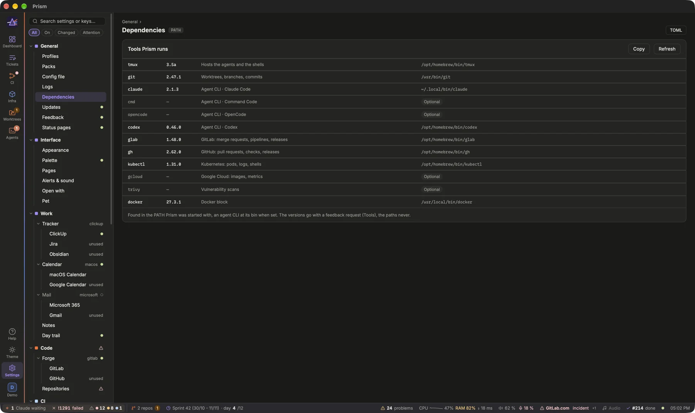

Every Prism setting lives in one file, `~/.config/prism/config.toml`, and the **Settings** view mirrors it field by field. Change a value in either place: it is the same setting.

## Opening Settings

Press `⌘,`. `Esc` closes the view.

The left column is a tree of pages, sorted by what they configure:
- **General**: Profiles, Packs, Config file, Logs, Dependencies, Updates, Feedback.
- **Interface**: Appearance, Pages, Alerts & sound, Open with.
- **Work**: Tracker (with ClickUp, Jira and Obsidian under it), Calendar, Mail, Notes.
- **Code**: Forge (with GitLab and GitHub under it), Repositories.
- **CI**: Renovate, and the pages of a team's blocks, if any.
- **Security**: Vulnerabilities.
- **Agents**: Agent (with Claude Code, Command Code, OpenCode and Codex under it), Console.
- **Infra**: Kubernetes (with Pods and ArgoCD under it), Docker, Data (GCP), and the pages of a team's blocks, if any.

Wherever there are several providers, the feature's page holds what they share and the choice, and each provider has its own page with only its own keys: Forge holds `[forge]`, Forge › GitLab `[gitlab]` (host, merge queue label); Agent holds `[agents]`, and each CLI its `[agents.<cli>]` (**Binary** and **Extra arguments**, added to every launch and resume; Claude Code also its Claude Desktop sessions, cost alert and plan usage token). A page can gather several tables of the file: Repositories holds `[[workspaces]]`, `[[repos]]` and `[worktrees]`, and a page made of several stages can show them as tabs. The tables of a page are listed next to its title, and each part of the page names its own. The caret folds a branch; with the tree focused, `←` and `→` fold and unfold the current page.

A feature that can be switched off (Docker, Vulnerabilities, ClickUp…) has its switch in the page header, and a dot in the tree: filled when on, hollow when off. A provider other than the chosen one reads **unused** (an agent CLI that a repository runs, **N repos**); its page stays editable, its keys apply once it is chosen.

The **Search settings or keys…** box filters the tree by page name, table (`[gitlab]`, `[[repos]]`) or key (`merge_queue_label`). **On**, **Changed** and **Attention** show only the features switched on, the pages with unsaved changes, or those where a check failed.

[Open Settings](prism:settings/appearance)

## Reading a field
Each field shows its label, a short explanation and its key in the file. Two badges tell you when a change takes effect:
- **applies now**: applied as soon as you save.
- **restart**: read at launch, applied at the next start of Prism.

A folder (a repository's clone, the worktrees folder, the Obsidian vault…) can be typed, or chosen with the folder button next to it, which opens the system's picker; a folder in your home is written `~/…`. Under **Packs**, **Choose…** picks a pack file to import the same way.

On the right, **default** means the key is not in your file and the built-in value applies. Once you set it, **Reset to default** removes the key again. A changed field is highlighted until you save.

Some values are checked live: a repository's project on the forge, a kube context, a repository path, a folder, your gcloud login. The verdict appears next to the field, with a tick or a warning, and **Check again** runs the checks once more. For a source (the forge, ClickUp, Worktrees…), the top of the section also says whether it was **Read correctly with the current config** or why the last read failed.

> [!TIP]
> A warning icon next to a page in the tree means a check failed there, or that source could not be read. A dot means unsaved changes.

## Saving
Changes are not written until you save.

1. Edit as many fields as you like, in any section. A bar at the bottom counts the unsaved changes.
2. Press `⌘S` or click **Save to config.toml**. **Discard** drops them instead.
3. If a saved setting is read at launch, the bar names the sections concerned and offers **Restart Prism**.

After editing `config.toml` by hand, `restart` in the console, or `prism restart` in a terminal, restarts Prism so that it rereads it.

The **TOML** button shows the file next to the settings, with what saving would write. Saving rewrites only the keys you changed: your comments, the order and the layout of the file are kept, and the previous version is copied to `config.toml.bak`.

With packs, a menu at the top of that panel switches between three views:
- **config.toml**: your file, with what saving would write.
- **Pack <name>**: the pack's file as imported in `packs/`, read-only (**Update** in Settings › General › Packs reads it again).
- **Merged**: the packs, then your file on top, as Prism combines them: tables key by key, `[[repos]]` by name, anything else replaced; the pack's `[pack]` header and the sections a pack may not set are left out. Unsaved changes show in it, highlighted. The built-in defaults are not shown.

> [!NOTE]
> Settings that apply on save include Appearance, Console, Notes, Alerts, Pages, Agents, the worktree stale delay and the ClickUp workflow statuses. Most source settings (the forge, ClickUp lists, Runners, Data…) wait for a restart.

## From the phone
With **Settings** on in Settings › Remote › Exposure (`[remote] settings`, off by default), the remote has **More › Settings**: the same tree, every value read, tokens never (they stay in the keychain). A few keys change from there, marked *editable*: the notifications (digest, digest times, what still notifies at once, quiet hours, focus events), the alert thresholds, and the appearance (theme, density, animations, tooltips, screensaver). **Save** shows what will change, then asks for the phone's passkey, every time; the Mac checks each key again before writing config.toml, and logs which phone changed what. Anything that runs a program, lets someone in or decides what Prism reads (agents, dev servers, updates, packs, profiles, the remote itself) is changed on the Mac only.

**New projects from the phone.** Add your **Working folders** in Settings › Code › Repositories (`[[workspaces]]`), one per kind of project — say *Work* in `~/Development` with your company's group, *Personal* in `~/Perso` with none (your own account) and its own **Forge**, GitHub while the profile is on GitLab. A working folder's projects are cloned from, created and published on its forge (glab or gh, logged in on the Mac); a project on another forge than the profile's is written with `forge = "github"` in `[[repos]]`: the Repos menu links to it there, and its MRs join the same block, read with that forge's tool and login; its pipelines are not followed. New project and Clone a project offer them on the Mac (the first by default; a click on one sets the folder, the group and the forge), and the remote gets **More › New project** (`[remote] projects`, on by default, Settings › Remote › Exposure). The phone picks one of the working folders and gives the name, its group prefilled: the Mac creates the folder there and nowhere else, with a git repository on the main branch, a README.md and a first commit, and on request the project on GitLab or GitHub (glab or gh, the Mac's login), set as origin and pushed. Your passkey is asked every time, and the Mac logs which phone created what. The project is added to `[[repos]]` in config.toml, with worktrees on; it shows in the repositories once Prism restarts (**More › Restart Prism**). A project created without the forge stays local as long as you like: **Kept local**, under the form, lists the repositories with a clone and no project (the one just created included), and **Publish** creates its project on the forge (the group of its working folder offered), named after its folder, sets it as origin and pushes its current branch, with your passkey; its `project` is written in config.toml. On the Mac, **Publish on GitLab…** (or GitHub) in Settings › Code › Repositories, the **Publish…** button of a repository without a project in the Repos menu, or the palette's *Publish a local project* do the same. A repository that has a remote already is not published: give its Project instead. Without a working folder, the phone creates nothing. [Open Settings › Code › Repositories](prism:settings/repos)

**Several profiles, one phone.** Each profile is its own Prism; open them side by side and the phone reaches them all through one of them. The profile whose remote has the tunnel (tailscale or other) is the hub: the phone is paired with it, unlocks with it, and its notifications come from it. In each other profile, set Settings › Remote › Access › **Tunnel** to **relay** (`[remote] tunnel = "relay"`, `enabled = true`): its Prism listens on 127.0.0.1 only, on a free port it tells the hub with a secret (`remote/endpoint.json` in its data folder, readable by you only), and the phone reaches it at `/p/<profile>/` of the hub's address. The hub checks the session and your passkey; each profile keeps its own rights (Exposure: actions, critical, typing…). On the phone, the header gets the profile switcher: **All** shows the agents waiting in every profile on Home, each with its profile's badge and its quick answers, a card per profile, and Agents grouped by profile; the other views are the hub's. A profile chosen shows alone, its own tabs, the header's line and the tab shown in its color; a new agent starts there. A closed profile has **Open**: its Prism starts on the Mac beside the hub's, with your passkey. An agent waiting in any profile wakes the phone, the notification naming the profile and the agent, and a tap opens it there. With the hub's Prism closed, no profile is reached from the phone.

## The Config file page
**Settings › General › Config file** shows the path of the file, with **Reveal in Finder**, **Open in editor** and **Reload** (read the file again after editing it by hand). You can always edit `config.toml` directly: it is the source of truth. If the file does not load, Prism still opens, and the error shows in **Alerts** and in Settings.

[Open Settings › General › Config file](prism:settings/file)

## Logs, to troubleshoot
When a source does not read and its message is not enough, look at the logs. Prism writes them to a file of the profile, besides standard error: `~/Library/Logs/app.prism.desktop/prism.log` on macOS (a profile other than the default one in `profiles/<id>` inside), `~/.local/state/app.prism.desktop/` on Linux. **Settings › General › Logs** shows the path, with **Reveal in Finder**, **Open**, **Copy last 300 lines** (to paste into a report) and **Show last lines**. **Level** (`[logs] level`, read at launch) is `info` by default: set `debug`, restart, reproduce the problem, copy the lines, then set it back. The file never holds a token nor a message's content; it is rotated at 5 MB.

[Open Settings › General › Logs](prism:settings/logs)

## Problems
What Prism could not do no longer stays in the log: **Problems**, on the right of the status bar, counts what fails now and what failed since you last opened it, in red when one of them is an error. A click lists them: **Failing now** (a source that does not read, the config or a pack that does not load, a pack's or the updates' source out of reach), each with **Settings** to where it is fixed, then **Lately** (the last warnings and errors of the core, a repeated one counted, and the actions that failed, with their age). **Copy** puts them all on the clipboard, for an issue or a message; **Clear** forgets what failed lately (what fails now stays); **Log** opens Settings › General › Logs. The palette's *Problems* opens the list too. It stays on the Mac: the phone never sees it.

## Dependencies
**Settings › General › Dependencies** lists the tools Prism runs — `tmux`, `git`, the agent CLIs (`claude`, `cmd`, `opencode`, `codex`, each at its **Binary** when set), `glab`, `gh`, `kubectl`, `gcloud`, `trivy`, `docker`, and on Linux the audio helpers (`pactl`, `playerctl`) — with the version each one gives, where it was found in the PATH, and what Prism runs it for. A tool your config needs (tmux and git, the agent CLI and the forge's chosen, kubectl with Kubernetes on, trivy with Vulnerabilities on) and that is missing reads **Not found**, with how to install it; the others, **Optional**. **Copy** puts the list on the clipboard for a report; **Refresh** asks each tool its version again (the answer is otherwise kept 10 minutes, after installing or updating one). The versions also go with a feedback request (the **Tools** line), never the paths.

[Open Settings › General › Dependencies](prism:settings/dependencies)

## Updates
**Settings › General › Updates** shows this Prism's version and the newest release of its source (`[updates] source`: `glab:group/project` or `gh:owner/repo`, read with glab or gh). Your team's pack usually sets it: its builds carry the team's blocks, the open-source Prism has its own. Prism checks at launch and every 6 hours (**Check for updates**); a newer one shows in the status bar. **Install** (click twice) replaces Prism and restarts it on macOS and from an AppImage; with a `.deb` or an Arch package, it downloads the package for `sudo apt install` or `sudo pacman -U`.

[Open Settings › General › Updates](prism:settings/updates)

## Feedback
**Send feedback** opens an issue on the repository Prism comes from (`[feedback] repo`, or else `[updates] source`) or on a pack's (the repository it was imported from), with glab or gh: the access you already have, no token. Open it from the console (`feedback`), **Help › Send Feedback…**, the status bar, a block's **?** (*Suggest something for this block…*) or **More** on the phone.

The composer shows the issues that look like yours (a 👍 rather than a duplicate) and exactly what goes with it, each line off-able: Prism's version, where it was opened from, the packs and the versions of the tools it runs (**Tools**, as Settings › General › Dependencies lists them, a needed one missing named so), ticked; the theme and the last errors of the log (paths, addresses and emails stripped), not ticked. A **capture of the window** (macOS and Linux: spectacle, grim, scrot or import — the composer says when none is there), shown in the composer, is uploaded with the issue on GitLab and GitHub; on both it is also on the clipboard, to paste into a comment. Nothing of the config, the tickets or the mail is ever sent. **Preview** shows the issue as the forge will. **Draft with an agent** asks an agent to read the code, look for a duplicate and write the draft, which comes back into the composer: the agent never opens the issue. When glab or gh cannot open it, the forge's new issue page opens filled in. A draft is kept until it is sent.

**Settings › General › Feedback** lists where feedback goes and the issues opened from Prism. With **Follow my requests**, their state is read again with the updates: a closed one shows in the status bar, and a release whose notes name it (`#214`) says *Brings your request* in Updates. **Labels** gives each kind (Feature, Bug, Idea) its label.

[Open Settings › General › Feedback](prism:settings/feedback)

## Cleanup
**Settings › Cleanup**, last in the tree, says what you really use. Prism counts on this machine how much each feature is used — a block when a page showing it comes up, an agent action when it runs, a palette entry when it is chosen, the Agents view, a quick answer, a thread, a page swipe — in the profile's `usage.json`: nothing leaves the machine. Once the counts cover 30 days (the page says how many until then), **On, never used** lists the features switched on that nothing used over the last 30 days: **Turn off** writes their switch off like any field (saved with `⌘S`), **Keep** (click twice) takes the line off for good. **Most used** lists what you use most, and **Different from default** the keys your `config.toml` sets to another value than their default, each with **Reset** (the pack's value, else the default, applies), the rest in the **TOML** panel. **Hide turned-off features in Settings** (`[cleanup] hide_off`) takes the features switched off out of the tree; a search still finds them.

[Open Settings › Cleanup](prism:settings/cleanup)

## Tooltips
Prism shows its own tooltips, in the theme's colours, with shortcuts as keys (`Only mine` `m`). Under **Settings › Interface › Appearance**, **Tooltips** sets the delay before one shows (moving to the next one shows it at once), or switches back to the system's.

## Where the alert thresholds live
Every threshold behind an **Alerts** line or a badge is in **Settings › Interface › Alerts & sound** (`[alerts]`), one per rule: a branch behind its base, a job waiting for a runner, a review waiting for you, an idle ticket, a Claude session waiting, ArgoCD out of sync, the meeting reminder, a worktree in use, the data pipeline thresholds and the large MR size. They all apply as soon as you save.

[Open Settings › Interface › Alerts & sound](prism:settings/alerts)

## Claude usage and the status bar
The status bar along the bottom of the window, its zones and how to arrange it are in [Pages, blocks and layout](prism:help/pages).

The **Claude usage** block shows your plan's 5-hour window and week, with the reset time. It uses the token Claude Code keeps in the system keychain. When that token has expired, **Settings › Agents › Agent › Claude Code › Refresh the token** (`[agents.claude] refresh_token`, on by default) lets Prism run `claude doctor`, which renews it without calling the model, at most every 15 minutes.
