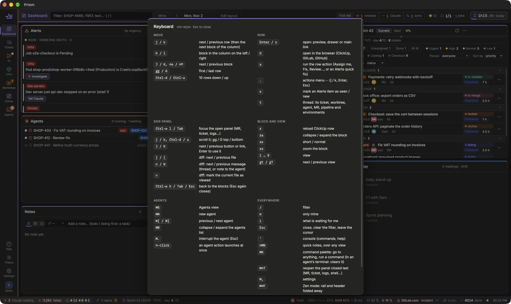
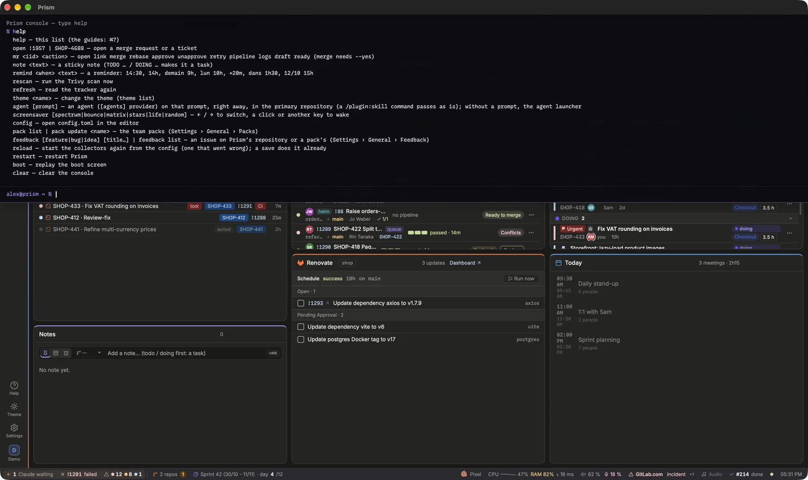

Prism can be driven entirely from the keyboard, vim-style, and its console runs commands by name. Press `?` at any time to see every shortcut on one screen.

On Linux and Windows, Ctrl takes the place of the Mac's Command key, and Ctrl+Shift inside an agent's terminal, where Ctrl goes to Claude.

## Moving around

A cursor marks the active block and the current row in it.
- `j` / `k` (or ↓ / ↑) go to the next / previous row; at the end of a block, they continue into the next block of the column.
- `h` / `l` (or ← / →) go to the block in the column on the left / right.
- `J` / `K` (or `⇧↓` / `⇧↑`) go to the next / previous block.
- `gg` / `G` jump to the first / last row; `Ctrl-d` / `Ctrl-u` move 10 rows down / up.

When you type a two-key command like `gg` or `za`, the first key shows at the bottom right while Prism waits for the second.

> [!NOTE]
> Shortcuts are inactive while you type in a field. They only ever click what the mouse would click: nothing happens behind your back.

## Acting on a row
- `Enter` or `o` opens the row: a preview, a side panel or its main link.
- `O` opens it in the browser (ClickUp, GitLab or GitHub).
- `a` runs the row's action: **Assign me**, **Fix**, **Review**…
- `.` opens its ⋯ menu; move with `j` / `k`, `Enter` to choose, `Esc` to leave.
- `x` marks an **Alerts** item as seen, or as new again.

## Side panel, blocks and pages
When an MR, a ticket, logs or an event is open on the right:
1. Press `Ctrl-w l` or `Tab` to move the focus into the panel.
2. Scroll with `j` / `k`, `Ctrl-d` / `Ctrl-u`, `gg` / `G`.
3. Step through its buttons and links with `J` / `K`, and press `Enter` to use one. In a diff, `]` / `[` go to the next / previous file, `n` / `N` to the next / previous message (a thread, or a note to the agent; the **Next message** button of the diff's bar does the same), and `v` marks the current file as viewed.
4. `Ctrl-w h`, `Tab` or `Esc` return to the blocks; a second `Esc` closes the panel.

On the active block: `za` collapses or expands it, `zs` switches between short and normal, `zz` zooms it, and `r` reads ClickUp again right away (the ↻ of the block).

Pages: `1` … `9` or `⌘1` … `⌘9` open a page of the rail (`⌘` alone on the digit key, Shift not needed on AZERTY, so `⌘⇧3`/`4`/`5` stay macOS's screenshots), `gt` / `gT` go to the next / previous one. The **Agents** view takes the digit after the last page (`⌘6` with five pages), and `⌘N` starts a new agent.

## Keys that work everywhere
| Key | Effect |
|---|---|
| `/` | go to the filter; `Esc` clears it |
| `m` | only mine: my MRs and tickets |
| `i` | the **For me** panel: what is waiting for you |
| `Esc` | close, clear the filter, leave the cursor |
| `⌘,` | Settings |
| `⌘⇧F` | Zen mode: the rail and the page header fold away, the blocks get the window (also View › Zen Mode); the header comes back while you filter (`/`) or open For me (`i`) |
| `?` | the keyboard shortcuts |
| `⌘?` or `F1` | this Help |
| `Ctrl+Q` / `F11` (Linux, Windows) | quit Prism / full screen, which the Mac's menu bar does there: closing the window only minimises it |

[Show the keyboard shortcuts](prism:keys)

## The command palette
`⌘K` opens one field to go to anything Prism shows and to do anything it can. Type a part of it: a page or a block (`ci`), an agent (its title, ticket, branch or tags), an MR (`!1957`, its title, branch or author), a ticket (`4688`), a pipeline, an environment, a pod, a Settings page or key (`tooltip_delay`), a guide or one of its headings. `↑` / `↓` choose, `↵` goes there. Nothing typed: what you opened last, what waits for you (an agent asking, an MR to review), the pages.

The console's commands are there too, with their words: `note buy milk`, `remind demain 9h call Alice`, `agent fix the login test`, `theme nord`; `⇥` completes a command's name, and `↵` on one that needs words types it for you. What a command prints shows in a toast, or in the console when it is a list (`pack list`). Prism's own commands come with them: New agent, Zen mode, Edit layout, Settings, Help, Console, Full screen, Quit Prism.

Any ticket opens from there, even one Prism does not show (closed, on another board): from 3 characters, what you type is also searched in the tracker, and its tickets join the Tickets group once the typing pauses (“Searching the tracker…” meanwhile). A typed id (`ABC-123`) opens as is. ClickUp has no search: Prism reads the tickets of the followed spaces once, closed ones included, and keeps them 10 minutes; Jira searches the board's project. The switch: **Search the tracker** (`[palette] tracker_search`).

`⌘↵` opens the chosen line's actions: an MR's or a ticket's menu (approve, rebase, merge, retry, statuses, agent actions…), an agent's quick answers, Allow, Interrupt. One that cannot be undone asks for a second `↵`. `Esc` goes back, then closes.

In an agent's terminal, `⌘K` stays the terminal's: it clears it. **Keys kept by the terminal** (`[agents] terminal_keys`, Settings › Agents › Agent) lists the shortcuts a terminal keeps: `Cmd+K` by default; add `Cmd+N`, `Cmd+1`… to keep those too, remove `Cmd+K` to open the palette there. The palette also opens from **View › Command Palette…**, and on the phone from the search button. Its shortcut and its switch: Settings › Interface › Palette (`[palette]`).

[Open Settings › Interface › Palette](prism:settings/palette)

## Panels closed, shells left open
A side panel (an MR, a ticket, a pipeline's or a pod's logs, a shell, an event, ArgoCD, a thread) closes with `Esc`, × or a click outside it. `⌘⇧T` opens the one closed last again, as it was: the same pod, container and log (current or previous), the same job; what it shows is read again. With nothing typed, the palette lists the panels closed lately under **Closed lately** (the ten last, for the session), and the command **Reopen the last closed panel**.

The shells of a worktree or a pod outlive their drawer: tmux keeps them. While one is open, the status bar shows **N shells**: a click lists them (where, since when, what runs there, “kubectl exited” when the pod is gone), a line opens its drawer again, × closes its shells (click twice). The palette lists them too, under **Open shells**.

To keep a panel open while you click elsewhere, turn on **Pin side panes** (`[appearance] pin_drawers`, Settings › Interface › Appearance): a pin in each panel's header; pinned, only × (or `Esc`) closes it. The pin is remembered per kind of panel.

## The console

The console drops down from the top of the window. Its key is `` ` `` by default (`[console] key`); press it again or `Esc` to close it.

Type `help` to list the commands. The console is for actions and power use; moving around is the keyboard's job (pages, zoom, filter, only mine, Settings, Help: see above). The commands:
- `open !1957` or `open ABC-4688`: open a merge request or a ticket.
- `mr <iid> <action>`: `open`, `link`, `merge --yes`, `rebase`, `approve`, `unapprove`, `retry`, `pipeline` (a new one, GitLab), `logs`, `draft`, `ready`, with the same checks as the MR menu. `helm!214` names an MR of another repository.
- `note <text>` adds a sticky note (`TODO …` makes it a task); `remind <when> <text>` a reminder (`remind demain 9h call Alice`, `remind +20m stand-up`).
- `refresh` reads ClickUp again; `rescan` runs the Trivy scan now.
- `agent <prompt>` starts an agent on that prompt right away (`agent refine ABC-4661`); `agent` alone opens the agent launcher.
- `feedback [feature|bug|idea] [title…]` opens the feedback composer, `feedback list` the requests opened from Prism.
- `theme <name>` (`theme list` for the names), `config` (config.toml in the editor), `pack list` / `pack update <name>`, `restart`, `boot`, `screensaver [mode]`, `clear`.

`Tab` completes a command and its arguments; `Ctrl+L` clears the screen, as in a terminal. `↑` / `↓` browse the history, kept between launches (`[console] history`, 50 lines by default).

[Open the console](prism:console)

> [!TIP]
> On an AZERTY keyboard, `` ` `` is a dead key. Pick `Backquote` (the key left of 1) or a combination like `Cmd+K` in **Settings › Agents › Console**. With a Cmd or Ctrl modifier, the shortcut works even while you type in a field.

## Aliases and quick notes
**Aliases** are your own short commands, expanded before running. In **Settings › Agents › Console › Aliases**, map `r` to `agent review`, and `r !1957` runs `agent review !1957`. They appear in `help` and in completion.

The **quick notes** open over any view with `⌘⇧N` (`[notes] key`). `Enter` saves the note and keeps the box open for the next one; `Esc` closes it. Both shortcuts accept a character, a key name like `Backquote`, or a combination; record a new one in Settings.

[Open Settings › Agents › Console](prism:settings/console)
