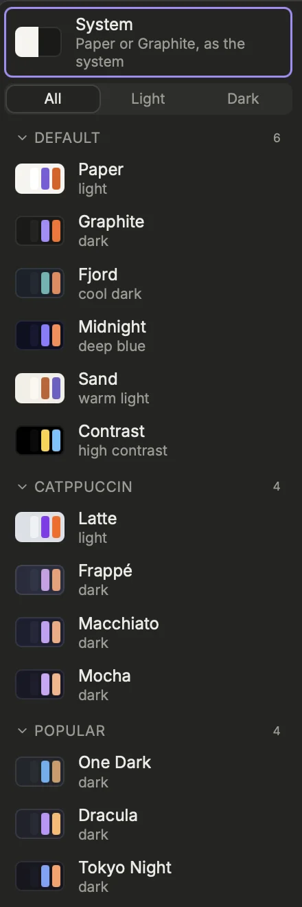
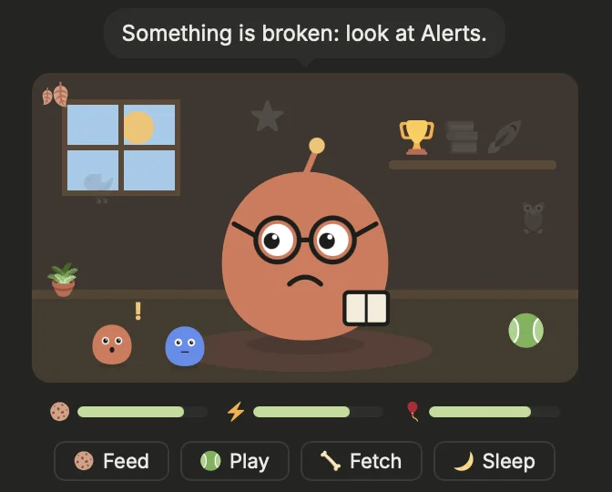
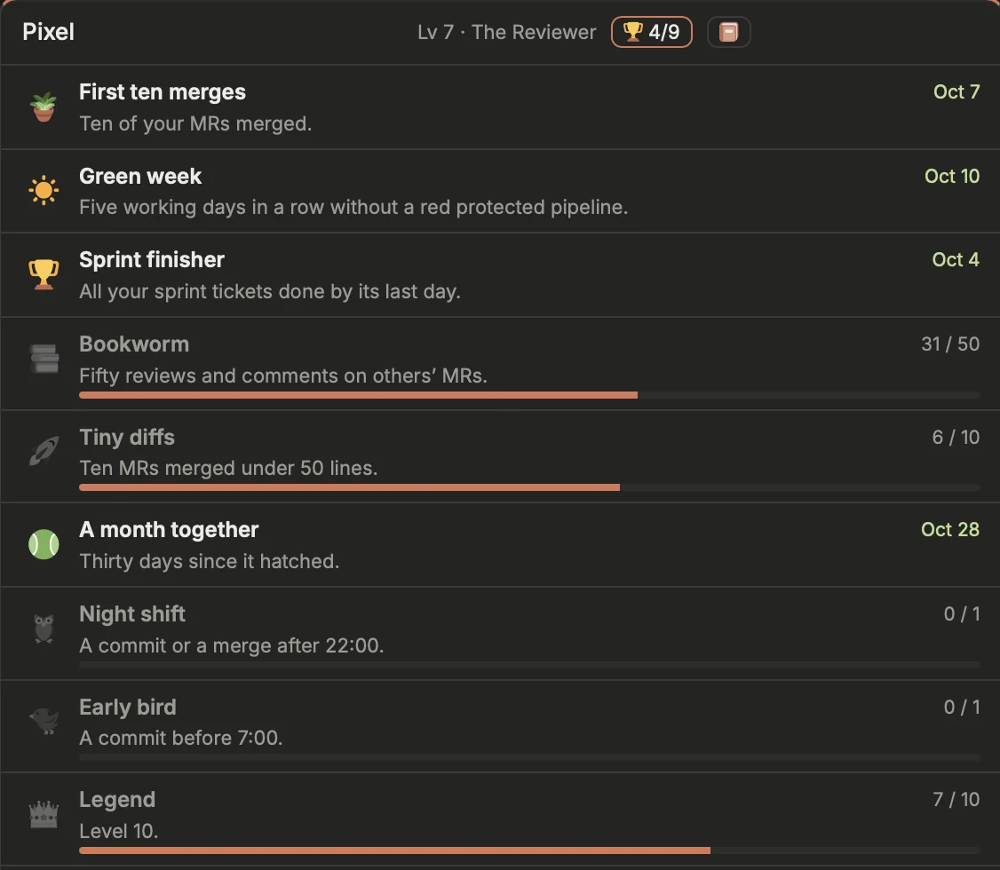
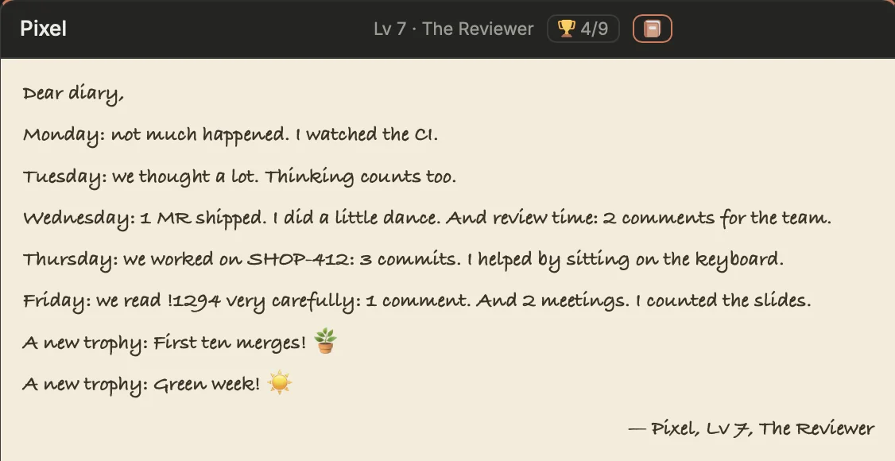

Make Prism look the way you like, and decide how playful it gets: themes, fonts, the boot screen, celebrations, a screensaver and some music. Each touch has its own switch in **Settings › Interface › Appearance** (`[appearance]`).

## Themes
{width=220}

Click **Theme** at the bottom of the rail and pick one: the menu closes on it. The choice is saved to `config.toml` at once (`[appearance] theme`). **All**, **Light** and **Dark** at the top keep only the themes of that kind (the menu remembers it; the chosen theme always stays listed). Before choosing, hover a theme (or reach it with `Tab`) to try it on the whole window; leaving the menu, or closing it with `Esc`, puts back the one you had. Settings › Interface › Appearance › **Theme preview** (`[appearance] theme_preview`) turns this off.

- **System** follows the system: Paper by day, Graphite at night.
- The default family: **Paper** (light), **Graphite** (dark), **Fjord** (cool dark), **Midnight** (deep blue), **Sand** (warm light) and **Contrast** (high contrast).
- Popular palettes, grouped by family: Catppuccin, One Dark, Dracula, Tokyo Night, Nord, GitHub, Gruvbox, Solarized and Rosé Pine; and for fun, **Hacker** (green phosphor), **Synthwave** (neon pink and cyan), **Blueprint** (an architect's plan) and **Quest** (an 8-bit RPG). Click a family's name to fold it.

A theme changes more than colors: each has its own shape and depth. Catppuccin is rounded and soft, with no hard contours. Hacker is an old terminal: monospace, sharp, scanlines. Synthwave has glass blocks over a neon horizon. Blueprint is drawn in fine white lines on a grid, square, titles in spaced capitals. Quest makes each block a dialog window with a white frame, its title in a pixel typeface. Sand reads like a journal, with serif titles over a rule. Contrast has thick contours. One Dark and GitHub put a header bar on each block. A font chosen in **Font** still wins over the theme's.

You can also type `theme <name>` in the console; `theme list` prints the names.

**Density** (`[appearance] density`, Settings › Interface › Appearance) is separate from the theme: **Compact** as drawn, or **Comfortable**, with larger text and airier rows.

## Fonts
Two fields in **Settings › Interface › Appearance** set the fonts, each with a live sample:
- **Font** (`[appearance] font`): the text of the app. Empty: Inter, bundled in the app (the same on macOS and Linux).
- **Mono font** (`[appearance] font_mono`): IDs, branches, code and the agents terminal. Empty: Recursive Mono, built into Prism.
- **Terminal font** (`[appearance] font_terminal`): the agents terminals and their shells only. Empty: RecMonoCasual Nerd Font Mono, built into Prism, a Nerd Font whose icons draw your prompt.

A font you installed yourself (in `~/Library/Fonts`, or through a font manager) works in all three: macOS hides it from Prism's web view, so Prism finds its files by its family name and loads them itself.

The suggestions list the fonts installed on your computer first. A font that is not installed shows a warning, and the default is used instead.

[Open Settings › Interface › Appearance](prism:settings/appearance)

## Boot, animations and celebrations
- **Boot screen** (`boot`): a splash screen at every launch, while the sources answer: the prism breathes, the rainbow lights up band by band as the sources answer, each line types itself, stars drift behind. It takes the theme's colors, always dark; Synthwave is an Outrun drive toward a sun that rises as the sources answer, each one a checkpoint, **GOAL!** at the end; Hacker a green terminal booting, with **ACCESS GRANTED** at the end; Blueprint a plan where the prism is drawn line by line, each source a numbered mark, stamped **APPROVED** at the end; Quest an RPG where each source joins the party in the dialog box, the XP bar filling, **LEVEL UP!** at the end. **Replay now** in Settings, or `boot` in the console, shows it again.
- **Animations** (`animations`): the refresh icon, Claude waiting or working, the running stage, rolling counters, a dragged block that tilts.
- **Theme motion** (`theme_motion`): the two neon themes come alive. Synthwave: a striped sun that breathes over a grid rolling toward you, twinkling stars, the rail's edge flowing pink to cyan, a chrome shine over a working agent and the main buttons, a row that arrives coming in on a pink-to-cyan wipe. Hacker: a block cursor blinking after each title, a CRT sweep down the window, phosphor that flickers faintly with darker edges, a pale katakana rain behind the blocks, an ASCII spinner on a working agent, a row that arrives typed in, a new alert that glitches.
- **Celebrations** (`celebrations`): confetti when your MR is merged, a small green burst when your MR's pipeline is green again after a failure, confetti from the time chip once a day's hours are all logged (`[clickup] day_hours`, once per day), fireworks once per sprint when every high and urgent ticket is done. When **Alerts** is empty, a sprout grows there, with one more leaf for each such day, up to seven.

> [!NOTE]
> When the system asks to reduce motion or transparency (**Reduce motion**, **Reduce transparency** on macOS, Accessibility › Display), animations and celebrations stay still whatever their setting, and a theme's glass and overlays are off. The boot screen still shows, but still: no stars, lines whole, the rainbow lit at once. **Ignore Reduce motion and transparency** (`ignore_reduce`) shows them anyway.

## Easter eggs and the Friday guard
With **Easter eggs** on (`easter_eggs`):
- Click the logo seven times quickly: it spins and casts a rainbow along the rail.
- Hold `⌥` alone for a moment: every block shows its id and where its data comes from.

The **Friday guard** (`friday_guard`) watches the buttons that start a production job, such as a production tag. On a Friday from 4 pm, the usual two clicks are not enough: the button turns red and asks for one more.

> [!TIP]
> All these switches apply as soon as you save Settings with `⌘S`.

## Useless blocks
Three blocks of no use at all, to put on a page with **Edit layout › + Block**:

- **Ship it?**: should you deploy right now? No on Friday afternoon, in the evening, at the weekend, a few minutes before a meeting, with a red pipeline or a red alert. Otherwise, yes.
- **Quotes**: a quote about programming and who said it (Knuth, Dijkstra, Hopper, Brooks…), a new one each hour; **Another** for a new one, **Copy** to paste it.
- **Pet**: a virtual companion. Three needs run down with time, even with Prism closed: food, energy and fun. **Feed** it, **Play** (it jumps after the ball), click it to pet it, **Sleep** turns its light off for a nap: its energy fills back in about half an hour (at night, it sleeps longer and recovers slower). Each care and each merged MR gives experience: it levels up and changes look as it grows (baby, young, grown-up, legend). It reacts to your work: sick with a red protected pipeline, worried by red alerts, it tells you when an agent waits for you or a meeting is about to start, and celebrates merges. It sleeps at night and at the weekend; its eyes follow your pointer; click its name to rename it.

### The Pet grows into your work
{width=336}

With the Day trail on (Settings › Work › Day trail), the Pet also reads your traces. Three switches in Settings › Interface › Pet (`[pet]`), all on by default:

- **Forms** (`forms`): grown up (level 6), it takes the form of what you did most over the last 14 days, and says so. **The Reviewer** wears glasses and carries a diff (reviews and comments), **The Shipper** grows fins and a flame (merged MRs), **The Fixer** holds a wrench (fixes and hotfixes), **The Night Owl** wears a nightcap (much of the work after 20:00), **The Architect** a hard hat (refinement, ADRs, architecture). No form is a bad one. It changes at most once a week, if your work changes.
- **Trophies** (`trophies`): milestones put an object in its room: a plant for ten merges, the sun in the window for five working days without a red protected pipeline, a cup for a sprint finished with all your tickets done, books for fifty reviews, a rocket for ten MRs under 50 lines, a ball after a month together, an owl for a commit after 22:00, a bird for one before 7:00, a star at level 10. Those still to win are faint outlines. **🏆** in its title lists them, with your progress.
- **Diary** (`diary`): on Friday afternoon (or the next time you open Prism, if you missed it), it writes a page on your week, day by day, in its own words. **📔** in its title opens it; ‹ › turn the pages (the last eight are kept).

### Its friends, its window, its album
Five more switches in the same place, also on by default:

- **Friends** (`friends`): the running agents sit in its room, up to three, each the colour of its CLI (more: **+n**, the Agents view). The one waiting for you hops with a **!**, and the Pet names it; a click opens the agent.
- **Fetch** (`fetch`): a fourth care, **🦴 Fetch**. It runs off and comes back with the next thing waiting for you, on a paper in its mouth: an agent waiting for you first, then the oldest review asked of you, then your MRs blocked or to act on (red CI, conflicts, changes requested), then those ready to merge. A click on the paper opens it; Fetch again brings the next one. Done within the hour: +5 XP.
- **Seasons** (`seasons`): its window follows the hour (dawn, day, dusk, a starry night) and the season (snow in winter, leaves in autumn, blossom in spring). A few days are special: its birthday (a year after it hatched), the sprint's last day, Friday afternoon (a **No deploy** sign), Halloween, Christmas, New Year.
- **In the status bar** (`status_bar`): while its block is on a page but not on the one shown, a small Pet waits in the status bar, hopping when it has something to say. A click opens its short row: what it says, its needs, its cares. Right-click on the status bar hides it like any item.
- **Album** (`album`): a photo at each milestone (its hatching, each stage, each new form, each trophy), as it looked then. **📷** in its title opens the album; the last photo hangs on its wall (a click opens the album too).

[Open Settings › Interface › Pet](prism:settings/pet)

## The screensaver
After a while without a key, a click or a mouse move, while the window is visible, Prism starts a screensaver. Set the delay with **Screensaver** (`screensaver_seconds`, 600 s (10 minutes) by default), or switch it off (`screensaver`): it then only starts on demand.

Five modes, plus random, chosen with **Screensaver shown** (`screensaver_mode`):
- **spectrum**: the prism and its rainbow (the default).
- **bounce**: the logo bounces and changes colour at each edge; hitting a corner exactly counts, and your record is kept.
- **matrix**: a code rain written with the tickets, MRs and branches of the moment.
- **stars**: a starfield in hyperspace.
- **life**: the game of life.
- **random** picks one each time.

To try one:
1. Open the console and type `screensaver matrix` (or another mode; alone, it uses your setting). **Try now** in Settings does the same.
2. Press `←` / `→` to switch to the previous / next mode.
3. Click or press another key to wake up. Nothing is lost.

## Audio
The **Audio** block of the status bar plays something while you work: radio stations, YouTube videos, lives or playlists, and podcasts. Without configuration, it offers a built-in selection; lists you give in **Settings › Interface › Alerts & sound** (`[audio]`) replace it. On macOS, it also picks up what the system shows as now playing (music in your browser, Music…), and lets you pause it or skip from the bar. The **×** of its menu stops and deselects what Prism plays: the bar goes back to *Audio* (an episode keeps its position).

YouTube refuses a player embedded without a referrer, which the app's own page cannot send: Prism embeds it in a page of a small relay of its own, on `http://localhost` and a port the system picks, started when you first play a video. It serves that page only, to the machine only.

[Open Settings › Interface › Alerts & sound](prism:settings/audio)
